Journal of Computational Physics 374 (2018) 954–983

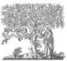

ELSEVIER

Contents lists available at ScienceDirect

Journal of Computational Physics

www.elsevier.com/locate/jcp

# An unstructured mesh convergent reaction–diffusion master equation for reversible reactions

Samuel A. Isaacson *, Ying Zhang

Department of Mathematics and Statistics, Boston University, Boston, MA 02215, United States of America

# ARTICLE INFO

Article history:

Received 19 December 2017

Received in revised form 18 June 2018

Accepted 18 July 2018

Available online 23 July 2018

Keywords:

Reaction–diffusion master equation

Stochastic chemical kinetics

Stochastic reaction–diffusion

Volume reactivity model

Doi model

# ABSTRACT

The convergent reaction–diffusion master equation (CRDME) was recently developed to provide a lattice particle-based stochastic reaction–diffusion model that is a convergent approximation in the lattice spacing to an underlying spatially-continuous particle dynamics model. The CRDME was designed to be identical to the popular lattice reaction–diffusion master equation (RDME) model for systems with only linear reactions, while overcoming the RDME's loss of bimolecular reaction effects as the lattice spacing is taken to zero. In our original work we developed the CRDME to handle bimolecular association reactions on Cartesian grids. In this work we develop several extensions to the CRDME to facilitate the modeling of cellular processes within realistic biological domains. Foremost, we extend the CRDME to handle reversible bimolecular reactions on unstructured grids. Here we develop a generalized CRDME through discretization of the spatially continuous volume reactivity model, extending the CRDME to encompass a larger variety of particle–particle interactions. Finally, we conclude by examining several numerical examples to demonstrate the convergence and accuracy of the CRDME in approximating the volume reactivity model.

© 2018 Elsevier Inc. All rights reserved.

# 1. Introduction

The dynamics of many biological processes rely on an interplay between spatial transport and chemical reaction. Examples of such processes include gene regulation, where proteins undergo a diffusive search throughout the nuclei of cells to reach specific DNA binding sites [1–3]; and signal transduction, where phosphorylation and dephosphorylation of signaling proteins can occur at spatially segregated locations leading to spatial gradients of activated and inactivated proteins [4]. The interplay of diffusion and reaction can also influence whether such signals are able to successfully propagate from the cell membrane to nucleus [5,6]. A challenge in developing mathematical models of these processes is that they often occur within spatially heterogeneous environments. Organelles, filamentous structures, and macro-molecules can represent both steric barriers and reactive targets for proteins undergoing diffusive transport within cells. Even the basic geometrical property of cell shape can dramatically alter information flow in signaling pathways [7] and the ability of cells to sense gradients [8].

An additional modeling challenge arises from experimental observations that many biochemical processes within single cells have stochastic dynamics [9–12]. To facilitate the study of reaction–diffusion processes at the scale of a single cell it is therefore necessary to develop mathematical models and numerical simulation methods that can accurately account for the

* Corresponding author.

E-mail addresses: isaacson@math.bu.edu (S.A. Isaacson), phzhang@bu.edu (Y. Zhang).

https://doi.org/10.1016/j.jcp.2018.07.036

0021-9991/© 2018 Elsevier Inc. All rights reserved.

S.A. Isaacson, Y. Zhang / Journal of Computational Physics 374 (2018) 954–983

955

stochastic diffusion and reaction of molecules within realistic cellular domains. Particle-based stochastic reaction–diffusion models are one popular approach to model the stochastic diffusion and reactions between individual molecules within cells [13–18]. While there are a plethora of particle-based stochastic reaction–diffusion models and simulation methods that have been used for modeling cellular processes [19–31], they all share a number of basic features. Such models typically represent proteins, mRNAs, and other cellular molecules as point particles or small spheres. In the most common form that we will subsequently consider, individual molecules move by diffusion processes, or by random walk approximations. Linear zeroth order reactions, e.g. ∅ → A, occur with a fixed probability per time, while linear first order reactions, e.g. A → B, generally occur with a fixed probability per time for each molecule of the reactant species (i.e. each A molecule). Nonlinear second order reactions, e.g. A + B → C, occur according to a variety of mechanisms when an individual pair of A and B molecules are sufficiently close. It is in the choice of this association mechanism that the common particle-based stochastic reaction–diffusion models tend to differ.

In this work we focus on the spatially continuous volume reactivity model, which approximates molecules as point particles that move by Brownian Motion. A bimolecular reaction of the form A + B → C is modeled through an interaction function that determines the probability density per time an A molecule at x and a B molecule at y can react to produce a C molecule at z. The Doi model is the most common form of the volume reactivity model used in studying cellular processes. It was popularized by Doi [15,16], who attributes the original model to Termamoto and Shigesada [17]. In the Doi model, a bimolecular reaction such as A + B → C is modeled for an individual pair of A and B molecules as occurring with a fixed probability per time, λ, once their separation is smaller than a specified reaction radius ε, i.e. |x − y| < ε.

A number of methods have been proposed for generating approximate realizations of the stochastic process of diffusing and reacting particles described by the Doi model [22,32,31,27]. Brownian Dynamics methods discretize this process in time using an operator splitting approach applied to the underlying forward Kolmogorov equation [22,32,31]. This separates the diffusive and reactive processes into separate time steps, allowing their individual approximation. For example, in [31] this splitting is coupled with exact sampling of the diffusive motion of molecules during the diffusive timestep (generally only possible in freespace or periodic domains), and exact sampling of reactions between stationary molecules using a variant of the Stochastic Simulation Algorithm (SSA) [33,34] during the reactive timestep. This has allowed the simulation of two-dimensional pattern formation systems with on the order of a million particles in square domains.

In [27] we developed an alternative convergent approximation and corresponding numerical simulation method by discretizing the Doi model in space instead of time. The resulting convergent reaction–diffusion master equation (CRDME) represents a spatial discretization of the forward Kolmogorov equation for the Doi model, approximating the continuous Brownian motion and reactions of molecules by a continuous time jump-process in which molecules hop and react on an underlying spatial mesh. This jump process gives the number of molecules of each chemical species at each mesh location at a given time. The CRDME corresponds to the set of ODEs describing the change in time of the probability the jump-process has a given value.

The CRDME was designed with two major goals; providing a convergent approximation to the Doi model, and being equivalent to the popular lattice reaction–diffusion master equation (RDME) model in its treatment of linear reactions and spatial transport. In the RDME molecules move by hopping between mesh voxels through continuous-time random walks [18,35]. Within each mesh voxel molecules are assumed to be well-mixed, i.e. uniformly distributed. Zeroth and first order reactions are treated similarly to the volume-reactivity model. Nonlinear second order reactions of the form A + B → C occur with a fixed probability per time for two molecules located within the same voxel. In this way the RDME can be formally interpreted as a discretization of the volume reactivity model, where interaction functions between molecules are given by delta functions in their separation [36]. The CRDME’s primary difference from the RDME is in also allowing molecules within nearby voxels to react, arising from direct discretization of the Doi model.

The choice to maintain consistency with the RDME for linear reactions and spatial transport is due to its many attractive features and extensions that enable the modeling of cellular processes. Foremost, in the absence of nonlinear reactions the RDME can be interpreted as a discretization of the forward equation for the volume reactivity model. In the absence of any reactions this forward equation simply corresponds to a high-dimensional diffusion equation in the combined coordinates of all molecules. By exploiting this connection standard PDE discretization techniques can be used to extend the RDME to include spatial transport mechanisms that are needed to model cellular processes. These include extensions to include drift due to potential fields [37,1], advection due to underlying velocity fields [38], and embedded boundary [20] and unstructured mesh [26,39] discretization methods for deriving jump rates in meshes of complex domain geometries. Such discretizations can be chosen to preserve important physical properties of the underlying spatially-continuous transport model, such as detailed balance of spatial fluxes and Gibbs–Boltzmann equilibrium states for models that include drift due to potential fields [37,1].

A second benefit to the RDME model is that in appropriate large-population limits it is formally expected to limit to more macroscopic stochastic PDE (SPDE) models, and as the population further grows, to reaction–diffusion PDE models for continuous concentration fields [40,41]. These connections have been exploited to develop computationally efficient hybrid models that represent different chemical species or reactions at different physical levels of detail [42,38], or that partition spatial domains into regions of low populations represented by jump processes satisfying the RDME and regions of higher populations represented through continuous concentration fields satisfying reaction–diffusion SPDEs or deterministic PDEs [43,44].

956

S.A. Isaacson, Y. Zhang / Journal of Computational Physics 374 (2018) 954–983

Finally, for researchers interested in simply using the RDME to model cellular systems, there are a number of optimized, publicly available software packages that can simulate the jump process of molecules reacting and diffusing within complex geometries. These include the unstructured mesh URDME/PYURDME/StochSS [25] and STEPS [26] software packages, and the GPU-based structured mesh Lattice Microbes software package [24] (which has successfully simulated systems containing hundreds of thousands to order of one million molecules within complex geometries corresponding to three-dimensional whole bacterial cells).

For these many reasons the RDME has become a popular tool for studying cellular processes in which both noise in the chemical reaction process and the diffusion of molecules may be important. Unfortunately, there is a major practical difficulty when using the RDME. The formal continuum limit of the RDME, the volume-reactivity model with delta-function interactions, is only correct in one-dimension. In two or more dimensions, in the continuum limit that the mesh spacing in the RDME approaches zero, bimolecular reactions are lost [45–47]. This loss of reaction occurs as in the RDME molecules are represented by point particles that can only react when located within the same mesh voxel. In the continuum limit that the mesh spacing approaches zero the RDME converges to a model in which molecules correspond to point particles undergoing Brownian motion, which can only react when located at the same position. In two or more dimensions the probability of two molecules ever reaching the same position is zero, and so the particles are never able to encounter each other and react.

This loss of bimolecular reactions in the limit that the mesh spacing approaches zero is a challenge in using RDME-type models. In contrast to numerically solving PDE models, or solving the RDME for systems with only linear reactions, one can not expect that shrinking the mesh spacing will eventually give better accuracy in approximating some underlying spatially-continuous model. Moreover, for a given chemical system it is not known how to determine an “optimal” mesh spacing that minimizes the approximation error for convergent linear reaction and spatial transport terms, while avoiding errors due to an unphysical decrease in the occurrence of bimolecular reactions. For specific chemical systems one may be able to numerically estimate an optimal mesh spacing, but even then there is no explicit control on how well the RDME approximates any particular spatially continuous stochastic reaction–diffusion model.

Several methods have been proposed to overcome this challenge in using the RDME. In [22,48,47,49] bimolecular reaction rates in the RDME are renormalized, allowing the more accurate approximation of statistics from spatially-continuous particle models over a broader range of mesh spacings than the standard RDME. While such methods still lose bimolecular reactions in the continuum limit that the mesh spacing approaches zero, and are hence non-convergent, they can provide accurate statistics over much larger ranges of mesh spacings than the RDME (even approaching length scales comparable to the Doi reaction-radius ε [47]). Such approaches have recently been extended to unstructured grids, to allow for more accurate RDME-like models in complex geometries corresponding to biological domains [49]. A second approach is to consider multiscale couplings, where the RDME model is replaced with Brownian Dynamics or other continuous particle dynamics models in regions where increased accuracy, and hence smaller mesh spacings, are desired [50].

In this work we take a different approach, developing a CRDME model that converges to the spatially-continuous volume-reactivity model, but is consistent with the RDME in its handling of linear reactions and spatial transport. In this way the CRDME can leverage both the large body of extensions to the RDME to facilitate more general spatial transport mechanisms in complex geometries, and the optimized simulation methods and multiscale couplings developed for the RDME. Here we extend the Cartesian grid CRDME developed in [27] for bimolecular association reactions to reversible reactions on general unstructured grids. The new unstructured grid CRDME can be used to simulate chemical processes in complex domain geometries as needed for studying cellular systems. It also has the appealing property of preserving pointwise detailed balance at steady-state whenever the spatially continuous volume reactivity model it approximates also satisfies pointwise detailed balance.

To construct an unstructured mesh CRDME for reversible reactions we utilize a hybrid discretization approach. We begin in the next section by approximating the continuous Brownian motion of a single molecule within a bounded domain by a lattice jump process. We review the method developed in [39], which derives transition rates for the hopping of one molecule between neighboring mesh voxels. Here the mesh is given by polygonal voxels, representing the dual mesh to a triangulation of the original domain. The diffusive jump rates are derived by finite element discretization of the diffusion operator on the triangulated mesh [39]. In Section 3 we then consider the approximation of reversible bimolecular reactions on the same underlying polygonal dual mesh. We begin by introducing the abstract spatially-continuous volume-reactivity model for reversible reactions in Section 3.1. In Section 3.2 we show which choice of interaction functions in the abstract volume-reactivity model gives rise to the popular Doi reaction model. Section 3.3 then develops our finite volume method for deriving a jump process approximation to the association and dissociation reaction terms in the abstract volume reactivity model. Combining the finite element discretization of spatial transport terms from Section 2 with the finite volume discretization of reaction terms from Section 3.3, in Section 3.4 we obtain a CRDME for a pair of molecules that can undergo the reversible A + B ⇌ C reaction. Here the finite element discretization weights determine the probability per time that a molecule can hop from a given voxel to its neighbor, while the finite volume discretization weights determine the probability per time reactants in different voxels can react. Combined they define a jump process for the two molecules hopping and reacting on the unstructured mesh. The CRDME then describes the time evolution of the probability this jump process has a given value.

We next explain how this two-particle CRDME can be generalized to a system with an arbitrary number of molecules of each species, and summarize the transitions comprising the general multiparticle reaction–diffusion jump process in Table 1.

S.A. Isaacson, Y. Zhang / Journal of Computational Physics 374 (2018) 954–983

957

We also summarize Appendix A, where it is shown how to formulate the general multiparticle abstract volume-reactivity model, how to discretize this model to obtain a multiparticle CRDME, and how this model can be rewritten in a form that looks similar to the RDME. In Section 3.5 we briefly discuss the relationship between the reversible binding CRDME model and the RDME, pointing out that the RDME can be interpreted as a (non-convergent) approximation of the abstract volume-reactivity model that is similar to the CRDME, but restricts reactions to molecules within the same mesh voxel. In Section 3.6 we develop several methods for numerically evaluating the transition rates needed to model reversible reactions in the CRDME model, considering both general (smooth) interaction functions, and the discontinuous indicator function that is used in the Doi model. Finally, in Section 4 we consider a number of numerical examples to demonstrate the convergence and accuracy of the CRDME in approximating the volume-reactivity model, and to illustrate how the CRDME can be used to study models for cellular processes within realistic domain geometries arising from imaging data.

## 2. Diffusion approximation on unstructured meshes

We begin by deriving a lattice master equation (equivalently continuous time random walk or jump process) approximation to the Brownian motion of individual molecules using the unstructured mesh method developed in [39]. Spatial transition rates (i.e. hopping rates) between lattice sites are obtained from a finite element discretization of the Laplacian on triangulated meshes, giving rise to a semi-discrete diffusion equation model with the form of a master equation. In this section we summarize the method. Readers interested in a more detailed discussion of this approach should see [39].

In the absence of chemical reactions, the Brownian motions of individual molecules are independent processes. It is therefore sufficient to derive a jump process (equivalently master equation) approximation for a system in which there is only one diffusing molecule. Let $\Omega \subset \mathbb{R}^d$ be a bounded domain with boundary $\partial\Omega$. We will denote by $p(\mathbf{x}, t)$ the probability density the molecule's position at time $t$ is $\mathbf{x}$. Assuming reflecting boundary conditions on $\partial\Omega$, $p(\mathbf{x}, t)$ then satisfies the diffusion equation

$$\frac{\partial p}{\partial t}(\mathbf{x}, t) = D \Delta p(\mathbf{x}, t), \quad \forall \mathbf{x} \in \Omega, t > 0 \tag{1}$$

$$\nabla p(\mathbf{x}, t) \cdot \boldsymbol{\eta}(\mathbf{x}) = 0, \quad \forall \mathbf{x} \in \partial\Omega, t > 0,$$

where $D$ denotes the molecule's diffusion constant (having units of area per unit time), and $\boldsymbol{\eta}(\mathbf{x})$ the outward normal at $\mathbf{x} \in \partial\Omega$.

For simplicity, in discretizing Eq. (1) to have the form of a master equation we will focus on meshes in two-dimensions, $d = 2$. Note, however, the final formulas we derive are also valid for $d = 3$, see [39]. We discretize $\Omega$ into a primal mesh, given by a collection of triangles (red dashed lines in Fig. 1). Let $\{\mathbf{x}_i\}_{i=1,\dots,K}$ label the nodes of the mesh, corresponding to vertices of the triangles. We define the dual mesh to consist of polygonal voxels $\{V_i\}_{i=1,\dots,K}$ in the interior of $\Omega$, with voxel $V_i$ containing node $\mathbf{x}_i$. Away from $\partial\Omega$, edges of the polygonal voxel containing $\mathbf{x}_i$ are given by lines connecting the centroid of each triangle for which $\mathbf{x}_i$ is a vertex to the midpoint of each of that triangle's two edges that contain $\mathbf{x}_i$ (black lines in Fig. 1). For vertices that lie on the boundary of the primal mesh, the corresponding polygonal voxel also includes lines along the boundary connecting the vertex to the midpoint of each triangle edge containing the vertex. In 1D, the primal mesh is a set of intervals with vertices at two ends. The corresponding dual mesh is also a set of intervals, but shifted with respect to the primal mesh so that the center of the interval is given by a vertex. In 3D, the primal mesh is a set of tetrahedrons and the corresponding dual mesh is a set of polyhedrons [39].

A standard finite element discretization of Eq. (1) on the primal mesh using piecewise linear elements gives a linear system of ODEs to solve for the set of nodal values, $p_h(\mathbf{x}_i, t) \approx p(\mathbf{x}_i, t)$. Let $\mathbf{p}_h(t) = [p_h(\mathbf{x}_1, t), \dots, p_h(\mathbf{x}_K, t)]^T$ denote the vector of nodal values. The finite element discretization of Eq. (1) gives the semi-discrete diffusion equation

$$M \frac{d\mathbf{p}_h}{dt}(t) = DS \mathbf{p}_h(t), \tag{2}$$

where $M$ denotes the mass matrix and $S$ the stiffness matrix. Under suitable conditions on the mesh and domain this gives a second-order discretization in space, with both matrices symmetric, $M$ positive definite, and $S$ negative semi-definite.

The system Eq. (2) can be further simplified by introducing mass lumping. $M$ is replaced by a diagonal lumped mass matrix, $\Lambda$, where $\Lambda_{ii} = \sum_{j=1}^{K} M_{ij}$. In one-dimension, $\Lambda_{ii}$ gives the length of the dual mesh element $V_i$. In two-dimensions, $\Lambda_{ii}$ gives the area of the polygonal voxel $V_i$, while in three-dimensions, $\Lambda_{ii}$ gives the volume of polyhedral voxel $V_i$ [39]. Inverting the lumped mass matrix, we obtain a simplified semidiscrete diffusion equation

$$\frac{d\mathbf{p}_h}{dt}(t) = D \Delta_h \mathbf{p}_h(t), \tag{3}$$

where $\Delta_h$ can be interpreted as a discrete Laplacian,

$$\Delta_h := \Lambda^{-1} S. \tag{4}$$

To arrive at a master equation approximation to the diffusion equation, we define $P_i(t)$ to be the probability that the diffusing molecule is in voxel $V_i$ at time $t$. We make the approximation that $P_i(t) = p_h(\mathbf{x}_i, t)|V_i|$, where $|V_i|$ denotes the

958

S.A. Isaacson, Y. Zhang / Journal of Computational Physics 374 (2018) 954–983

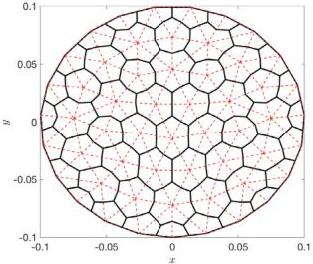

Fig. 1. An example of the dual mesh. The primal mesh is shown in dashed lines. The dual mesh is drawn in solid lines. Note, edges of triangles on the boundary are also within the primal mesh. (For interpretation of the colors in the figure(s), the reader is referred to the web version of this article.)

area of voxel $V_i$ (length in 1D or volume in 3D). Let $\boldsymbol{P}(t) = [P_1(t), \dots, P_K(t)]^T = \Lambda \boldsymbol{p}_h(t)$ denote the vector of probabilities to be in each voxel. As $S$ is symmetric and $\Lambda^{-1}$ diagonal, Eq. (3) then simplifies to the master equation

$$\frac{d\boldsymbol{P}}{dt} = DS\Lambda^{-1}\boldsymbol{P}(t) = D\Delta_h^T\boldsymbol{P}(t). \tag{5}$$

For $i \neq j$,

$$D(\Delta_h^T)_{ij} = \frac{DS_{ij}}{|V_j|} \tag{6}$$

then gives the probability per time, i.e. transition rate or hopping rate, for a molecule in voxel $j$ to hop to voxel $i$, while

$$-D(\Delta_h^T)_{ii} = \frac{D}{|V_i|} \sum_{j \neq i} S_{ji}$$

gives the total probability per time for a molecule in $V_i$ to hop to a neighboring voxel [39]. $D\Delta_h^T$ may then be interpreted as the transition rate matrix for a continuous-time random walk by the molecule between voxels of the lattice.

It is important to note that using an unstructured mesh to approximate complex geometries can lead to negative values for $(\Delta_h^T)_{ij}$, and hence negative transition rates, when using piecewise linear finite elements. In [39] this problem is resolved by modifying the transition matrix $\Delta_h^T$ when $(\Delta_h^T)_{ij} < 0$ so that $(\Delta_h^T)_{ij} = 0$ and $(\Delta_h^T)_{ii} = -\sum_{j \neq i} (\Delta_h^T)_{ij}$. Recently, more accurate methods for eliminating negative discretization weights were developed in [51]. For primal meshes given by Delaunay triangulations in 2D, the transition rates $(\Delta_h^T)_{ij}$ between voxels of the dual mesh defined by Fig. 1 can be shown to always be non-negative, see the discussion and references in [39]. For simplicity, all examples subsequently considered in this work use meshes that correspond to Delaunay triangulations in 2D to avoid this potential complication.

Remark 2.1. While in the remainder we shall assume that diffusive hopping rates are between elements of the dual mesh and given by Eq. (6), there are a number of alternative methods one could use for determining spatial hopping rates in general geometries. These include the finite volume Cartesian grid cut-cell method of [20] and the unstructured grid finite volume approach of [26]. The method we describe for approximating reversible bimolecular reactions in the next section can be used without modification with any of these alternative methods for determining spatial hopping rates.

### 3. Reversible reactions on unstructured meshes

Having established how we will approximate the spatial movement of molecules by a continuous-time random walk (i.e. master equation), we now focus on developing a convergent jump process (i.e. convergent master equation) approximation for reversible bimolecular reactions. We begin by formulating the general spatially-continuous volume-reactivity model in Section 3.1, and the specific instance of this model popularized by Doi [15,16] in Section 3.2. In Section 3.3 we use a finite volume discretization method to develop a master equation approximation to the reaction terms on general unstructured polygonal meshes. The resulting discretization weights correspond to transition rates for reactions to occur between two

S.A. Isaacson, Y. Zhang / Journal of Computational Physics 374 (2018) 954–983

959

molecules within voxels of the mesh. The finite volume discretization we present extends the method we developed for Cartesian grids in [27] to reversible reactions on unstructured polygonal grids. In Section 3.4 we combine the spatial discretization method from Section 2 with the reaction discretization method developed in Section 3.3 to derive the convergent reaction–diffusion master equation (CRDME) jump process approximation to the volume-reactivity model. For simplicity, we derive the CRDME for the reversible bimolecular reaction $A + B \rightleftharpoons C$ in a system whose state is either one molecule of A and one molecule of B, or one molecule of the complex C. In Appendix A, we show that knowing transition rates for this simplified model is sufficient to fully determine a corresponding set of transition rates for systems with arbitrary numbers of molecules.

Section 3.5 discusses the relationship between the CRDME and the popular lattice reaction–diffusion master equation (RDME) model, which can be interpreted as a coarse-mesh approximation to the CRDME. Finally, in Section 3.6 we discuss several implementation details, including the numerical method we use to evaluate the reactive transition rate formulas derived in Section 3.3 for reversible reactions in the CRDME.

### 3.1. Abstract volume-reactivity model

Consider the $A + B \rightleftharpoons C$ reaction in a system with just one A and one B molecule, or one C complex. As in Section 2, we assume the reaction is taking place within a $d$-dimensional bounded domain $\Omega \subset \mathbb{R}^d$, with molecules experiencing a reflecting Neumann boundary condition on the boundary $\partial\Omega$. Denote by $\boldsymbol{x} \in \Omega$ the position of the molecule of species A, by $\boldsymbol{y} \in \Omega$ the position of the molecule of species B, and by $\boldsymbol{z} \in \Omega$ the position of the molecule of species C. The diffusion constants of the molecules are given by $D^A$, $D^B$, and $D^C$ respectively. We let $\kappa^+(z|\boldsymbol{x}, \boldsymbol{y})$ denote the probability density per unit time an $A + B \rightarrow C$ reaction successfully occurs producing a C molecule at $z$, given an A molecule at $\boldsymbol{x}$ and a B molecule at $\boldsymbol{y}$. With this definition, we denote by $\kappa^+(x, y)$ the probability per time an A molecule at $\boldsymbol{x}$ and a B molecule at $\boldsymbol{y}$ react and create a C molecule within $\Omega$. Then

$$\kappa^+(\boldsymbol{x}, \boldsymbol{y}) := \int_{\Omega} \kappa^+(\boldsymbol{z}|\boldsymbol{x}, \boldsymbol{y}) \, d\boldsymbol{z}. \tag{7}$$

Similarly, we let $\kappa^-(\boldsymbol{x}, \boldsymbol{y}|\boldsymbol{z})$ denote the probability density per unit time a reaction successfully occurs producing an A molecule at $\boldsymbol{x}$ and a B molecule at $\boldsymbol{y}$ given a C molecule at $\boldsymbol{z}$. With this definition, we denote by $\kappa^-(\boldsymbol{z})$ the probability per time a C molecule at $\boldsymbol{z}$ unbinds and produces A and B molecules within $\Omega$. Then

$$\kappa^-(\boldsymbol{z}) := \int_{\Omega^2} \kappa^-(\boldsymbol{x}, \boldsymbol{y}|\boldsymbol{z}) \, d\boldsymbol{x} \, d\boldsymbol{y},$$

where $\Omega^2 := \Omega \times \Omega \subset \mathbb{R}^{2d}$.

Using the preceding definitions we can now formulate the general volume-reactivity model. Let $p(\boldsymbol{x}, \boldsymbol{y}, t)$ denote the probability density that system is in the state where the A and B molecules are unbound, and located at positions $\boldsymbol{x}$ and $\boldsymbol{y}$ at time $t$. Likewise, define $p_b(\boldsymbol{z}, t)$ to be the probability density that the molecules are bound together, and that the corresponding C molecule is at position $\boldsymbol{z}$ at time $t$. Then $p(\boldsymbol{x}, \boldsymbol{y}, t)$ satisfies

$$\frac{\partial p}{\partial t}(\boldsymbol{x}, \boldsymbol{y}, t) = (D^A \Delta_{\boldsymbol{x}} + D^B \Delta_{\boldsymbol{y}}) p(\boldsymbol{x}, \boldsymbol{y}, t) - \kappa^+(\boldsymbol{x}, \boldsymbol{y}) p(\boldsymbol{x}, \boldsymbol{y}, t) + \int_{\Omega} \kappa^-(\boldsymbol{x}, \boldsymbol{y}|\boldsymbol{z}) p_b(\boldsymbol{z}, t) \, d\boldsymbol{z}, \tag{8}$$

and $p_b(\boldsymbol{z}, t)$ satisfies

$$\frac{\partial p_b}{\partial t}(\boldsymbol{z}, t) = D^C \Delta_{\boldsymbol{z}} p_b(\boldsymbol{z}, t) - \kappa^-(\boldsymbol{z}) p_b(\boldsymbol{z}, t) + \int_{\Omega^2} \kappa^+(\boldsymbol{z}|\boldsymbol{x}, \boldsymbol{y}) p(\boldsymbol{x}, \boldsymbol{y}, t) \, d\boldsymbol{x} \, d\boldsymbol{y}, \tag{9}$$

together with appropriate initial conditions and no-flux reflecting boundary conditions on $\partial\Omega$ for each molecule.

In the next section we present a special case of the preceding model, where $\kappa^+(\boldsymbol{z}|\boldsymbol{x}, \boldsymbol{y})$ is chosen such that two molecules which are sufficiently close will react with a fixed probability per unit time [17,15,16,22]. This “standard” form of the volume-reactivity model is also known as the Doi model. Note, the abstract formulation presented above also encompasses alternative bimolecular reaction models, such as the Gaussian-type interactions we used in [52] to model reactions involving unstructured tails of membrane bound proteins.

### 3.2. Standard volume-reactivity reaction rate functions (Doi model)

In the standard volume-reactivity (Doi) model, A and B are assumed to react with probability per unit time $\lambda$ when within a distance $\varepsilon$, commonly called the reaction radius. Let $\mathcal{R} = \{(\boldsymbol{x}, \boldsymbol{y}) \in \Omega^2 \mid |\boldsymbol{x} - \boldsymbol{y}| < \varepsilon\} \subset \mathbb{R}^{2d}$ denote the effective reaction region, and $\mathbb{1}_{\mathcal{R}}(\boldsymbol{x}, \boldsymbol{y})$ denote the indicator function of $\mathcal{R}$. A common choice for $\kappa^+(\boldsymbol{z}|\boldsymbol{x}, \boldsymbol{y})$ is

960

S.A. Isaacson, Y. Zhang / Journal of Computational Physics 374 (2018) 954–983

$$\kappa^{+}(\boldsymbol{z}|\boldsymbol{x},\boldsymbol{y})=\lambda\mathbb{1}_{\mathcal{R}}(\boldsymbol{x},\boldsymbol{y})\delta\left(\boldsymbol{z}-(\gamma\boldsymbol{x}+(1-\gamma)\boldsymbol{y})\right),$$

where $\gamma\in[0,1]$ determines the placement of the newly created C molecule relative to the locations of the A and B molecules. One simple choice is to take $\gamma=\frac{1}{2}$, so that the C molecule is placed at the midpoint between the A and B molecules. Another common choice is to use the diffusion weighted center of mass [19]

$$\gamma=\frac{D^{\mathrm{B}}}{D^{\mathrm{A}}+D^{\mathrm{B}}}.$$

For $\gamma$ fixed, the probability per time that an A molecule at $\boldsymbol{x}\in\Omega$ and a B molecule at $\boldsymbol{y}\in\Omega$ successfully react is then

$$\kappa^{+}(\boldsymbol{x},\boldsymbol{y})=\lambda\mathbb{1}_{\mathcal{R}}(\boldsymbol{x},\boldsymbol{y})\mathbb{1}_{\Omega}\left(\gamma\boldsymbol{x}+(1-\gamma)\boldsymbol{y}\right).$$

Here the second indicator function enforces that the reaction can only occur if the location the product C molecule would be placed at is within $\Omega$. If $\Omega$ is convex this is guaranteed. If $\Omega$ is not convex, this association reaction model can be interpreted as a two-step process; the molecules attempt to react with probability per unit time $\lambda$ when within $\varepsilon$, and if the product location is within the domain the reaction is allowed to proceed. If the product location is outside the domain the reaction event is rejected.

The dissociation of the C molecule back into A and B molecules is assumed to occur with probability per unit time $\mu$. Several different models have been used to specify the placement of newly created A and B molecules when dissociation occurs. The simplest choice would be to place them at the location of the C molecule at the time of unbinding [32], which we call point unbinding. In this case

$$\kappa^{-}(\boldsymbol{x},\boldsymbol{y}|\boldsymbol{z})=\mu\delta(\boldsymbol{x}-\boldsymbol{y})\delta(\boldsymbol{y}-\boldsymbol{z}).$$

The probability per time that a C molecule at $\boldsymbol{z}\in\Omega$ successfully dissociates is then

$$\kappa^{-}(\boldsymbol{z})=\mu\int_{\Omega^{2}}\delta(\boldsymbol{x}-\boldsymbol{y})\delta(\boldsymbol{y}-\boldsymbol{z})\,d\boldsymbol{x}d\boldsymbol{y}=\mu.$$

In the remainder we focus on what we call the uniform unbinding model. Here the position of the A molecule is sampled from a uniform distribution within the ball of radius $(1-\gamma)\varepsilon$ about the position of the C molecule, $B_{(1-\gamma)\varepsilon}(\boldsymbol{z}):=\{\boldsymbol{x}\in\mathbb{R}^{d}\mid\|\boldsymbol{z}-\boldsymbol{x}\}<(1-\gamma)\varepsilon\}$. The position of the B molecule is then chosen by reflection so that $\boldsymbol{z}=\gamma\boldsymbol{x}+(1-\gamma)\boldsymbol{y}$. We then have

$$\kappa^{-}(\boldsymbol{x},\boldsymbol{y}|\boldsymbol{z})=\mu\left[\frac{1}{|B_{(1-\gamma)\varepsilon}(\boldsymbol{0})|}\mathbb{1}_{B_{(1-\gamma)\varepsilon}(\boldsymbol{z})}(\boldsymbol{x})\right]\delta\left(\boldsymbol{y}-\frac{\boldsymbol{z}-\gamma\boldsymbol{x}}{1-\gamma}\right).$$

One complication with this choice is that when $\boldsymbol{z}$ is sufficiently close to $\partial\Omega$, the position of one or both of the A and B molecules may end up outside the domain. In this case a natural choice that is consistent with the preceding definitions is to simply reject the dissociation event [53]. $\kappa^{-}(\boldsymbol{z})$ is therefore reduced relative to the point unbinding case,

$$\kappa^{-}(\boldsymbol{z})=\frac{\mu}{|B_{(1-\gamma)\varepsilon}(\boldsymbol{0})|}\int_{\Omega}\mathbb{1}_{B_{(1-\gamma)\varepsilon}(\boldsymbol{z})}(\boldsymbol{x})\mathbb{1}_{\Omega}\left(\frac{\boldsymbol{z}-\gamma\boldsymbol{x}}{1-\gamma}\right)\,d\boldsymbol{x}\leq\mu.$$

For points $\boldsymbol{z}$ that are sufficiently far from the boundary, or if $\Omega=\mathbb{R}^{d}$, this simplifies to $\kappa^{-}(\boldsymbol{z})=\mu$ and unbinding events are always successful. The combination of the standard (Doi) association model with rejection of unbinding events that produce molecules outside the domain can be shown to imply point-wise detailed balance of the resulting reversible binding reaction [53].

Remark 3.1. With the choices Eq. (10), Eq. (11) and Eq. (14), $\gamma=0$ indicates that the B molecule is not diffusing. Upon binding, the C molecule is therefore placed at $\boldsymbol{y}$. On the other hand, $\gamma=1$ indicates that the A molecule is not diffusing, and one needs to interchange $\boldsymbol{x}$ and $\boldsymbol{y}$ in Eq. (14). Such choices would be appropriate if one of the A or B molecules represents a stationary target.

### 3.3. Discretization of reaction terms to master equation

We now develop a master equation approximation to the reaction terms of the general volume-reactivity model on polygonal unstructured meshes. This is achieved by developing a finite volume discretization of Eq. (8) and Eq. (9) that has the general form of a master equation for a jump process. We discretize $\Omega$ into a polygonal mesh of $K$ voxels labeled by $V_{i}$, $i\in\{1,\ldots,K\}$, with corresponding centroids $\{\boldsymbol{x}_{i}\}_{i=1,\ldots,K}$. As we will often need to consider the phase-space voxels that pairs or triplets of molecules are located within, we let $V_{ij}=V_{i}\times V_{j}$ and $V_{ijk}=V_{i}\times V_{j}\times V_{k}$, with corresponding centroids labeled by $(\boldsymbol{x}_{i},\boldsymbol{y}_{j})$ and $(\boldsymbol{x}_{i},\boldsymbol{y}_{j},\boldsymbol{z}_{k})$. With these definitions we make the well-mixed approximation that the probability

S.A. Isaacson, Y. Zhang / Journal of Computational Physics 374 (2018) 954–983

961

densities, $p(\mathbf{x}, \mathbf{y}, t)$ and $p_{\mathrm{b}}(\mathbf{z}, t)$, are piecewise constant within each mesh voxel, $V_{ij}$ and $V_{k}$ respectively. The probability the system is in the unbound state with the A molecule in $V_{i}$ and the B molecule in $V_{j}$ at time $t$ is then approximated by

$$P_{ij}(t) = \int_{V_{ij}} p(\mathbf{x}, \mathbf{y}, t) \, d\mathbf{x} \, d\mathbf{y} \approx p(\mathbf{x}_{i}, \mathbf{y}_{j}, t) |V_{ij}|. \tag{15}$$

Similarly, we denote by $\mathbf{z}_{k}$ the centroid of $V_{k}$. The probability density the system is in the bound state with the C molecule in $V_{k}$ at time $t$ is then approximated by

$$P_{\mathrm{bk}}(t) = \int_{V_{k}} p_{\mathrm{b}}(\mathbf{z}, t) \, d\mathbf{z} \approx p_{\mathrm{b}}(\mathbf{z}_{k}, t) |V_{k}|. \tag{16}$$

In what follows we drop the diffusive terms in Eq. (8) and Eq. (9) as we will ultimately approximate them through the finite element method of Section 2. In the next section we illustrate the final combined model with both spatial (diffusive) transport and chemical reactions. With this simplification, we construct a finite volume discretization of Eq. (8) and Eq. (9) by integrating both sides of Eq. (8) and Eq. (9) over $V_{ij}$ and $V_{k}$ respectively. Eq. (8) is approximated by

$$\begin{aligned} \frac{dP_{ij}}{dt} &= - \int_{V_{ij}} \kappa^{+}(\mathbf{x}, \mathbf{y}) p(\mathbf{x}, \mathbf{y}, t) \, d\mathbf{x} \, d\mathbf{y} + \int_{\Omega} \left[ \int_{V_{ij}} \kappa^{-}(\mathbf{x}, \mathbf{y} | \mathbf{z}) \, d\mathbf{x} \, d\mathbf{y} \right] p_{\mathrm{b}}(\mathbf{z}, t) \, d\mathbf{z} \\ &\approx - \frac{1}{|V_{ij}|} P_{ij}(t) \int_{V_{ij}} \kappa^{+}(\mathbf{x}, \mathbf{y}) \, d\mathbf{x} \, d\mathbf{y} + \sum_{k} \frac{1}{|V_{k}|} P_{\mathrm{bk}}(t) \int_{V_{ijk}} \kappa^{-}(\mathbf{x}, \mathbf{y} | \mathbf{z}) \, d\mathbf{x} \, d\mathbf{y} \, d\mathbf{z} \\ &= - \kappa_{ij}^{+} P_{ij}(t) + \sum_{k} \kappa_{ijk}^{-} P_{\mathrm{bk}}(t), \end{aligned} \tag{17}$$

where

$$\kappa_{ij}^{+} := \frac{1}{|V_{ij}|} \int_{V_{ij}} \kappa^{+}(\mathbf{x}, \mathbf{y}) \, d\mathbf{x} \, d\mathbf{y} \tag{18}$$

$$\kappa_{ijk}^{-} := \frac{1}{|V_{k}|} \int_{V_{ijk}} \kappa^{-}(\mathbf{x}, \mathbf{y} | \mathbf{z}) \, d\mathbf{x} \, d\mathbf{y} \, d\mathbf{z}. \tag{19}$$

One can interpret $\kappa_{ij}^{+}$ as the probability per unit time that given an A molecule in $V_{i}$ and a B molecule in $V_{j}$, they react to produce a C molecule in $\Omega$. Similarly, $\kappa_{ijk}^{-}$ gives the probability per unit time that given a C molecule in $V_{k}$, it dissociates into an A molecule in $V_{i}$ and a B molecule in $V_{j}$.

The reaction terms of Eq. (9) are approximated by

$$\begin{aligned} \frac{dP_{\mathrm{bk}}}{dt} &= - \int_{V_{k}} \kappa^{-}(\mathbf{z}) p_{\mathrm{b}}(\mathbf{z}, t) \, d\mathbf{z} + \int_{\Omega^{2}} \left[ \int_{V_{k}} \kappa^{+}(\mathbf{z} | \mathbf{x}, \mathbf{y}) \, d\mathbf{z} \right] p(\mathbf{x}, \mathbf{y}, t) \, d\mathbf{x} \, d\mathbf{y} \\ &\approx - \frac{1}{|V_{k}|} P_{\mathrm{bk}}(t) \int_{V_{k}} \kappa^{-}(\mathbf{z}) \, d\mathbf{z} + \sum_{i,j} \frac{1}{|V_{ij}|} P_{ij}(t) \int_{V_{ijk}} \kappa^{+}(\mathbf{z} | \mathbf{x}, \mathbf{y}) \, d\mathbf{x} \, d\mathbf{y} \, d\mathbf{z} \\ &= - \kappa_{k}^{-} P_{\mathrm{bk}}(t) + \sum_{i,j} \kappa_{ijk}^{+} P_{ij}(t), \end{aligned} \tag{20}$$

where

$$\kappa_{k}^{-} := \frac{1}{|V_{k}|} \int_{V_{k}} \kappa^{-}(\mathbf{z}) \, d\mathbf{z} \tag{21}$$

$$\kappa_{ijk}^{+} := \frac{1}{|V_{ij}|} \int_{V_{ijk}} \kappa^{+}(\mathbf{z} | \mathbf{x}, \mathbf{y}) \, d\mathbf{x} \, d\mathbf{y} \, d\mathbf{z}. \tag{22}$$

962

S.A. Isaacson, Y. Zhang / Journal of Computational Physics 374 (2018) 954–983

One can interpret $\kappa_{k}^{-}$ as the probability per unit time that given a C molecule in $V_{k}$, it dissociates into A and B molecules within $\Omega$. Similarly, $\kappa_{ijk}^{+}$ gives the probability per unit time that given an A molecule in $V_{i}$ and a B molecule in $V_{j}$, they react to produce a C molecule in $V_{k}$.

Using the definitions of $\kappa^{+}(\boldsymbol{x},\boldsymbol{y})$ and $\kappa^{-}(\boldsymbol{z})$, we have

$$\int_{V_{ij}} \kappa^{+}(\boldsymbol{x}, \boldsymbol{y}) d\boldsymbol{x} d\boldsymbol{y} = \int_{V_{ij}} \left[ \int_{\Omega} \kappa^{+}(\boldsymbol{z}|\boldsymbol{x}, \boldsymbol{y}) d\boldsymbol{z} \right] d\boldsymbol{x} d\boldsymbol{y} = \sum_{k} \kappa_{ijk}^{+}|V_{ij}|,$$

and

$$\int_{V_{k}} \kappa^{-}(\boldsymbol{z}) d\boldsymbol{z} = \int_{V_{k}} \left[ \int_{\Omega^{2}} \kappa^{-}(\boldsymbol{x}, \boldsymbol{y}|\boldsymbol{z}) d\boldsymbol{x} d\boldsymbol{y} \right] d\boldsymbol{z} = \sum_{i,j} \kappa_{ijk}^{-}|V_{k}|,$$

which gives that

$$\kappa_{ij}^{+} = \sum_{k} \kappa_{ijk}^{+} \tag{23a}$$

$$\kappa_{k}^{-} = \sum_{i,j} \kappa_{ijk}^{-}. \tag{23b}$$

With these identities, we can identify the probability of placing a newly created C molecule in $V_{k}$ given that an A molecule in $V_{i}$ and a B molecule in $V_{j}$ react,

$$\kappa_{k|ij}^{+} := \frac{\kappa_{ijk}^{+}}{\kappa_{ij}^{+}}. \tag{24}$$

Similarly, the probability of placing a newly created A molecule in $V_{i}$ and a B molecule in $V_{j}$ given that a C molecule in $V_{k}$ dissociated is

$$\kappa_{ij|k}^{-} := \frac{\kappa_{ijk}^{-}}{\kappa_{k}^{-}}. \tag{25}$$

The semi-discrete equations Eq. (17) and Eq. (20) have the form of a master equation (i.e. forward Kolmogorov equation) for a jump process corresponding to the positions of the molecules and the current chemical state of the system (unbound or bound). The transition rates (i.e. propensities) $\{\kappa_{ij}^{+}, \kappa_{k}^{-}, \kappa_{ijk}^{+}, \kappa_{ijk}^{-}\}$ and placement probabilities $\{\kappa_{k|ij}^{+}, \kappa_{ij|k}^{-}\}$ then allow for the simulation of this process using any of the many Stochastic Simulation Algorithm (SSA)-based methods, for example [33, 54]. Note, there are two statistically equivalent approaches one can take to use the reversible binding model we've derived within simulations. In the first approach one separates the association and dissociation reactions from the placement of reaction products:

1. Given one A molecule in $V_{i}$ and one B molecule in $V_{j}$, the reaction $A_{i} + B_{j} \rightarrow C$ occurs with transition rate $\kappa_{ij}^{+}$. Similarly, given one C molecule in $V_{k}$, the reaction $C_{k} \rightarrow A + B$ occurs with transition rate $\kappa_{k}^{-}$.
2. If $A_{i}$ and $B_{j}$ molecules react, place a C molecule in $V_{k}$ with probability $\kappa_{k|ij}^{+}$. If a $C_{k}$ molecule dissociates apart, place an A molecule in $V_{i}$ and a B molecule in $V_{j}$ with probability $\kappa_{ij|k}^{-}$.

Equivalently, the second approach expands the set of reactions to include product placement within the transition rates:

1. Given one A molecule in $V_{i}$ and one B molecule in $V_{j}$, the reaction $A_{i} + B_{j} \rightarrow C_{k}$ occurs with transition rate $\kappa_{ijk}^{+}$. Similarly, given one C molecule in $V_{k}$, the reaction $C_{k} \rightarrow A_{i} + B_{j}$ occurs with transition rate $\kappa_{ijk}^{-}$.

The first approach requires two sampling steps: selection of the reaction to execute, and then placement of newly created molecules. In contrast, the second approach requires only one sampling step but has many more possible reactions. In the remainder, we use the first algorithm for all reported simulations.

### 3.4. Unstructured mesh CRDME for reversible reactions

To arrive at a final unstructured mesh CRDME for simulating the reversible A + B $\rightleftharpoons$ C reaction, we combine the finite element discretization for spatial (diffusive) transport from Section 2 with the finite volume discretization of the reversible

S.A. Isaacson, Y. Zhang / Journal of Computational Physics 374 (2018) 954–983

963

Table 1

Summary of diffusive and chemical transitions for the jump process approximation of the general multi-particle A + B ⇌ C reaction. The statistics of this process are given by the corresponding forward Kolmogorov equation for the probability distribution, the multiparticle CRDME Eq. (A.8). Here a_i denotes the number of A molecules in voxel V_i, with b_j and c_k defined similarly. Transition rates give the probability per time for a transition to occur, often called propensities in the chemical kinetics literature. The final column explains how to update the system state upon occurrence of a transition event.

|   | Transitions | Transition rates | Upon transition event  |
| --- | --- | --- | --- |
|  Diffusive hopping: | A_j → A_i | D^A(Δ_h^T)_{ij} a_j | A_i := A_i + 1, A_j := A_j - 1,  |
|   |  B_j → B_i | D^B(Δ_h^T)_{ij} b_j | B_i := B_i + 1, B_j := B_j - 1,  |
|   |  C_j → C_i | D^C(Δ_h^T)_{ij} c_j | C_i := C_i + 1, C_j := C_j - 1,  |
|  Chemical reactions: | A_i + B_j → C | κ_ij^+ a_i b_j | A_i := A_i - 1, B_j := B_j - 1. Sample k from {κ_ij^+}_{k=1,...,K}. Set C_k := C_k + 1.  |
|   |  C_k → A + B | κ_k^- c_k | C_k := C_k - 1. Sample (i, j) from {κ_ijk^-}_{i,j=1,...,K}. Set A_i := A_i + 1, B_j := B_j + 1.  |

binding process developed in the previous section. Both discretizations are constructed on the (dual) polygonal mesh of a triangulated primal mesh, see the discussion in Section 2. Applying the finite element discretization Eq. (2) to each Laplacian in Eq. (8) and Eq. (9), and using the reaction term discretizations Eq. (17) and Eq. (20), we obtain the final master equation model

$$\frac{dP_{ij}}{dt} = D^A \sum_{i'=1}^{K} \left[ (\Delta_h^T)_{ii'} P_{i'j}(t) - (\Delta_h^T)_{i'i} P_{ij}(t) \right] + D^B \sum_{j'=1}^{K} \left[ (\Delta_h^T)_{jj'} P_{ij'}(t) - (\Delta_h^T)_{j'j} P_{ij}(t) \right] - \kappa_{ij}^+ P_{ij}(t) + \sum_{k=1}^{K} \kappa_{ijk}^- P_{bk}(t), \tag{26a}$$

$$\frac{dP_{bk}}{dt} = D^C \sum_{k'=1}^{K} \left[ (\Delta_h^T)_{kk'} P_{bk'}(t) - (\Delta_h^T)_{k'k} P_{bk}(t) \right] - \kappa_k^- P_{bk}(t) + \sum_{i,j=1}^{K} \kappa_{ijk}^+ P_{ij}(t). \tag{26b}$$

Here P_ij(t) gives the probability for the A and B molecules to be in V_ij at time t, and P_bk(t) the probability for the C molecule to be in voxel V_k at time t, see Eq. (15) and Eq. (16). We call Eq. (26) the convergent reaction–diffusion master equation (CRDME).

While Eq. (26) is specialized to a system containing one A and one B molecule, or one C molecule when the two are bound, it is straightforward to generalize the equation to systems that include arbitrary numbers of each species. In Appendix A we develop the corresponding continuous particle dynamics equations for such systems, generalizing the two molecule system given by Eq. (8) and Eq. (9). The structure of the resulting equation Eq. (A.1) includes only two-body interactions, allowing the discretization method we used to derive Eq. (26) to be applied to Eq. (A.1) to derive a general CRDME for systems with arbitrary numbers of molecules Eq. (A.8). The resulting set of diffusive and chemical reactions, along with associated transition rates (i.e. propensities), are summarized in Table 1. Notice, the only difference between the general multi-particle system and the two-particle system is that the transition rates are multiplied by the number of possible ways a given transition can occur. Let a_i denote the number of molecules of species A in V_i, with b_j and c_k defined similarly. For the forward reaction there are a_i b_j possible pairs of species A molecules in V_i and species B molecules in V_j that can react. The new transition rate for the A_i + B_j → C reaction is therefore κ_ij^+ a_i b_j. Similarly there are c_k possible dissociation reactions for species C molecules in voxel V_k, giving a new transition rate of κ_k^- c_k. Likewise, there are a_j possible hopping transitions of a molecule of species A from voxel V_j to V_i, giving a new diffusive transition rate of D^A(Δ_h^T)_{ij} a_j.

The set of transitions in Table 1 collectively define a vector jump process for the number of molecules of each species and their locations on the mesh. Let A_i(t) represent the stochastic process for the number of molecules of species A in voxel V_i at time t, and define B_j(t) and C_k(t) similarly. We denote by

$$\boldsymbol{W}(t) = (A_1(t), \dots, A_K(t), B_1(t), \dots, B_K(t), C_1(t), \dots, C_K(t))$$

the stochastic process for the total system state at time t, and by w a value of W(t), i.e. W(t) = w. The master equation Eq. (A.8) then gives the probability that W(t) = w. Implicit equations for the stochastic processes that are components of W(t) can also be written, which are equivalent in distribution to the master equation [55,56].

The coupled system of ODEs that correspond to the master equation Eq. (A.8) for the A + B ⇌ C reaction with arbitrary numbers of molecules is too high-dimensional to solve directly. Instead, the well-known Stochastic Simulation Algorithm (SSA), also known as the Gillespie method or Kinetic Monte Carlo method, and its many variants can be used to generate

964

S.A. Isaacson, Y. Zhang / Journal of Computational Physics 374 (2018) 954–983

exact realizations of W(t) [33,34,54]. For all numerical examples we subsequently consider in Section 4 we use this method to directly simulate the hopping of molecules between voxels and their chemical interactions.

### 3.5. Relation to reaction–diffusion master equation (RDME)

The CRDME is quite similar to the corresponding reaction–diffusion master equation (RDME) model [35,18], which also satisfies Eq. (26) but with the redefined transition rates

$$\kappa_{ijk}^{+} = \frac{\beta^{+}\delta_{ij}\delta_{ik}}{|V_{i}|}, \quad \kappa_{ijk}^{-} = \beta^{-}\delta_{ik}\delta_{jk}.$$

In the RDME $\beta^{+}$ is usually taken to be the well-mixed rate constant for the A + B $\rightarrow$ C reaction (with units of volume per time in three-dimensions), $\beta^{-}$ is the dissociation rate (with units of inverse time), and $\delta_{ij}$ is the Kronecker delta function [36]. With these choices, using Eq. (23) we find that

$$\kappa_{ij}^{+} = \frac{\beta^{+}\delta_{ij}}{|V_{i}|}, \quad \kappa_{k}^{-} = \beta^{-}.$$

As such, the primary difference between the CRDME and the RDME is that the latter only allows for chemical reactions between molecules within the same voxel, while the former allows for reactions between molecules located in nearby voxels.

It has been shown that this difference has the unfortunate drawback of causing the RDME to lose bimolecular reactions in the continuum limit that the voxel sizes approach zero (in two or more dimensions) [45–47]. The RDME is therefore not a convergent approximation to any reasonable continuous particle dynamics model, though in practice it may give a good approximation for voxel sizes that are neither too large nor small [45–47]. As explained in the introduction, the loss of bimolecular reactions is due to the representation of molecules as point particles, and their restriction to only react when in the same voxel. As the voxel size approaches zero we recover a system of point particles moving by Brownian motion, for which bimolecular reactions are only possible when one A molecule and one B molecule are located at the same point. The probability of the latter event occurring is zero, so that the molecules simply never find each other to react [47,45].

While the RDME loses bimolecular reactions in the continuum limit that the voxel size approaches zero, we demonstrated for the irreversible A + B $\rightarrow$ C reaction on Cartesian meshes that as the voxel size is coarsened the RDME approaches the corresponding CRDME for the standard volume-reactivity (Doi) model [27]. As such, we may interpret the RDME as an approximation to the CRDME that is only valid for sufficiently large voxel sizes (roughly corresponding to voxel sizes that are significantly larger than the reaction radii for any bimolecular reactions).

### 3.6. Numerical evaluation of transition rates

To use the SSA to generate realizations of the jump process corresponding to the CRDME Eq. (26), or its multiparticle generalization Eq. (A.8), requires the numerical evaluation of the diffusive and reactive transition rates. The diffusive rates require calculating the matrix with entries $(\Delta_{h}^{T})_{ij} = (S\Lambda^{-1})_{ij}$. For all simulations reported in this work we used the MATLAB linear finite element implementation of [57] to calculate the stiffness (S) and mass (M) matrices, from which the matrix $\Delta_{h}^{T}$ is then easily calculated.

The transitions we use to model chemical reactions, see Table 1, require the transition rates $\kappa_{ij}^{+}$ and $\kappa_{k}^{-}$, along with the reaction probabilities $\kappa_{k|ij}^{+}$ and $\kappa_{ij|k}^{-}$. When $\kappa^{+}(\mathbf{x}, \mathbf{y})$ is a sufficiently smooth function, we found that $\kappa_{ij}^{+}$ could be easily evaluated by nesting MATLAB's built-in two-dimensional numerical integration routine integral2 to evaluate the four-dimensional integral Eq. (18). While the Doi model, in which $\kappa^{+}(\mathbf{x}, \mathbf{y})$ is discontinuous Eq. (10), is perhaps the most popular volume-reactivity model, smooth interactions do arise in applications. For example, in [52] we used the Gaussian interaction

$$\kappa^{+}(\mathbf{x}, \mathbf{y}) = \lambda \left(\frac{3}{2\pi}\right)^{3/2} \frac{1}{\varepsilon^{3}} e^{-\frac{3(\mathbf{x}-\mathbf{y})^{2}}{2\varepsilon^{2}}} \tag{27}$$

to model bimolecular reaction rates between membrane-bounded tethered signaling molecules with unstructured tails. (Here $\lambda$ corresponds to a catalytic rate constant, with units of volume per time, and $\varepsilon$ defines the width of the Gaussian interaction.)

In the Doi model variant of the volume-reactivity model $\kappa^{+}(\mathbf{x}, \mathbf{y})$ is given by Eq. (12). The corresponding association reaction transition rate in the CRDME is then

$$\kappa_{ij}^{+} = \frac{\lambda}{|V_{ij}|} \int_{\mathcal{R} \cap V_{ij}} \mathbb{1}_{\Omega}(\gamma\mathbf{x} + (1 - \gamma)\mathbf{y}) d\mathbf{x} d\mathbf{y}.$$

In the special case that $\Omega$ is convex, $\kappa_{ij}^{+}$ simplifies to

S.A. Isaacson, Y. Zhang / Journal of Computational Physics 374 (2018) 954–983

965

Algorithm 1 Sampling next possible Ck → A + B reaction time, τ, and product voxel locations, (Vi, Vj).

1: Sample candidate next reaction time τ from an exponential distribution with rate μ,

$$\tau := \frac{-1}{\mu} \ln(U_{[0,1)}),$$

where U[0,1) denotes a uniform random number on [0, 1).

2: Sample the position z of the Ck molecule within Vk using the well-mixed assumption; i.e. from

$$\frac{1}{|V_k|} \mathbb{1}_{V_k}(z).$$

3: Given z, sample the position x of the A molecule from a uniform distribution within the ball of radius (1 − γ)ε about z; i.e. from

$$\frac{1}{|B_{(1-\gamma)\varepsilon}(\mathbf{0})|} \mathbb{1}_{B_{(1-\gamma)\varepsilon}(z)}(x).$$

4: if x ∈ Ω then

5: Given x and z, the position of the B molecule is y := (1 − γ)⁻¹(z − γx).

6: if y ∈ Ω then

7: Determine which Vi and Vj contain x and y.

8: return Vi, Vj, and τ.

9: end if

10: end if

11: return that no reaction occurs.

$$\kappa_{ij}^+ = \frac{\lambda |\mathcal{R} \cap V_{ij}|}{|V_{ij}|} = \frac{\lambda}{|V_{ij}|} \int_{V_i} |B_\varepsilon(x) \cap V_j| \, d\mathbf{x}, \tag{28}$$

the same formula we derived for Cartesian grids in [27]. Here |Bε(x) ∩ Vj| denotes the area of intersection between a disk of radius ε about x and the voxel Vj. In Appendix B we describe how we evaluate the hyper-volume |R ∩ Vij| in practice by using this representation as the two-dimensional integral of an area of intersection. For domains in which Ω is not convex, we found it easiest to numerically evaluate κ+jk directly and then use Eq. (23a) to calculate κ+j+.

Evaluating κ+jk for the Doi volume-reactivity model requires the numerical evaluation of the integral in Eq. (22). Using Eq. (10) we find

$$\begin{aligned} \kappa_{ijk}^+ &= \frac{\lambda}{|V_{ij}|} \int_{\mathcal{R} \cap V_{ij}} \mathbb{1}_{V_k}(\gamma x + (1 - \gamma)y) \, d\mathbf{x} \, d\mathbf{y} \\ &= \frac{\lambda}{|V_{ij}|} \int_{V_i} |B_\varepsilon(x) \cap V_j \cap \hat{V}_k(x)| \, d\mathbf{x}, \end{aligned}$$

where Ŷk(x) denotes the translated and dilated set

$$\hat{V}_k(x) = \left\{ \frac{y - \gamma x}{1 - \gamma} \bigg| y \in V_k \right\}. \tag{29}$$

We evaluated κ+jk+ through this representation as the two-dimensional integral of an area of intersection function. Since both Ŷk(x) and Vj are polygons, their intersection is also one or more polygon(s), and as such the integrand |Bε(x) ∩ Vj ∩ Ŷk(x)| can be reduced to a sum of areas of intersections between the disk Bε(x) and polygons. This allows the direct reuse of the code we developed for evaluating |Bε(x) ∩ Vj|. The details of our method for evaluating the integral are described in Appendix B. Knowing both κ+jk+ and κ+j+ then allowed the evaluation of the placement probability κ+jk+ using Eq. (24).

There are a number of equivalent methods one could use to generate samples of the jump process for the dissociation reaction Ck → A + B with rate κk− and placement probabilities κ−ij|k. One approach would be to numerically evaluate the integral Eq. (19), use Eq. (23b) to evaluate κk− and use Eq. (25) to evaluate κ−ij|k. In practice we found it simpler to sample a possible time for the next unbinding reaction using the dissociation rate, μ, and then exploit the well-mixed approximation for placing reaction products. The domain boundary is ignored initially, and the A and B molecules are placed at sampled locations x and y. A given reaction event is then rejected if one of x or y is outside the domain. If both molecules are placed inside the domain, the voxel Vi containing x and voxel Vj containing y are determined, and both Ai and Bj are updated. Our precise sampling method is given in Algorithm 1. In the following theorem we prove that this sampling procedure is equivalent to directly sampling κ−ijk (which in turn is equivalent to sampling κk− and κ−ij|k).

966

S.A. Isaacson, Y. Zhang / Journal of Computational Physics 374 (2018) 954–983

Theorem 3.1. The probability per time a C molecule located in $V_k$ reacts to produce an A molecule in $V_i$ and a B molecule in $V_j$ in Algorithm 1 is $\kappa_{ijk}^-$.

Proof. In Algorithm 1, the probability density per time a reaction is successful, with the new A molecule placed at $\mathbf{x}$ and the new B molecule at $\mathbf{y}$ given the C molecule is in $V_k$ is

$$\begin{array}{l} \rho(\mathbf{x}, \mathbf{y}) = \mu \mathbb{I}_{\Omega}(\mathbf{x}) \mathbb{I}_{\Omega}(\mathbf{y}) \int_{V_k} \delta\left(\mathbf{y} - \frac{\mathbf{z} - \gamma \mathbf{x}}{1 - \gamma}\right) \left(\frac{\mathbb{I}_{B_{(1-\gamma)\varepsilon}(\mathbf{z})}(\mathbf{x})}{|B_{(1-\gamma)\varepsilon}(\mathbf{0})|}\right) \left(\frac{\mathbb{I}_{V_k}(\mathbf{z})}{|V_k|}\right) d\mathbf{z} \\ = \frac{1}{|V_k|} \mathbb{I}_{\Omega}(\mathbf{x}) \mathbb{I}_{\Omega}(\mathbf{y}) \int_{V_k} \kappa^{-}(\mathbf{x}, \mathbf{y}|\mathbf{z}) d\mathbf{z}. \end{array}$$

The probability per time the reaction successfully occurs producing $\mathbf{x} \in V_i$ and $\mathbf{y} \in V_j$ is then

$$\begin{array}{l} \int_{V_{ij}} \rho(\mathbf{x}, \mathbf{y}) d\mathbf{x} d\mathbf{y} = \frac{1}{|V_k|} \int_{V_{ijk}} \kappa^{-}(\mathbf{x}, \mathbf{y}|\mathbf{z}) d\mathbf{x} d\mathbf{y} d\mathbf{z} \\ = \kappa_{ijk}^{-}, \end{array}$$

where the last line follows by definition Eq. (19). $\square$

Finally, we note that there is a third method one can use to determine the $\kappa_{ijk}^{-}$'s, and hence $\kappa_k^{-}$ and $\kappa_{ij|k}^{-}$, when detailed balance is satisfied. As we discuss in [53], the volume-reactivity model with choices Eq. (10) and Eq. (14) satisfies the pointwise detailed balance condition

$$\kappa^{+}(\mathbf{z}|\mathbf{x}, \mathbf{y}) \tilde{p}(\mathbf{x}, \mathbf{y}) = \kappa^{-}(\mathbf{x}, \mathbf{y}|\mathbf{z}) \tilde{p}_{\mathrm{b}}(\mathbf{z}), \tag{30}$$

where $\tilde{p}(\mathbf{x}, \mathbf{y})$ and $\tilde{p}_{\mathrm{b}}(\mathbf{z})$ denote the equilibrium solutions to Eq. (8) and Eq. (9). Combining Eq. (30) with the reflecting domain boundary conditions we derived in [53] that

$$\tilde{p}(\mathbf{x}, \mathbf{y}) = \frac{1}{|\Omega|} \frac{K_d}{1 + K_d|\Omega|}, \quad \tilde{p}_{\mathrm{b}}(\mathbf{z}) = \frac{1}{|\Omega|} \frac{1}{1 + K_d|\Omega|}, \tag{31}$$

where $K_d$ corresponds to the equilibrium dissociation constant of the reaction. Substituting into Eq. (30) and integrating over $V_{ijk}$ we find

$$K_d|V_{ij}|\kappa_{ijk}^{+} = |V_k|\kappa_{ijk}^{-}.$$

Therefore, once $\kappa_{ijk}^{+}$ is evaluated we may calculate $\kappa_{ijk}^{-}$ using

$$\kappa_{ijk}^{-} = \frac{K_d|V_{ij}|}{|V_k|}\kappa_{ijk}^{+}.$$

Remark 3.2. Using the preceding equation, by direct substitution it follows that whenever the spatially continuous volume reactivity model satisfies the detailed balance condition Eq. (30), the CRDME Eq. (26) has the equilibrium solutions

$$\tilde{P}_{ij} = \tilde{p}|V_{ij}| = \frac{|V_{ij}|}{|\Omega|} \frac{K_d}{1 + K_d|\Omega|}, \quad \tilde{P}_{\mathrm{bk}} = \tilde{p}_{\mathrm{b}}|V_k| = \frac{|V_k|}{|\Omega|} \frac{1}{1 + K_d|\Omega|},$$

and satisfies the discrete detailed balance condition

$$\kappa_{ijk}^{+} \tilde{P}_{ij} = \kappa_{ijk}^{-} \tilde{P}_{\mathrm{bk}}.$$

Remark 3.3. If the reaction-rate functions in the volume reactivity model do not satisfy detailed balance, the dissociation transition rates, $\kappa_{ijk}^{-}$, can still be evaluated by quadrature (i.e. numerically evaluating Eq. (19)). Alternatively, one can modify the sampling procedure given in Algorithm 1 for the chosen $\kappa^{-}(\mathbf{x}, \mathbf{y}|\mathbf{z})$.

S.A. Isaacson, Y. Zhang / Journal of Computational Physics 374 (2018) 954–983

967

#### 4. Numerical examples

We now illustrate the convergence and accuracy of the unstructured mesh CRDME with several examples. For all simulations we generate exact realizations of the jump process $\mathbf{W}(t)$ associated with the CRDME, defined in Section 3.4, using the next reaction method SSA [54]. We begin in Section 4.1 by demonstrating that several reaction time statistics converge to finite values as the mesh size approaches zero for the two-particle $A + B \to \varnothing$ annihilation reaction within a circle. We examine two different association functions $\kappa^{+}(\mathbf{x}, \mathbf{y})$, the smooth Gaussian interaction Eq. (27) and the standard discontinuous Doi interaction Eq. (12).

With convergence established for the forward reaction approximation, we then confirm in Section 4.2 that statistics of the two-particle reversible $A + B \leftrightarrows C$ reaction converge to the solution of the Doi model by comparing with Brownian Dynamics (BD) simulations. Finally, in Section 4.3 we consider several multiparticle systems. We first consider an example from [48], and show that our method is consistent with results from both Brownian Dynamics simulations and the renormalized RDME approach of [48]. To show the flexibility of our method, we conclude by looking at a simplified version of a signal propagation model [5] in the complex two-dimensional geometry given by the cytosol of a human B cell (corresponding to a slice plane from a full three-dimensional reconstruction).

#### 4.1. $A + B \to \varnothing$ annihilation reaction

We begin by examining the $A + B \to \varnothing$ annihilation reaction in a system with just one A molecule and one B molecule. We consider both the CRDME with both the discontinuous Doi interaction Eq. (10) and the smooth Gaussian interaction Eq. (27). We also include an RDME model for comparison, illustrating the lack of convergence of the RDME even for this simple example (in contrast to the two CRDME models).

Molecules are assumed to diffuse within a disk centered at the origin of radius $R = 0.1$ $\mu$m, i.e. $\Omega = B_R(\mathbf{0})$. A reflecting Neumann boundary condition is assumed on the circle $\partial B_R(\mathbf{0})$, so that molecules can not leave the domain. The circle is approximated by a set of 122 line segments, and mesh refinement is restricted to the interior of the circle (Fig. 1). We discretize the circle into a primal triangular mesh using MATLAB's delaunayTriangulation function, specifying an edge constraint on the boundary to ensure the triangulation is strictly in the interior of the domain. Starting from this initial mesh, we subsequently create a series of refined meshes by repeatedly dividing each triangle into four congruent triangles. Repeating this step throughout the entire initial Delaunay triangular mesh produces a consistent refined mesh that preserves Delaunay properties [58]. A dual polygonal mesh on which molecules diffuse and react is constructed at the final stage of the refinement. That is, the CRDME and RDME are defined on this polygonal dual mesh as described in previous sections. In what follows, we denote by $h$ the maximum diameter of all polygons within a given dual mesh.

In the remainder of the paper, unless otherwise stated, spatial units of all parameters are micrometers and time is seconds. For all simulations of the annihilation reaction we chose the A and B molecules' diffusion constants to be $10 \text{ } \mu\text{m}^2 \text{ s}^{-1}$. For CRDME simulations using the Doi reaction mechanism Eq. (10), we choose the reaction radius $\varepsilon$ to be $10^{-3} \text{ } \mu\text{m}$ and $\lambda = 10^9 \text{ s}^{-1}$. In the case of the CRDME with Gaussian interaction Eq. (27), we choose $\varepsilon = 0.025 \text{ } \mu\text{m}$, corresponding to a typical interaction distance for the tethered enzymatic reactions we studied in [52]. For such interactions, the catalytic rate $\lambda$ is set to be $2.55459 \times 10^7 \text{ } \mu\text{m}^3 \text{ s}^{-1}$, which is calibrated so that the mean reaction time between the two molecules matches that when using the Doi reaction mechanism. Finally, in the RDME model we choose the (well-mixed) association rate defined in Section 3.5 to be $\beta^+ = \lambda \pi \varepsilon^2$. This choice is consistent with the effective well-mixed reaction rate one would expect from the volume-reactivity model with Doi interaction when $\varepsilon \sqrt{\lambda/D}$ is a small parameter, see [27].

Let $T_{\text{bind}}$ denote the random time for the two molecules to react when each starts uniformly distributed in $\Omega$. The corresponding survival time distribution is given by

$$\operatorname*{Pr}[T_{\text{bind}} > t] = \int_{\Omega} p(\mathbf{x}, \mathbf{y}, t) \, d\mathbf{x} d\mathbf{y},$$

where $\mathbf{x}$ and $\mathbf{y}$ are the locations of the $A$ and $B$ molecules respectively, and $p(\mathbf{x}, \mathbf{y}, t)$ satisfies Eq. (8) with $\kappa^{-}(\mathbf{x}, \mathbf{y}|\mathbf{z}) = 0$. We estimate the survival time distribution from the numerically sampled reaction times using the ecdf command in MATLAB. Fig. 2(a) demonstrates the divergence of the estimated survival time distribution for the RDME as the mesh width is reduced. Note, there is no range of mesh widths over which the survival distribution from the RDME is robust to changes in $h$. In contrast, Fig. 2(b) demonstrates the convergence (to within sampling error) of the estimated survival time distribution of the unstructured mesh CRDME using a Doi interaction. Similarly, Fig. 2(c) demonstrates the convergence (to within sampling error) of the estimated survival time distribution of the unstructured mesh CRDME using a Gaussian interaction. For both CRDME models, the survival time distributions are seen to converge as the maximum mesh width $h \to 0$.

To study the rate of convergence we examined the mean reaction time $\mathbb{E}[T_{\text{bind}}]$, defined by

$$\mathbb{E}[T_{\text{bind}}] = \int_{0}^{\infty} \operatorname*{Pr}[T_{\text{bind}} > t] \, dt.$$

968

S.A. Isaacson, Y. Zhang / Journal of Computational Physics 374 (2018) 954–983

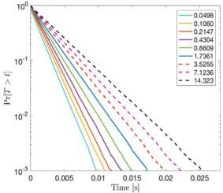

(a) RDME

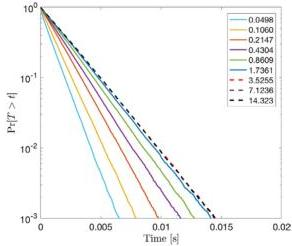

(b) CRDME, Doi interaction

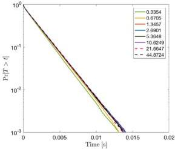

(c) CRDME, Gaussian interaction

Fig. 2. Survival time distributions vs. t from the two-particle A + B → ∅ reaction for (a) (non-convergent) RDME model; (b) CRDME Doi reaction model Eq. (12); (c) CRDME Gaussian interaction model Eq. (27). In each case the domain is a disk. For the RDME each curve was estimated from 128000 simulations, for the CRDME with Doi interaction from 128000 simulations, and for the CRDME with Gaussian interaction from 100000 simulations. The legends give the ratio, ε/h as the mesh is refined (h is approximately successively halved). See Section 4.1 for other parameter values and details. We see that the survival time distribution for the RDME never converges as h is reduced, while for both reaction models the CRDME survival time distributions converge.

We estimated the mean reaction time from the numerically sampled reaction times by calculating the sample mean. In Fig. 3(a) we show the sample mean reaction times for the three choices of reaction mechanisms as ε/h is varied. We see that as ε/h → ∞ (i.e. h → 0) the sample mean reaction times for both CRDME reaction models converge to a finite value, while the sample mean for the RDME reaction model diverges. Fig. 3(b) illustrates the rate of convergence for the CRDME Doi and Gaussian interaction models by plotting the successive difference of the estimated mean reaction times as h is decreased (approximately halved). For h sufficiently small, the empirical rate of convergence for both reaction mechanisms is roughly second order.

### 4.2. A + B ⇌ C reversible binding reaction

We now consider the reversible bimolecular A + B ⇌ C reaction in a system that initially contains just one C molecule. The corresponding volume reactivity model is then given by Eq. (8) and Eq. (9). It is assumed all three molecules have the same diffusion constant, D^A = D^B = D^C = 0.01 μm² s⁻¹. The domain Ω is chosen to be a square with sides of length L = 0.2 μm, and we assume a reflecting Neumann boundary condition on ∂Ω in each of the x, y, and z coordinates. We use the Doi reaction model Eq. (10) for the forward A + B → C reaction, with reaction radius ε = 10⁻³ μm, and consider two dissociation mechanisms: the point unbinding model Eq. (13) introduced in [32], and the uniform unbinding model Eq. (14). For the association reaction, the product C molecule is placed at the diffusion weighted center of mass Eq. (11),

S.A. Isaacson, Y. Zhang / Journal of Computational Physics 374 (2018) 954–983

969

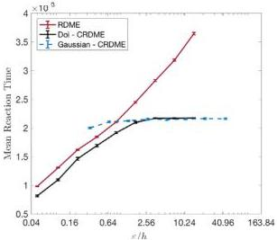

(a) Convergence of $\mathbb{E}[T_{\mathrm{bind}}]$

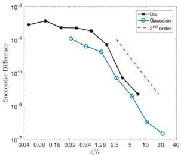

(b) Rate of convergence of $\mathbb{E}[T_{\mathrm{bind}}]$

Fig. 3. Mean reaction time $\mathbb{E}[T_{\mathrm{bind}}]$ for the two-particle $A + B \to \varnothing$ reaction as the mesh width, $h$, is reduced. In panel (a) we plot the mean reaction time $\mathbb{E}[T_{\mathrm{bind}}]$ vs. $\varepsilon/h$ as $h$ is (approximately) successively halved. Each mean reaction time for the RDME was estimated from 128000 simulations; for the CRDME with Doi interaction from 128000 simulations; and for the CRDME with Gaussian interaction from 100000 simulations. Note, 95% confidence intervals are drawn on each data point, but for some points are smaller than the marker labeling the point. See Section 4.1 for parameter values and further details. In panel (b) we demonstrate the rate of convergence when using the CRDME with Doi or Gaussian reaction models by plotting the difference between successive points on the corresponding $\mathbb{E}[T_{\mathrm{bind}}]$ vs $\varepsilon/h$ curves from Fig. 3(a). The smaller of the two $h$ values is used for labeling. The effective convergence rate of the successive differences to zero for the CRDME with either reaction model scales roughly like $O(h^2)$.

so that $\gamma = \frac{1}{2}$. For all simulations the C molecule was initially placed randomly within $\Omega$, corresponding to the initial conditions that

$$p(\mathbf{x}, \mathbf{y}, 0) = 0, \qquad p_{\mathrm{b}}(\mathbf{z}, 0) = \frac{1}{|\Omega|}.$$

To confirm that the unstructured mesh CRDME converges to the solution of the Doi volume-reactivity model, we compare statistics from SSA simulations of the jump processes corresponding to the CRDME against statistics calculated from Brownian Dynamics (BD) simulations using the method of [22,32] (with a fixed time step of $dt = 10^{-10}$ s). Unless otherwise stated, for all simulations the association rate constant in Eq. (10) was chosen to be $\lambda = 9.3662 \times 10^7$ s$^{-1}$, and the dissociation rate constant in Eq. (13) and Eq. (14) was chosen to be $\mu = 9.2735 \times 10^5$ s$^{-1}$. Here $\lambda$ was determined by matching the mean association time $T_{\mathrm{bind}}$ ($T_{\mathrm{bind}} = 1.9328$ s) for the irreversible $A + B \to \varnothing$ reaction to occur in $\Omega$, given a uniform initial distribution for the A and B molecules, to the corresponding time found in Fig. 2 of [48]. $\mu$ was then determined by matching the equilibrium constant ($K = 3.1730 \times 10^{-4}$ $\mu$m$^2$) with that in [48]. Let $P_{\mathrm{bound}}(t)$ denote the probability the A and B molecules are bound together in the C state at time $t$. That is

$$P_{\mathrm{bound}}(t) = \int_{\Omega} p_{\mathrm{b}}(\mathbf{z}, t) \, d\mathbf{z}.$$

We estimate $P_{\mathrm{bound}}(t)$ numerically by averaging the number of C molecules at a fixed time in the system over the total number of CRDME (resp. BD) simulations. Fig. 4 demonstrates that for each of the unbinding models, $P_{\mathrm{bound}}(t)$ from the unstructured mesh CRDME with Doi interaction agrees to statistical error with $P_{\mathrm{bound}}(t)$ from BD simulations. Fig. 5(a) shows the convergence of $P_{\mathrm{bound}}(t)$ from the CRDME as the mesh width $h \to 0$. To illustrate the rate of convergence of $P_{\mathrm{bound}}(t)$, in Fig. 5(b) we plot the successive difference of the estimated $P_{\mathrm{bound}}(t)$ at $t = 0.01$ s as $h$ is approximately halved. In the limit that $\varepsilon/h \to \infty$, the empirical rate of convergence is roughly second order.

### 4.3. CRDME applications

In the previous subsections we demonstrated the convergence of the CRDME for two basic bimolecular chemical reactions involving at most two molecules ($A + B \to \emptyset$ and $A + B \rightleftharpoons C$). We now demonstrate that the CRDME is capable of accurately resolving more general multiparticle reaction systems, considering the example given by equation 3 of [48]. The domain $\Omega$ is chosen to be a square with sides of length $L = 1$ $\mu$m, allowing us to directly compare with the results of [48].

970

S.A. Isaacson, Y. Zhang / Journal of Computational Physics 374 (2018) 954–983

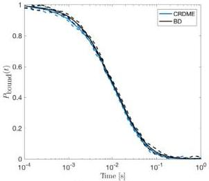

(a) Point unbinding

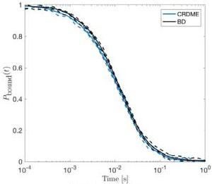

(b) Uniform unbinding

Fig. 4. Probability molecules are bound $P_{\text{bound}}(t)$ vs. time for CRDME SSA simulations and BD simulations. Blue curves correspond to the CRDME simulations and black to the BD simulations. Corresponding 95% confidence intervals are drawn with dashed lines in the same color. Each curve was estimated from 128000 simulations. The left panel corresponds to the point unbinding model Eq. (13), while the right corresponds to the uniform unbinding model Eq. (14). The domain $\Omega$ was a square with sides of length $L = 0.2$ $\mu$m, and was discretized into $N = 263169$ polygonal voxels with maximum mesh width approximately $h = 3.5334 \times 10^{-5}$ $\mu$m. The polygonal mesh was constructed as the dual mesh to a uniform triangulation of the square, that was itself obtained from a Cartesian mesh by dividing each square into two triangles. For remaining parameters see Section 4.2.

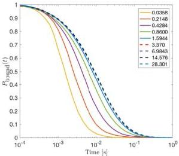

(a) Convergence of $P_{\text{bound}}(t)$

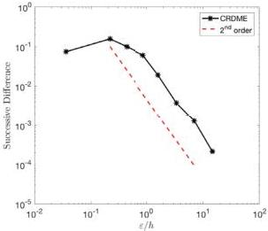

(b) Rate of convergence of $P_{\text{bound}}(t)$

Fig. 5. Convergence of the probability the molecules are in the bound state, $P_{\text{bound}}(t)$, as $h \to 0$. In panel (a) we plot $P_{\text{bound}}(t)$ vs time as $\varepsilon/h$ is varied for $\varepsilon = 10^{-3}$ $\mu$m. Each curve was estimated from 100000 simulations. We see convergence as the mesh width $h$ goes to 0 (i.e. $\varepsilon/h \to \infty$). Legend gives the ratio, $\varepsilon/h$, for each curve. For remaining parameters see Section 4.2. In panel (b) we demonstrate the rate of convergence at $t = 0.01$ s by plotting the difference between successive points of $P_{\text{bound}}(t)$ vs. $\varepsilon/h$. The smaller of the two $h$ values is used for labeling. The effective convergence rate to zero scales like $O(h^2)$.

The reaction system described by equation 3 of [48] is

$$A + B \underset{\mu}{\overset{\lambda}{\rightleftharpoons}} C, \quad \emptyset \xrightarrow{k_1} C, \quad A \xrightarrow{k_2} \emptyset, \quad B \xrightarrow{k_2} \emptyset. \tag{32}$$

Here the reaction radius, $\varepsilon$, is again chosen to be $10^{-3}$ $\mu$m, the reaction rate was chosen to be $\lambda = 1.0056 \times 10^8$ s$^{-1}$ and the dissociation rate was chosen to be $\mu = 3.1621 \times 10^4$ s$^{-1}$. Parameters are calibrated as described in the preceding subsection using the parameter relations established in [48]. For our CRDME simulations, the domain $\Omega$ was discretized into 263169 mesh voxels with maximum mesh width $h = 3.5334 \times 10^{-5}$ $\mu$m, as detailed in Fig. 4. In Fig. 6, we plot the time evolution of the average number of C molecules as found in [48], as determined from BD simulations using the uniform

S.A. Isaacson, Y. Zhang / Journal of Computational Physics 374 (2018) 954–983

971

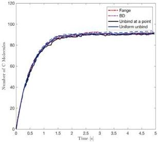

Fig. 6. Mean number of C molecules vs. time when ε = 10⁻³ μm for the reaction system Eq. (32) in a square with sides of length 1 μm. The diffusion constant of all species is D = 0.01 μm² s⁻¹. The production rate of C molecules is k₁ = 180 s⁻¹ and the first-order rate constant for degradation of A and B molecules is k₂ = 10 s⁻¹. The blue line corresponds to CRDME simulations of the point unbinding model Eq. (13), while the solid black line corresponds to CRDME simulations of the uniform unbinding model Eq. (14). The dash-dot red line gives the finest mesh resolution result obtained in [48] using their modified RDME model, while the purple dash-dot line indicates the result from BD simulations of the uniform unbinding model Eq. (14). The dashed black and blue lines correspond to a 95% confidence interval for the mean in the point and uniform unbinding CRDME simulations respectively. The CRDME and BD curves were estimated from 100 simulations, while the red line was generated by estimating the data points in Fig. 4B of [48]. The mesh used for all CRDME simulations was the same as described in Fig. 4. All BD simulations used a time-step of dt = 10⁻¹⁰ s.

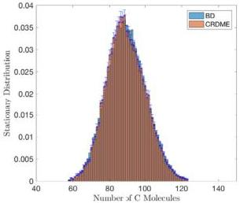

(a) Point unbinding

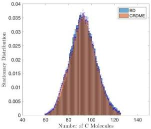

(b) Uniform unbinding

Fig. 7. Histogram of the empirical stationary distribution for the number of C molecules obtained from 60000 CRDME and BD simulations of Eq. (32). Parameters are the same as in Fig. 6. Panel (a) corresponds to using the point unbinding model Eq. (13) in both the CRDME and BD simulations. Panel (b) corresponds to using the uniform unbinding model Eq. (14) in both the CRDME and BD simulations. 95% confidence intervals for CRDME are drawn in blue. For each unbinding model, the CRDME simulations agree with the Brownian dynamics simulations to statistical error.

unbinding mechanism Eq. (14), and from CRDME simulations using both the point Eq. (13) and uniform Eq. (14) unbinding mechanisms. The estimated average number of C molecules agreed quite well between all four methods (when averaged over 100 simulations). Fig. 7 shows the corresponding stationary distribution of the number of C molecules in the CRDME and BD simulations for each unbinding model. In both cases the stationary distributions agree to the level of statistical error.

We conclude by demonstrating the ability of our method to handle complex geometries by considering a simplified version of a signaling cascade model [5] within a two-dimensional domain corresponding to the cytosol of a human B cell (reconstructed from an X-ray tomogram [2]). The simplified (three-level) signaling cascade model is given by

972

S.A. Isaacson, Y. Zhang / Journal of Computational Physics 374 (2018) 954–983

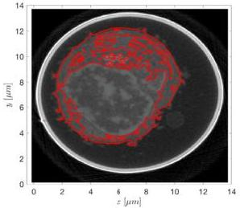

(a) Reconstructed boundaries

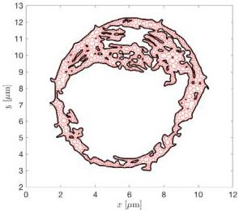

(b) The mesh of the human B cell

Fig. 8. A two-dimensional slice of an X-ray tomogram of a human B cell. In panel (a) we plot the reconstructed boundaries (red solid lines) on top of the original imaging data. In panel (b) we show the mesh of the human B cell used in the CRDME simulation of the signaling cascade model Eq. (33). The maximum connected region is discretized into 6915 polygonal elements.

first level: $$c_{1}^{u} \xrightarrow{k_{1}^{a}} c_{1}^{p},$$ (cell membrane)

$$c_{1}^{p} \xrightarrow{k_{1}^{i}} c_{1}^{u},$$

second level: $$c_{2}^{u} + c_{1}^{p} \xrightarrow{k_{2}^{a}} c_{2}^{p} + c_{1}^{p},$$

$$c_{2}^{p} \xrightarrow{k_{2}^{i}} c_{2}^{u},$$

third level: $$c_{3}^{u} + c_{2}^{p} \xrightarrow{k_{3}^{a}} c_{3}^{p} + c_{2}^{p},$$

$$c_{3}^{p} \xrightarrow{k_{3}^{i}} c_{3}^{u},$$

where the first level phosphorylation reaction occurs only in the cell membrane. The diffusion of molecules and all other reactions occur within the cytosol.

We extracted a two-dimensional slice of a human B cell from a (labeled) three-dimensional X-ray tomogram provided by the National Center for X-ray Tomography (NCXT) [59]. The boundaries of the cell, the nucleus, and cytosolic organelles were then segmented using the bwboundaries command in MATLAB. The maximum connected region from the resulting segmented cytosol was determined (Fig. 8(a)), and that domain was then triangulated in Gmsh [60]. The corresponding dual mesh was then calculated, providing a polygonal mesh approximation to the cytosol we used in CRDME simulations (Fig. 8(b)). For demonstrative purposes, we choose a coarse mesh with a maximum dual mesh diameter of 121.4 nm and an average dual mesh diameter of 15.9 nm.

We assumed no-flux Neumann boundary conditions on the boundary of the cell, the nucleus, and all organelles within the cytosol, with a diffusion constant of $$D = 5 \mu m^{2} s^{-1}$$ for each species. The bimolecular reaction radius $$\varepsilon$$ was chosen to be 10 nm. The reaction rates were chosen to be consistent with those used in [5]. The dephosphorylation rates, $$k_{n}^{i}$$, are set to be $$5 s^{-1}$$ for $$n = 1, 2, 3$$. The phosphorylation rates, $$k_{n}^{a}$$, are set to be $$50 s^{-1}$$ for $$n = 2, 3$$, and the phosphorylation rate for the first species, $$k_{1}^{a}$$, is set to be $$5 s^{-1}$$. We note that the first-level kinase phosphorylation only occurs in the cell membrane. In the simulation, this reaction process was restricted to voxels bordering the boundary of the cell. Finally, we initialized the system with no $$c_{n}^{p}$$ for $$n = 1, 2, 3$$, 200 $$c_{1}^{u}$$ molecules and 100 $$c_{2}^{u}$$ and $$c_{3}^{u}$$ molecules in each voxel.

In Figs. 9(a) and 9(b) we show the phosphorylated form ($$c_{n}^{p}$$, $$n = 1, 2, 3$$) profiles at $$t = 0.01$$ s and $$t = 0.4$$ s (steady state) of the system from one CRDME simulation in comparison to the numerical solution of the PDE corresponding to Eq. (33). In both cases, we observe initially a rapid infusion of $$c_{2}^{p}$$ and $$c_{3}^{p}$$ starting from the cell membrane (Fig. 9(a)), and eventually $$c_{2}^{p}$$ and $$c_{3}^{p}$$ become uniformly distributed in the cell.

## 5. Discussion

By using a finite volume discretization of reaction terms, we have developed a convergent lattice jump process approximation, the convergent reaction–diffusion master equation (CRDME), to the abstract volume-reactivity model for reversible

S.A. Isaacson, Y. Zhang / Journal of Computational Physics 374 (2018) 954–983

973

A

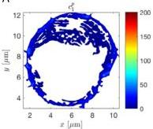

B

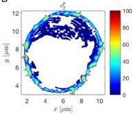

C

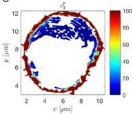

D

E

F

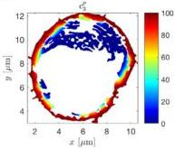

(a) t = 0.01s

A

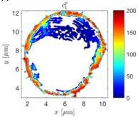

B

C

D

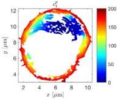

E

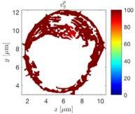

F

(b) Approximate steady-state, t = 0.4s

Fig. 9. Phosphorylated form (c_n^P, n = 1, 2, 3) profiles at t = 0.01 s and at steady-state (t = 0.4 s). In panels A, B, and C we plot the result from one CRDME simulation. In panels D, E, and F we plot the result by numerically solving the PDE corresponding to Eq. (33) using the finite element method in space and backward-Euler method in time.

974

S.A. Isaacson, Y. Zhang / Journal of Computational Physics 374 (2018) 954–983

reactions. The final CRDME can handle general bimolecular interaction functions on both structured and unstructured polygonal grids, including the popular Doi reaction model. The flexibility of the CRDME approach allows the reuse of a variety of methods for approximating the spatial diffusion of molecules developed for the RDME model. These include the unstructured grid finite element approach we used here (developed in [39]), but also the Cartesian grid cut cell finite volume method of [20] and the unstructured grid finite volume method of [26]. As we demonstrated in Section 4, this enables the use of the CRDME to study complex particle-based stochastic reaction–diffusion models within realistic domain geometries arising from cellular imaging data.

One benefit to the CRDME approach is that it is equivalent to the popular RDME model in its treatment of spatial transport (e.g. diffusion) and linear reactions, while converging to an underlying spatially-continuous particle model in the limit that the mesh spacing approaches zero (whereas in two or more dimensions the RDME loses bimolecular reactions in such limits). This enables CRDME-based models to immediately reuse many of the extensions to the RDME that have been developed to optimize simulation performance, and extend the RDME to more general spatial transport mechanisms. Moreover, as the RDME approaches the CRDME as the mesh is coarsened [27], this suggests a possible adaptive mesh refinement method. The CRDME could be used in regions where fine meshes are required and the RDME loses bimolecular reaction effects, while the RDME (or a renormalized RDME [49]), is used in regions where coarse meshes are acceptable. Constructing such hybrid models is relatively straightforward since the RDME and CRDME differ only in the set of jump process transitions they use to model bimolecular reactions.

There are still a number of directions in which the CRDME could be improved. Foremost is the development of optimized simulation methods for the jump process associated with the CRDME; in this work we used a simple variant of the method for well-mixed reactions developed in [54]. Once such optimized simulation methods are available, it would be interesting to compare the computational work to achieve a given accuracy with the CRDME to that required by Brownian Dynamics methods for solving the Doi model, and potentially to that required by renormalized RDMEs that approximate the Doi model. Note, the latter would require first developing renormalized RDME approximations to the Doi model as current approaches have focused on approximating the Smoluchowski–Collins–Kimball model [49].

We have also not discussed how to evaluate the reactive jump rate integrals for $\kappa_{ij}^{+}$ and $\kappa_{ijk}^{+}$ in three-dimensional domains. While the method we developed in Appendix B for evaluating such integrals in two-dimensions is straightforward, it is more complicated in three-dimensions, where one must rapidly and accurately evaluate volumes of intersection between spheres and polyhedra. In limited testing we have found that the recently developed primitive intersection library from [61] offers good performance and accuracy in many cases. It can then be wrapped within adaptive quadrature routines to evaluate integrals of volumes of intersection over polyhedra in a similar manner to how we wrapped our 2D area of intersection method to evaluate integrals over polygons in Appendix B.

### Acknowledgements

SAI would like to thank Steven Andrews, Aleksander Donev and David Isaacson for helpful discussions related to this work. SAI and YZ were supported by National Science Foundation award DMS-1255408. SAI was partially supported by a grant from the Simons Foundation, and thanks the Isaac Newton Institute of Mathematical Sciences for hosting him as a visiting Simons Fellow for the programme on Stochastic Dynamical Systems in Biology while completing this work.

### Appendix A. General multi-particle A + B $\leftrightarrows$ C Reaction

In this appendix we consider the general multiparticle A + B $\leftrightarrows$ C reaction within a bounded domain $\Omega \subset \mathbb{R}^{d}$. We will show that the natural generalization of the discretization procedure used in Sections 2 and 3.3 to derive the master equation approximation Eq. (26) also leads to a master equation approximation for the general multiparticle case. This new master equation corresponds to the forward Kolmogorov equation for the jump process given in Table 1, demonstrating that the multiparticle system's transition rates are simply the two-particle transition rates multiplied by the number of possible ways each transition event can occur given the current system state.

We first formulate the general multiparticle abstract volume reactivity model, using a similar notation to [15,16,62]. Denote by $A(t)$ the stochastic process for the number of species A molecules in the system at time $t$, with $B(t)$ and $C(t)$ defined similarly. Values of $A(t)$, $B(t)$ and $C(t)$ will be given by $a$, $b$ and $c$ (i.e. $A(t) = a$). When $A(t) = a$, we will let $\mathbf{Q}_{i}^{a}(t) \in \Omega$ label the stochastic process for the position of the $i$th molecule of species A within the domain $\Omega$. $\mathbf{q}_{i}^{a}$ will denote a possible value of $\mathbf{Q}_{i}^{a}(t)$. The species A position vector when $A(t) = a$ is then given by

$$\mathbf{Q}^{a}(t) = (\mathbf{Q}_{1}^{a}(t), \dots, \mathbf{Q}_{a}^{a}(t)) \in \Omega^{a},$$

where $\Omega^{a} = \Omega \times \dots \times \Omega \subset \mathbb{R}^{da}$. Similarly, $\mathbf{q}^{a}$ will denote a possible value of $\mathbf{Q}^{a}(t)$,

$$\mathbf{Q}^{a}(t) = \mathbf{q}^{a} = (\mathbf{q}_{1}^{a}, \dots, \mathbf{q}_{a}^{a}).$$

$\Omega^{b}$, $\Omega^{c}$, $\mathbf{Q}^{b}(t)$, $\mathbf{Q}_{m}^{b}(t)$, $\mathbf{Q}^{c}(t)$, $\mathbf{Q}_{n}^{c}(t)$, $\mathbf{q}_{m}^{b}$, $\mathbf{q}_{n}^{c}$, $\mathbf{q}^{b}$ and $\mathbf{q}^{c}$ will all be defined analogously. The state of the system is then a hybrid discrete-continuous state stochastic process given by $(A(t), B(t), C(t), \mathbf{Q}^{A(t)}, \mathbf{Q}^{B(t)}, \mathbf{Q}^{C(t)})$.

S.A. Isaacson, Y. Zhang / Journal of Computational Physics 374 (2018) 954–983

975

With this notation, denote by $f^{(a,b,c)}(\boldsymbol{q}^a,\boldsymbol{q}^b,\boldsymbol{q}^c,t)$ the probability density that $A(t)=a$, $B(t)=b$ and $C(t)=c$ with $\boldsymbol{Q}^a(t)=\boldsymbol{q}^a$, $\boldsymbol{Q}^b(t)=\boldsymbol{q}^b$ and $\boldsymbol{Q}^c(t)=\boldsymbol{q}^c$. We assume that molecules of the same species are indistinguishable, that is for $1\le l<l'\le a$ fixed

$$\begin{array}{l} f^{(a,b,c)}\left(\boldsymbol{q}_1^a,\dots,\boldsymbol{q}_{l-1}^a,\boldsymbol{q}_l^a,\boldsymbol{q}_{l+1}^a,\dots,\boldsymbol{q}_{l'-1}^a,\boldsymbol{q}_{l'}^a,\boldsymbol{q}_{l'+1}^a,\dots,\boldsymbol{q}_a^a,\boldsymbol{q}^b,\boldsymbol{q}^c,t\right) \\ =f^{(a,b,c)}\left(\boldsymbol{q}_1^a,\dots,\boldsymbol{q}_{l-1}^a,\boldsymbol{q}_{l'}^a,\boldsymbol{q}_{l+1}^a,\dots,\boldsymbol{q}_{l'-1}^a,\boldsymbol{q}_l^a,\boldsymbol{q}_{l'+1}^a,\dots,\boldsymbol{q}_a^a,\boldsymbol{q}^b,\boldsymbol{q}^c,t\right), \end{array}$$

with similar relations holding for permutations of the molecule orderings within $\boldsymbol{q}^b$ and $\boldsymbol{q}^c$. With this assumption the $f^{(a,b,c)}$ are chosen to be normalized so that

$$\sum_{a=0}^{\infty}\sum_{b=0}^{\infty}\sum_{c=0}^{\infty}\left[\frac{1}{a!b!c!}\int\limits_{\Omega^a}\int\limits_{\Omega^b}\int\limits_{\Omega^c}f^{(a,b,c)}\left(\boldsymbol{q}^a,\boldsymbol{q}^b,\boldsymbol{q}^c,t\right)d\boldsymbol{q}^cd\boldsymbol{q}^bd\boldsymbol{q}^a\right]=1.$$

Here the bracketed term corresponds to the probability of having a given number of each species, i.e.

$$\Pr\left[A(t)=a,B(t)=b,C(t)=c\right]=\frac{1}{a!b!c!}\int\limits_{\Omega^a}\int\limits_{\Omega^b}\int\limits_{\Omega^c}f^{(a,b,c)}\left(\boldsymbol{q}^a,\boldsymbol{q}^b,\boldsymbol{q}^c,t\right)d\boldsymbol{q}^cd\boldsymbol{q}^bd\boldsymbol{q}^a.$$

We denote by $\boldsymbol{f}(t)$ the overall probability density vector,

$$\boldsymbol{f}(t)=\{f^{(a,b,c)}(\boldsymbol{q}^a,\boldsymbol{q}^b,\boldsymbol{q}^c)\}_{a,b,c},$$

so that the component of $\boldsymbol{f}(t)$ indexed by $(a,b,c)$ is $f^{(a,b,c)}(\boldsymbol{q}^a,\boldsymbol{q}^b,\boldsymbol{q}^c)$. The density vector satisfies the forward Kolmogorov equation

$$\frac{\partial\boldsymbol{f}}{\partial t}(t)=(\mathcal{L}+\mathcal{R}^++\mathcal{R}^-)\boldsymbol{f}(t). \tag{A.1}$$

We assume molecules can not leave $\Omega$, so that each component $f^{(a,b,c)}(\boldsymbol{q}^a,\boldsymbol{q}^b,\boldsymbol{q}^c,t)$ also satisfies a reflecting Neumann boundary condition on the appropriate domain boundary, $\partial(\Omega^{a+b+c})$. Here the linear operators $\mathcal{L}$, $\mathcal{R}^+$ and $\mathcal{R}^-$ correspond to diffusion, the forward association reaction and the reverse dissociation reaction respectively. The $(a,b,c)$ component of the diffusion operator is given by

$$(\mathcal{L}\boldsymbol{f}(t))_{a,b,c}=\left(D^A\sum_{l=1}^a\Delta_{\boldsymbol{q}_l^a}+D^B\sum_{m=1}^b\Delta_{\boldsymbol{q}_m^b}+D^C\sum_{n=1}^c\Delta_{\boldsymbol{q}_n^c}\right)f^{(a,b,c)}\left(\boldsymbol{q}^a,\boldsymbol{q}^b,\boldsymbol{q}^c,t\right), \tag{A.2}$$

where $\Delta_{\boldsymbol{q}_l^a}$ denotes the $d$-dimensional Laplacian acting on the $\boldsymbol{q}_l^a$ coordinate, and $\Delta_{\boldsymbol{q}_m^b}$ and $\Delta_{\boldsymbol{q}_n^c}$ are defined similarly. To define the reaction operators, $\mathcal{R}^+$ and $\mathcal{R}^-$, we introduce notations for adding or removing a molecule from a given state, $\boldsymbol{q}^a$. Let

$$\boldsymbol{q}^a\cup\boldsymbol{x}=\left(\boldsymbol{q}_1^a,\dots,\boldsymbol{q}_a^a,\boldsymbol{x}\right),\qquad\boldsymbol{q}^a\setminus\boldsymbol{q}_l^a=\left(\boldsymbol{q}_1^a,\dots,\boldsymbol{q}_{l-1}^a,\boldsymbol{q}_{l+1}^a,\dots,\boldsymbol{q}_a^a\right),$$

which correspond to adding a molecule to species A at $\boldsymbol{x}$, and removing the $l$th molecule of species A respectively. With these definitions, the reaction operator for the association reaction $A+B\to C$ is given by

$$\begin{array}{l} (\mathcal{R}^+\boldsymbol{f}(t))_{a,b,c}=-\left(\sum_{l=1}^a\sum_{m=1}^b\kappa^+\left(\boldsymbol{q}_l^a,\boldsymbol{q}_m^b\right)\right)f^{(a,b,c)}\left(\boldsymbol{q}^a,\boldsymbol{q}^b,\boldsymbol{q}^c,t\right) \\ +\sum_{n=1}^c\left[\int\limits_{\Omega^2}\kappa^+\left(\boldsymbol{q}_n^c|\boldsymbol{x},\boldsymbol{y}\right)f^{(a+1,b+1,c-1)}\left(\boldsymbol{q}^a\cup\boldsymbol{x},\boldsymbol{q}^b\cup\boldsymbol{y},\boldsymbol{q}^c\setminus\boldsymbol{q}_n^c,t\right)d\boldsymbol{x}d\boldsymbol{y}\right]. \tag{A.3} \end{array}$$

Similarly, the reaction operator for the dissociation reaction $C\to A+B$ is given by

$$\begin{array}{l} (\mathcal{R}^-\boldsymbol{f}(t))_{a,b,c}=-\left(\sum_{n=1}^c\kappa^-\left(\boldsymbol{q}_n^c\right)\right)f^{(a,b,c)}\left(\boldsymbol{q}^a,\boldsymbol{q}^b,\boldsymbol{q}^c,t\right) \\ +\sum_{l=1}^a\sum_{m=1}^b\left[\int\limits_{\Omega}\kappa^-\left(\boldsymbol{q}_l^a,\boldsymbol{q}_m^b|\boldsymbol{z}\right)f^{(a-1,b-1,c+1)}\left(\boldsymbol{q}^a\setminus\boldsymbol{q}_l^a,\boldsymbol{q}^b\setminus\boldsymbol{q}_m^b,\boldsymbol{q}^c\cup\boldsymbol{z},t\right)d\boldsymbol{z}\right]. \tag{A.4} \end{array}$$

976

S.A. Isaacson, Y. Zhang / Journal of Computational Physics 374 (2018) 954–983

To approximate Eq. (A.1) by a master equation model we reuse the jump process discretizations for diffusion and reaction developed in Sections 2 and 3. The former is possible since the diffusive motion of each molecule is independent, so we can apply the finite element discretization of Section 2 to each individual molecule's position coordinates. Similarly, each reaction term in the $\mathcal{R}^{+}$ and $\mathcal{R}^{-}$ definitions involves sums of independent one or two-body interactions that are identical to those in Eq. (8) and Eq. (9). As such, we may re-use the finite volume discretization of Section 3.3 independently for each of these terms.

We again let $\{V_{i}\}_{i=1}^{K}$ denote a polygonal mesh approximation to $\Omega$, constructed as the dual mesh to a triangulation of $\Omega$. Reusing the notation of Sections 2 and 3 we let $\boldsymbol{i}^{a}=(i_{1}^{a},\ldots,i_{a}^{a})$ denote the multi-index labeling the hyper-voxel $\mathcal{V}_{\boldsymbol{i}^{a}}$

$$\mathcal{V}_{\boldsymbol{i}^{a}}:=V_{i_{1}^{a}}\times\cdots\times V_{i_{a}^{a}},$$

with $\boldsymbol{j}^{b}$, $\boldsymbol{k}^{c}$, $\mathcal{V}_{\boldsymbol{j}^{b}}$ and $\mathcal{V}_{\boldsymbol{k}^{c}}$ defined similarly. Multi-species hypervoxels will be given by $\mathcal{V}_{\boldsymbol{i}^{a}\boldsymbol{j}^{b}}:=\mathcal{V}_{\boldsymbol{i}^{a}}\times\mathcal{V}_{\boldsymbol{j}^{b}}$ and $\mathcal{V}_{\boldsymbol{i}^{a}\boldsymbol{j}^{b}\boldsymbol{k}^{c}}:=\mathcal{V}_{\boldsymbol{i}^{a}}\times\mathcal{V}_{\boldsymbol{j}^{b}}\times\mathcal{V}_{\boldsymbol{k}^{c}}$. We then make the piecewise constant (well-mixed) approximation that

$$\begin{array}{l} F_{\boldsymbol{i}^{a}\boldsymbol{j}^{b}\boldsymbol{k}^{c}}(t):=\operatorname*{Pr}\left[A(t)=a,B(t)=b,C(t)=c\text{ and }\left(\boldsymbol{Q}^{a}(t),\boldsymbol{Q}^{b}(t),\boldsymbol{Q}^{c}(t)\right)\in\mathcal{V}_{\boldsymbol{i}^{a}\boldsymbol{j}^{b}\boldsymbol{k}^{c}}\right] \\ =\frac{1}{a!b!c!}\int_{\mathcal{V}_{\boldsymbol{i}^{a}\boldsymbol{j}^{b}\boldsymbol{k}^{c}}}f^{(a,b,c)}(\boldsymbol{q}^{a},\boldsymbol{q}^{b},\boldsymbol{q}^{c},t)d\boldsymbol{q}^{c}d\boldsymbol{q}^{b}d\boldsymbol{q}^{a} \\ \approx f^{(a,b,c)}(\boldsymbol{q}_{\boldsymbol{i}^{a}}^{a},\boldsymbol{q}_{\boldsymbol{j}^{b}}^{b},\boldsymbol{q}_{\boldsymbol{k}^{c}}^{c},t)\frac{|\mathcal{V}_{\boldsymbol{i}^{a}\boldsymbol{j}^{b}\boldsymbol{k}^{c}}|}{a!b!c!}, \tag{A.5} \end{array}$$

where $\boldsymbol{q}_{\boldsymbol{i}^{a}}^{a}$ denotes the vector of the centroids of the voxels in $\mathcal{V}_{\boldsymbol{i}^{a}}$, with $\boldsymbol{q}_{\boldsymbol{j}^{b}}^{b}$ and $\boldsymbol{q}_{\boldsymbol{k}^{c}}^{c}$ defined similarly. We collect the probabilities $F_{\boldsymbol{i}^{a}\boldsymbol{j}^{b}\boldsymbol{k}^{c}}(t)$ into a state vector

$$\boldsymbol{F}(t)=\{F_{\boldsymbol{i}^{a}\boldsymbol{j}^{b}\boldsymbol{k}^{c}}(t)\}_{\boldsymbol{i}^{a},\boldsymbol{j}^{b},\boldsymbol{k}^{c}},$$

so that the $(\boldsymbol{i}^{a},\boldsymbol{j}^{b},\boldsymbol{k}^{c})$ component of $\boldsymbol{F}(t)$ is $F_{\boldsymbol{i}^{a}\boldsymbol{j}^{b}\boldsymbol{k}^{c}}(t)$. By using the finite element discretization of Section 2 to approximate each Laplacian within the diffusion operator, integrating the action of each of the reaction operators, $\mathcal{L}$, $\mathcal{R}^{+}$, and $\mathcal{R}^{-}$ on $f^{(a,b,c)}$ over $\mathcal{V}_{\boldsymbol{i}^{a}\boldsymbol{j}^{b}\boldsymbol{k}^{c}}$, and using the well-mixed (piecewise constant) approximation Eq. (A.5), we find that $\boldsymbol{F}(t)$ satisfies the master equation

$$\frac{d\boldsymbol{F}}{dt}(t)=\left(\mathcal{L}_{h}+\mathcal{R}_{h}^{+}+\mathcal{R}_{h}^{-}\right)\boldsymbol{F}(t),$$

corresponding to the forward Kolmogorov equation for a jump process. Here the discretized diffusion operator $\mathcal{L}_{h}$ is given by

$$\begin{array}{l} (\mathcal{L}_{h}\boldsymbol{F}(t))_{\boldsymbol{i}^{a},\boldsymbol{j}^{b},\boldsymbol{k}^{c}}=D^{\mathrm{A}}\sum_{i=1}^{a}\sum_{i'=1}^{K}\left[\left(\Delta_{h}^{T}\right)_{i_{i}^{a}i'}F_{\boldsymbol{i}^{a}\setminus i_{i}^{a}\cup i',\boldsymbol{j}^{b},\boldsymbol{k}^{c}}(t)-\left(\Delta_{h}^{T}\right)_{i' i_{i}^{a}}F_{\boldsymbol{i}^{a}\boldsymbol{j}^{b}\boldsymbol{k}^{c}}(t)\right] \\ +D^{\mathrm{B}}\sum_{m=1}^{b}\sum_{j'=1}^{K}\left[\left(\Delta_{h}^{T}\right)_{j_{m}^{b}j'}F_{\boldsymbol{i}^{a},\boldsymbol{j}^{b}\setminus j_{m}^{b}\cup j',\boldsymbol{k}^{c}}(t)-\left(\Delta_{h}^{T}\right)_{j' j_{m}^{b}}F_{\boldsymbol{i}^{a}\boldsymbol{j}^{b}\boldsymbol{k}^{c}}(t)\right] \\ +D^{\mathrm{C}}\sum_{n=1}^{c}\sum_{k'=1}^{K}\left[\left(\Delta_{h}^{T}\right)_{k' k'}F_{\boldsymbol{i}^{a},\boldsymbol{j}^{b},\boldsymbol{k}^{c}\setminus k'\cup k'}(t)-\left(\Delta_{h}^{T}\right)_{k' k'\bar{k}}F_{\boldsymbol{i}^{a}\boldsymbol{j}^{b}\boldsymbol{k}^{c}}(t)\right]. \end{array}$$

Similarly, the forward reaction association operator $\mathcal{R}_{h}^{+}$ is given by

$$(\mathcal{R}_{h}^{+}\boldsymbol{F}(t))_{\boldsymbol{i}^{a},\boldsymbol{j}^{b},\boldsymbol{k}^{c}}=-\left(\sum_{l=1}^{a}\sum_{m=1}^{b}\kappa_{i_{l}^{a}j_{m}^{b}}^{+}\right)F_{\boldsymbol{i}^{a}\boldsymbol{j}^{b}\boldsymbol{k}^{c}}(t)+\frac{(a+1)(b+1)}{c}\sum_{n=1}^{c}\sum_{i'=1}^{K}\sum_{j'=1}^{K}\kappa_{i' j' k'\bar{k}}F_{\boldsymbol{i}^{a}\cup i',\boldsymbol{j}^{b}\cup j',\boldsymbol{k}^{c}\setminus k'\bar{k}}(t),$$

and the backward reaction dissociation operator $\mathcal{R}_{h}^{-}$ is given by

$$(\mathcal{R}_{h}^{-}\boldsymbol{F}(t))_{\boldsymbol{i}^{a},\boldsymbol{j}^{b},\boldsymbol{k}^{c}}=-\left(\sum_{n=1}^{c}\kappa_{k'\bar{k}}^{+}\right)F_{\boldsymbol{i}^{a}\boldsymbol{j}^{b}\boldsymbol{k}^{c}}(t)+\frac{c+1}{ab}\sum_{l=1}^{a}\sum_{m=1}^{b}\sum_{k'=1}^{K}\kappa_{i_{l}^{a}j_{m}^{b}k'}^{-}F_{\boldsymbol{i}^{a}\setminus i_{l}^{a},\boldsymbol{j}^{b}\setminus j_{m}^{b},\boldsymbol{k}^{c}\cup k'}(t).$$

We wish to now convert from a representation where the state variables are the numbers of molecules of each species and the indices of the voxels that contain each molecule, to a representation where the state variables are the numbers of

S.A. Isaacson, Y. Zhang / Journal of Computational Physics 374 (2018) 954–983

977

molecules of each species at each lattice site. While equivalent, this latter representation is more commonly used for the reaction–diffusion master equation (RDME), and allows for the easy identification of the effective transition rates listed in Table 1. Here we summarize how to convert between the two forms, and refer readers interested in detailed derivations to the near-identical conversion that we previously carried out in [36].

Denote by $A_i(t)$ the stochastic process for the number of molecules of species A in voxel $V_i$ at time $t$, with $B_j(t)$ and $C_k(t)$ defined similarly. By $a_i$, $b_j$ and $c_k$ we denote values of $A_i(t)$, $B_j(t)$ and $C_k(t)$, i.e. $A_i(t) = a_i$. For each species the new representation of the state at time $t$ is given by the vector stochastic process

$$\boldsymbol{A}(t) = (A_1(t), \dots, A_K(t)),$$

with $\boldsymbol{B}(t)$ and $\boldsymbol{C}(t)$ defined similarly. The vectors $\boldsymbol{a}$, $\boldsymbol{b}$ and $\boldsymbol{c}$ will then denote corresponding values of these stochastic processes. Finally, let

$$P(\boldsymbol{a}, \boldsymbol{b}, \boldsymbol{c}, t) := \Pr[\boldsymbol{A}(t) = \boldsymbol{a}, \boldsymbol{B}(t) = \boldsymbol{b}, \boldsymbol{C}(t) = \boldsymbol{c}].$$

With these definitions, we now derive a master equation satisfied by the probability distribution vector $\boldsymbol{P}(t) = \{P(\boldsymbol{a}, \boldsymbol{b}, \boldsymbol{c}, t)\}_{\boldsymbol{a}, \boldsymbol{b}, \boldsymbol{c}}$ from the master equation for $\boldsymbol{F}(t)$.

In the remainder, assume that the two representations of state are chosen to be consistent, i.e. that $\boldsymbol{a}$ and $\boldsymbol{i}^a$ are chosen so that

$$a_i = |\{i_l^a | i_l^a = i, l = 1, \dots, a\}|,$$

where $|\cdot|$ denotes the cardinality of the set (with similar relations for $b_j$ and $c_k$). With

$$\omega_{\boldsymbol{a}, \boldsymbol{b}, \boldsymbol{c}} = \frac{a! b! c!}{\prod_{i=1}^K a_i! b_i! c_i!}, \tag{A.6}$$

we showed in [36] that

$$P(\boldsymbol{a}, \boldsymbol{b}, \boldsymbol{c}, t) = \omega_{\boldsymbol{a}, \boldsymbol{b}, \boldsymbol{c}} F_{\boldsymbol{i}^a \boldsymbol{j}^b \boldsymbol{k}^c}(t). \tag{A.7}$$

We therefore define the action of the diffusion and reaction operators on $\boldsymbol{P}(t)$ by

$$(\mathcal{L}_h \boldsymbol{P})(\boldsymbol{a}, \boldsymbol{b}, \boldsymbol{c}, t) := \omega_{\boldsymbol{a}, \boldsymbol{b}, \boldsymbol{c}} (\mathcal{L}_h \boldsymbol{F}(t))_{\boldsymbol{i}^a, \boldsymbol{j}^b, \boldsymbol{k}^c}$$

$$(\mathcal{R}_h^+ \boldsymbol{P})(\boldsymbol{a}, \boldsymbol{b}, \boldsymbol{c}, t) := \omega_{\boldsymbol{a}, \boldsymbol{b}, \boldsymbol{c}} (\mathcal{R}_h^+ \boldsymbol{F}(t))_{\boldsymbol{i}^a, \boldsymbol{j}^b, \boldsymbol{k}^c}$$

$$(\mathcal{R}_h^- \boldsymbol{P})(\boldsymbol{a}, \boldsymbol{b}, \boldsymbol{c}, t) := \omega_{\boldsymbol{a}, \boldsymbol{b}, \boldsymbol{c}} (\mathcal{R}_h^- \boldsymbol{F}(t))_{\boldsymbol{i}^a, \boldsymbol{j}^b, \boldsymbol{k}^c},$$

so that

$$\frac{d\boldsymbol{P}}{dt}(t) = (\mathcal{L}_h + \mathcal{R}_h^+ + \mathcal{R}_h^-) \boldsymbol{P}(t). \tag{A.8}$$

To explicitly characterize the action of each operator on $P(\boldsymbol{a}, \boldsymbol{b}, \boldsymbol{c}, t)$, we use the symmetry of $\boldsymbol{F}$ with respect to components of each of $\boldsymbol{i}^a$, $\boldsymbol{j}^b$, and $\boldsymbol{k}^c$ respectively. Symmetry implies that

$$\begin{aligned} (\mathcal{L}_h \boldsymbol{F}(t))_{\boldsymbol{i}^a, \boldsymbol{j}^b, \boldsymbol{k}^c} &= D^{\mathrm{A}} \sum_{i=1}^K \sum_{i'=1}^K \left[ \left(\Delta_h^{\mathrm{T}}\right)_{ii'} a_i F_{\boldsymbol{i}^a \setminus i \cup i', \boldsymbol{j}^b, \boldsymbol{k}^c}(t) - \left(\Delta_h^{\mathrm{T}}\right)_{i'i} a_i F_{\boldsymbol{i}^a \boldsymbol{j}^b \boldsymbol{k}^c}(t) \right] \\ &+ D^{\mathrm{B}} \sum_{j=1}^K \sum_{j'=1}^K \left[ \left(\Delta_h^{\mathrm{T}}\right)_{jj'} b_j F_{\boldsymbol{i}^a, \boldsymbol{j}^b \setminus j \cup j', \boldsymbol{k}^c}(t) - \left(\Delta_h^{\mathrm{T}}\right)_{j'j} b_j F_{\boldsymbol{i}^a \boldsymbol{j}^b \boldsymbol{k}^c}(t) \right] \\ &+ D^{\mathrm{C}} \sum_{k=1}^K \sum_{k'=1}^K \left[ \left(\Delta_h^{\mathrm{T}}\right)_{kk'} c_k F_{\boldsymbol{i}^a, \boldsymbol{j}^b, \boldsymbol{k}^c \setminus k \cup k'}(t) - \left(\Delta_h^{\mathrm{T}}\right)_{k'k} c_k F_{\boldsymbol{i}^a \boldsymbol{j}^b \boldsymbol{k}^c}(t) \right]. \end{aligned} \tag{A.9}$$

Let $\boldsymbol{e}_i$ denote the unit vector along the $i$th coordinate axis of $\mathbb{R}^K$, and note we have a collection of identities relating $\omega_{\boldsymbol{a}, \boldsymbol{b}, \boldsymbol{c}}$ values for different state vectors, see [36]. For example,

$$a_i \omega_{\boldsymbol{a}, \boldsymbol{b}, \boldsymbol{c}} = (a_{i'} + 1) \omega_{\boldsymbol{a} + e_{i'} - e_i, \boldsymbol{b}, \boldsymbol{c}}.$$

Multiplying Eq. (A.9) by $\omega_{\boldsymbol{a}, \boldsymbol{b}, \boldsymbol{c}}$ we then find

978

S.A. Isaacson, Y. Zhang / Journal of Computational Physics 374 (2018) 954–983

Table 2

Summary of possible reactive transitions for the general multi-particle A + B ⇌ C reaction in the CRDME Eq. (A.8). Here a_i denotes the number of A molecules in voxel V_i, with b_j and c_k defined similarly. Transition rates give the probability per time for a reaction to occur (i.e. the propensities). The final column explains how to update the system state upon occurrence of the reaction.

|   | Transitions | Transition rates | Upon transition event  |
| --- | --- | --- | --- |
|  Chemical reactions: | A_i + B_j → C_k | κ_ijk^+ a_i b_j | A_i := A_i - 1 B_j := B_j - 1 C_k := C_k + 1  |
|   |  C_k → A_i + B_j | κ_ijk^- c_k | A_i := A_i + 1 B_j := B_j + 1 C_k := C_k - 1  |

$$\begin{array}{l} (\mathcal{L}_h \boldsymbol{P})(\boldsymbol{a}, \boldsymbol{b}, \boldsymbol{c}, t) \\ = D^A \sum_{i=1}^K \sum_{i'=1}^K \left[ \left(\Delta_h^T\right)_{ii'} (a_{i'} + 1) P(\boldsymbol{a} + \boldsymbol{e}_{i'} - \boldsymbol{e}_i, \boldsymbol{b}, \boldsymbol{c}, t) - \left(\Delta_h^T\right)_{i'i} a_i P(\boldsymbol{a}, \boldsymbol{b}, \boldsymbol{c}, t) \right] \\ + D^B \sum_{j=1}^K \sum_{j'=1}^K \left[ \left(\Delta_h^T\right)_{jj'} (b_{j'} + 1) P(\boldsymbol{a}, \boldsymbol{b} + \boldsymbol{e}_{j'} - \boldsymbol{e}_j, \boldsymbol{c}, t) - \left(\Delta_h^T\right)_{j'j} b_j P(\boldsymbol{a}, \boldsymbol{b}, \boldsymbol{c}, t) \right] \\ + D^C \sum_{k=1}^K \sum_{k'=1}^K \left[ \left(\Delta_h^T\right)_{kk'} (c_{k'} + 1) P(\boldsymbol{a}, \boldsymbol{b}, \boldsymbol{c} + \boldsymbol{e}_{k'} - \boldsymbol{e}_k, t) - \left(\Delta_h^T\right)_{k'k} c_k P(\boldsymbol{a}, \boldsymbol{b}, \boldsymbol{c}, t) \right]. \end{array} \tag{A.10}$$

Similarly,

$$(\mathcal{R}_h^+ \boldsymbol{F}(t))_{\boldsymbol{i}^a, \boldsymbol{j}^b, \boldsymbol{k}^c} = - \left( \sum_{i=1}^K \sum_{j=1}^K \kappa_{ij}^+ a_i b_j \right) F_{\boldsymbol{i}^a \boldsymbol{j}^b \boldsymbol{k}^c}(t) + \frac{(a+1)(b+1)}{c} \sum_{i=1}^K \sum_{j=1}^K \sum_{k=1}^K \kappa_{ijk}^+ c_k F_{\boldsymbol{i}^a \cup i, \boldsymbol{j}^b \cup j, \boldsymbol{k}^c \setminus k}(t),$$

so that

$$\begin{array}{l} (\mathcal{R}_h^+ \boldsymbol{P})(\boldsymbol{a}, \boldsymbol{b}, \boldsymbol{c}, t) = - \left( \sum_{i=1}^K \sum_{j=1}^K \kappa_{ij}^+ a_i b_j \right) P(\boldsymbol{a}, \boldsymbol{b}, \boldsymbol{c}, t) \\ \quad + \sum_{i=1}^K \sum_{j=1}^K \sum_{k=1}^K \kappa_{ijk}^+ (a_i + 1)(b_j + 1) P(\boldsymbol{a} + \boldsymbol{e}_i, \boldsymbol{b} + \boldsymbol{e}_j, \boldsymbol{c} - \boldsymbol{e}_k, t), \end{array} \tag{A.11}$$

and

$$(\mathcal{R}_h^- \boldsymbol{F}(t))_{\boldsymbol{i}^a, \boldsymbol{j}^b, \boldsymbol{k}^c} = - \left( \sum_{k=1}^K \kappa_k^- c_k \right) F_{\boldsymbol{i}^a \boldsymbol{j}^b \boldsymbol{k}^c}(t) + \frac{c+1}{ab} \sum_{i=1}^K \sum_{j=1}^K \sum_{k=1}^K \kappa_{ijk}^- a_i b_j F_{\boldsymbol{i}^a \setminus i, \boldsymbol{j}^b \setminus j, \boldsymbol{k}^c \cup k}(t),$$

so that

$$(\mathcal{R}_h^- \boldsymbol{P}(t))(\boldsymbol{a}, \boldsymbol{b}, \boldsymbol{c}, t) = - \left( \sum_{k=1}^K \kappa_k^- c_k \right) P(\boldsymbol{a}, \boldsymbol{b}, \boldsymbol{c}, t) + \sum_{i=1}^K \sum_{j=1}^K \sum_{k=1}^K \kappa_{ijk}^- (c_k + 1) P(\boldsymbol{a} - \boldsymbol{e}_i, \boldsymbol{b} - \boldsymbol{e}_j, \boldsymbol{c} + \boldsymbol{e}_k, t). \tag{A.12}$$

The coupled system of linear ordinary differential-difference equations given by Eq. (A.8) with the operator definitions Eq. (A.10), Eq. (A.11) and Eq. (A.12) gives a master equation for the probability the vector jump process (A(t), B(t), C(t)) has the value (a, b, c) at time t. By analogy with the RDME, which is usually written in terms of these state variables, we call Eq. (A.8) the convergent reaction-diffusion master equation (CRDME). The possible diffusive transitions for the jump process the CRDME describes are identical to those enumerated in Table 1, while the possible reactive transitions are given in Table 2. Note, as we described in Section 3.3, simulating the set of reactive transitions in Table 1 with the associated update rules upon reaction events is statistically equivalent to simulating the set of reactions in Table 2. As such, we have shown that the transitions in Table 1 give the generalization of the two-particle transitions in equation Eq. (26) to the general multi-particle case.

### Appendix B. Evaluating κ_ij^+ and κ_ijk^+ integrals for the Doi volume-reactivity model

In Section 3.6 we showed that κ_ij^+ in convex domains, and κ_ijk^+ in general domains, could be given in terms of area fractions φ_ij and φ_ijk:

S.A. Isaacson, Y. Zhang / Journal of Computational Physics 374 (2018) 954–983

979

$$\kappa_{ij}^{+} = \lambda \phi_{ij}, \qquad \kappa_{ijk}^{+} = \lambda \phi_{ijk},$$

where

$$\phi_{ij} := \frac{1}{|V_{ij}|} \int_{V_i} |B_\varepsilon(\boldsymbol{x}) \cap V_j| \, d\boldsymbol{x}, \tag{B.1}$$

$$\phi_{ijk} := \frac{1}{|V_{ij}|} \int_{V_i} |B_\varepsilon(\boldsymbol{x}) \cap V_j \cap \hat{V}_k(\boldsymbol{x})| \, d\boldsymbol{x}, \tag{B.2}$$

and $\hat{V}_k(\boldsymbol{x})$ is defined by Eq. (29). Evaluating these area fractions requires evaluation of the integrands, which correspond to areas of intersection between disks of radius $\varepsilon$ and polygons. Our general approach to evaluating these integrals was to develop fast and accurate routines to evaluate the integrands, and then evaluate the outer integrals over $V_i$ using MATLAB's integral2 routine. The method we now describe is a generalization of the method we outlined in [27] on Cartesian meshes (where the voxels $\{V_i\}_{i=1}^K$ were squares).

We begin by considering how to evaluate the area of intersection $|D \cap P|$ between a disk $D$ and a polygon $P$. The boundaries of each set will be given by $\partial D$ and $\partial P$ respectively, with $\partial(D \cap P)$ denoting the boundary curve(s) of intersection between the two sets. Assume the disk has radius $r$, with $\boldsymbol{C} = (c_0, c_1)$ labeling its center. We denote by $\{\boldsymbol{P}_i\}_{i=1}^n$ a counter-clockwise (CCW) ordering of the polygon's vertices, and for convenience define $\boldsymbol{P}_{n+1} := \boldsymbol{P}_1$. Let $S_i$ label the side of the polygon given by the line $\boldsymbol{L}_i(s)$ connecting $\boldsymbol{P}_i$ to $\boldsymbol{P}_{i+1}$, for $i = 1, \dots, n$. In parametric coordinates,

$$S_i = \{\boldsymbol{L}_i(s) \mid \boldsymbol{L}_i(s) = \boldsymbol{P}_i + s\boldsymbol{T}_i, \, s \in [0, 1]\},$$

where $\boldsymbol{T}_i = (\boldsymbol{P}_{i+1} - \boldsymbol{P}_i)$ denotes the (unnormalized) tangent vector to the line. Similarly, we describe the circle $\partial D$ by the parametric curve $\boldsymbol{\gamma}(t)$,

$$\partial D = \{\boldsymbol{\gamma}(t) \mid \boldsymbol{\gamma}(t) = \boldsymbol{C} + r\boldsymbol{\eta}(t), \, t \in [0, 2\pi)\},$$

where $\boldsymbol{\eta}(t) = (\cos(t), \sin(t))$ denotes the unit normal to the circle. The (unnormalized) tangent to the circle is then $\boldsymbol{T}(t) = r \frac{d\boldsymbol{\eta}}{dt}$.

With these definitions, the area of intersection between $D$ and $P$ is given by

$$\begin{aligned} |D \cap P| &= \iint_{D \cap P} dx \, dy, \\ &= \frac{1}{2} \iint_{D \cap P} \nabla \cdot (x, y) \, dx \, dy, \\ &= \frac{1}{2} \int_{\partial(D \cap P)} (x, y) \cdot \boldsymbol{\eta}(x, y) \, dl, \end{aligned}$$

where we have used the divergence theorem. Here $\boldsymbol{\eta}(x, y)$ denotes the unit outward normal at the point $(x, y)$, and $dl$ denotes the differential along the boundary curve at the point $(x, y)$. Using indicator functions we may split up the last integral as

$$\begin{aligned} |D \cap P| &= \frac{1}{2} \int_{\partial P} ((x, y) \cdot \boldsymbol{\eta}(x, y)) \, \mathbb{1}_D(x, y) \, dl + \frac{1}{2} \int_{\partial D} ((x, y) \cdot \boldsymbol{\eta}(x, y)) \, \mathbb{1}_P(x, y) \, dl \\ &= \frac{1}{2} \sum_{i=1}^n \left[ \int_{S_i} ((x, y) \cdot \boldsymbol{\eta}_i) \, \mathbb{1}_D(x, y) \, dl \right] + \frac{1}{2} \int_{\partial D} ((x, y) \cdot \boldsymbol{\eta}(x, y)) \, \mathbb{1}_P(x, y) \, dl. \tag{B.3} \end{aligned}$$

Here $\boldsymbol{\eta}_i$ denotes the constant unit outward normal to $P$ on $S_i$. To calculate $|D \cap P|$ we then need to evaluate these $n+1$ integrals. Our strategy will be to determine the points of intersection between $\partial D$ and $\partial P$. These divide each line segment $S_i$, and the circle $\partial D$, into a collection of sub-arcs along which the preceding integrals can be evaluated analytically.

### B.1. Finding points of intersection of $\partial D$ and $\partial P$

We first calculate the locations where the polygon is intersected by the circle. Let $s \in [0, 1]$ denote the parametric coordinate describing the line segment, $S_i$. Suppose the circle intersects $S_i$ at the (parameterization) points $\{s_i^j\}_{j=1}^{N_i}$ (where $N_i$ can be 0, 1, or 2). Let $s_i^0 = 0$ and $s_i^{N_i+1} = 1$.

980

S.A. Isaacson, Y. Zhang / Journal of Computational Physics 374 (2018) 954–983

The $\{s_i^j\}$ are determined by the solutions for $s \in [0, 1]$ to the equation

$$\left| \boldsymbol{L}_i(s) - \boldsymbol{C} \right|^2 = r^2. \tag{B.4}$$

Let

$$b := \frac{\boldsymbol{T}_i \cdot (\boldsymbol{P}_i - \boldsymbol{C})}{|\boldsymbol{T}_i|^2}, \quad \text{and} \quad d := \frac{|\boldsymbol{P}_i - \boldsymbol{C}|^2 - r^2}{|\boldsymbol{T}_i|^2}.$$

Expanding out Eq. (B.4) and using the quadratic formula, we find the circle crosses $S_i$ only for $b^2 - d > 0$. The points of intersection are given by

$$s^* = -b \pm \sqrt{b^2 - d},$$

wherever $s^* \in [0, 1]$. These give the values of the $\{s_i^j\}$. (Note, in practice we do not include points where the circle touches but does not cross $S_i$, since they are not needed to calculate the area of intersection.)

We now calculate the locations where the circle is intersected by the polygon. We denote by $\{t^j\}_{j=1}^M$ the parameterization values (on the circle) of the points of intersection with the polygon. Let $t^{M+1} = t^1 + 2\pi$. If there are no points of intersection $M = 0$, and calculating the area of intersection is trivial since we need only check if one point of the polygon is inside the circle, or one point of the circle is inside the polygon. We ignore this special case.

Each $t^j$ corresponds to some $s_i^{j'}$, $i \in \{1, \dots, n\}$, $j' \in \{1, \dots, N_i\}$. As such, for each $s_i^{j'}$ we solve

$$\boldsymbol{C} + r(\cos(t^*), \sin(t^*)) = \boldsymbol{L}_i(s_i^{j'})$$

for $t^*$. Defining the components of $\boldsymbol{P}_i = (P_i^0, P_i^1)$ and $\boldsymbol{T}_i = (T_i^0, T_i^1)$, the solution to the preceding equation is given by

$$t^* = \arctan \left( \frac{P_i^1 - c_1 + s_i^{j'} T_i^1}{P_i^0 - c_0 + s_i^{j'} T_i^0} \right),$$

with the range of arctan taken in $[0, 2\pi)$. The values of $t^*$ then determine the $\{t^j\}_{j=1}^M$.

# B.2. Evaluating the line integrals for the area of intersection

Knowing the parametric intersection points $\{s_i^j\}_{i=1, j=1}^{i=n, j=N_i}$ and $\{t^j\}_{j=1}^M$, we can evaluate the line integrals along $S_i$ and $\partial D$ in Eq. (B.3). We first explain how to evaluate the line integral along the side $S_i$ of the polygon. Let $(x(s), y(s))$ denote the parametric curve over which a given line integral is defined. Since $dl = |\boldsymbol{L}_i'(s)|ds = |\boldsymbol{T}_i|ds$, converting to parametric coordinates we find that

$$\int_{S_i} \left( (x, y) \cdot \boldsymbol{\eta}_i \right) \mathbb{1}_D(x, y) \, dl = \sum_{j=0}^N \int_{s_i^j}^{s_i^{j+1}} \left( \boldsymbol{L}_i(s) \cdot \boldsymbol{\eta}_i \right) \mathbb{1}_D(x(s), y(s)) |\boldsymbol{T}_i| ds,$$ $$= \sum_{j=0}^N \int_{s_i^j}^{s_i^{j+1}} \left( \boldsymbol{P}_i \cdot \boldsymbol{\eta}_i \right) \mathbb{1}_D(x(s), y(s)) |\boldsymbol{T}_i| ds.$$

Here the last equation follows using the definition of $\boldsymbol{L}_i(s)$ and that $\boldsymbol{T}_i$ is perpendicular to $\boldsymbol{\eta}_i$.

Let $L_i^j$ denote the subsegment of $S_i$ for $s \in (s_i^j, s_i^{j+1})$. $L_i^j$ is either completely inside or completely outside $D$. This can be determined by checking where the midpoint of $L_i^j$ lies. As such, in the preceding equation each indicator function is constant within each individual integral in the sum over $j$. We then find

$$\int_{s_i^j}^{s_i^{j+1}} \left( \boldsymbol{P}_i \cdot \boldsymbol{\eta}_i \right) \mathbb{1}_D(x(s), y(s)) |\boldsymbol{T}_i| ds = \begin{cases} \left( \boldsymbol{P}_i \cdot \boldsymbol{\eta}_i \right) |\boldsymbol{T}_i| (s_i^{j+1} - s_i^j), & L_i^j \in D, \\ 0, & L_i^j \notin D. \end{cases} \tag{B.5}$$

From this formula the line integrals along each $S_i$ are completely specified once the points of intersection, $\{s_i^j\}_{j=1}^{N_i}$ are known.

S.A. Isaacson, Y. Zhang / Journal of Computational Physics 374 (2018) 954–983

981

Algorithm 2 Evaluating the area of intersection \( |D \cap P| \).

1: function AREAOfINTERSECTION(disk D, polygon P)
2:    A = 0.
3:    for i = 1, ..., n do
4:    For side Si of polygon P calculate the intersection points {xi}Nj=1.
5:    for j = 0, ..., Ni do
6:    A = A + value of Eq. (B.5)
7:    end for
8:    Calculate the intersection points on the circle ∂D, {t}Mj=1.
9:    for j = 1, ..., M do
10:    A = A + value of Eq. (B.6)
11:    end for
12:    end for
13:    return |D ∩ P| = ½A
14: end function

We use a similar approach to evaluate the integral over the circle \(\partial D\). Since \(dl = |\pmb{T}(t)|dt\), converting to parametric coordinates we find

\[
\begin{array}{l} \int_ {\partial C} ((x, y) \cdot \boldsymbol {\eta} (x, y)) \mathbb {1} _ {P} (x, y) d l = \sum_ {j = 1} ^ {M} \int_ {t ^ {j}} ^ {t ^ {j + 1}} (\boldsymbol {\gamma} (t) \cdot \boldsymbol {\eta} (t)) \mathbb {1} _ {P} (x (t), y (t)) | \boldsymbol {T} (t) | d t, \\ = \sum_ {j = 1} ^ {M} \int_ {t ^ {j}} ^ {t ^ {j + 1}} (\boldsymbol {C} \cdot \boldsymbol {\eta} (t) + r) \mathbb {1} _ {P} (x (t), y (t)) | \boldsymbol {T} (t) | d t, \\ = \sum_ {j = 1} ^ {M} \int_ {t ^ {j}} ^ {t ^ {j + 1}} r \left(c _ {0} \cos (t) + c _ {1} \sin (t) + r\right) \mathbb {1} _ {P} (x (t), y (t)) d t. \\ \end{array}
\]

Each integral within the sum corresponds to a sub-arc of the circle that is entirely within or outside the polygon. As such, the indicator function is either identically one or zero within each integral, which can be determined by testing if the midpoint of the arc is within P. We therefore conclude

\[
\begin{array}{l} \int_ {t ^ {j}} ^ {t ^ {j + 1}} r \left(c _ {0} \cos (t) + c _ {1} \sin (t) + r\right) \mathbb {1} _ {P} (x (t), y (t)) d t \\ = \left\{ \begin{array}{l l} r \left[ c _ {0} \left(\sin (t ^ {j + 1}) - \sin (t ^ {j})\right) - c _ {1} \left(\cos (t ^ {j + 1}) - \cos (t ^ {j})\right) + r (t ^ {j + 1} - t ^ {j}) \right], & \text { arc } \in P, \\ 0, & \text { arc } \notin P. \end{array} \right. \tag {B.6} \\ \end{array}
\]

From this formula the line integral around \(\partial D\) is fully determined once the points of intersection \(\{t^j\}_{j=1}^M\) are known.

### B.3. Overall algorithm

Using Eq. (B.5) and Eq. (B.6) we can rapidly and accurately determine the area of intersection \( |D \cap P| \). The overall algorithm we use is summarized in Algorithm 2. Our implementation is in C++, and where possible uses the CGAL library [63] to accurately handle various geometry operations (triangulation of polygons, calculation of intersection points, testing if points are inside polygons, etc.).

To evaluate the integral Eq. (B.1) for \(\phi_{ij}\) we call MATLAB's numerical integration routine integral2, using our C++ version of Algorithm 2 to evaluate the integrand \(|B_{\varepsilon}(\pmb{x}) \cap V_j|\). To do the integration over a given polygon, we triangulate the polygon and sum the results of integration over each sub-triangle. To calculate \(\phi_{ijk}\) requires one extra step as the integrand \(|B_{\varepsilon}(\pmb{x}) \cap V_j \cap \hat{V}_k(\pmb{x})|\) in Eq. (B.2) involves the translated and scaled set \(\hat{V}_k(\pmb{x})\). Here our basic approach is to pass a MATLAB wrapper routine that evaluates the integrand to integral2. This routine first calculates the polygon(s) of intersection \(\{P_{\ell}\}\) corresponding to \(V_j \cap \hat{V}_k(\pmb{x})\) using MATLAB's polybool function. For each resulting polygon \(P_{\ell}\) the intersection area \(|B_{\varepsilon}(\pmb{x}) \cap P_{\ell}|\) is then calculated using our C++ implementation of Algorithm 2. The integrand is then calculated as

\[
\left| B _ {\varepsilon} (\boldsymbol {x}) \cap V _ {j} \cap \hat {V} _ {k} (\boldsymbol {x}) \right| = \sum_ {\ell} | B _ {\varepsilon} (\boldsymbol {x}) \cap P _ {\ell} |.
\]

982

S.A. Isaacson, Y. Zhang / Journal of Computational Physics 374 (2018) 954–983

# References

[1] S.A. Isaacson, D.M. McQueen, C.S. Peskin, The influence of volume exclusion by chromatin on the time required to find specific DNA binding sites by diffusion, Proc. Natl. Acad. Sci. USA 108 (9) (2011) 3815–3820.

[2] S.A. Isaacson, C.A. Larabell, M.A. Le Gros, D.M. McQueen, C.S. Peskin, The influence of spatial variation in chromatin density determined by X-ray tomograms on the time to find DNA binding sites, Bull. Math. Biol. 75 (11) (2013) 2093–2117.

[3] O.G. Berg, R.B. Winter, P.H. von Hippel, Diffusion-driven mechanisms of protein translocation on nucleic acids. 1. Models and theory, Biochemistry 20 (1981) 6929–6948.

[4] B.N. Kholodenko, G.C. Brown, J.B. Hoek, Diffusion control of protein phosphorylation in signal transduction pathways, Biochem. J. 350 (2000) 901–907.

[5] J. Muñoz-García, Z. Neufeld, B.N. Kholodenko, H.M. Sauro, Positional information generated by spatially distributed signaling cascades, PLoS Comput. Biol. 5 (3) (2009) e1000330.

[6] B.N. Kholodenko, J.F. Hancock, W. Kolch, Signalling ballet in space and time, Nat. Rev. Mol. Cell Biol. 11 (2010) 414–426.

[7] S. Neves, P. Tsokas, A. Sarkar, E. Grace, P. Rangamani, S. Taubenfeld, C. Alberini, J. Schaff, R. Blitzer, I. Moraru, R. Iyengar, Cell shape and negative links in regulatory motifs together control spatial information flow in signaling networks, Cell 133 (4) (2008) 666–680.

[8] F. Spill, V. Andasari, M. Mak, R.D. Kamm, M.H. Zaman, Effects of 3D geometries on cellular gradient sensing and polarization, Phys. Biol. 13 (3) (2016) 036008.

[9] A. Arkin, H.H. McAdams, Stochastic mechanisms in gene expression, Proc. Natl. Acad. Sci. USA 94 (1997) 814–819.

[10] W.J. Blake, M. Kaern, C.R. Cantor, J.J. Collins, Noise in eukaryotic gene expression, Nature 422 (2003) 633–637.

[11] J. Raser, E. O'Shea, Control of stochasticity in eukaryotic gene expression, Science 304 (2004) 1811–1814.

[12] J.E. Ladbury, S.T. Arold, Noise in cellular signaling pathways: causes and effects, Trends Biochem. Sci. 37 (5) (2012) 173–178.

[13] M.V. Smoluchowski, Mathematical theory of the kinetics of the coagulation of colloidal solutions, Z. Phys. Chem. 92 (1917) 129–168.

[14] F.C. Collins, G. Kimball, Diffusion-controlled reaction rates, J. Colloid Sci. 4 (4) (1949) 425–437.

[15] M. Doi, Second quantization representation for classical many-particle system, J. Phys. A: Math. Gen. 9 (9) (1976) 1465–1477.

[16] M. Doi, Stochastic theory of diffusion-controlled reaction, J. Phys. A: Math. Gen. 9 (9) (1976) 1479–1495.

[17] E. Teramoto, N. Shigesada, Theory of bimolecular reaction processes in liquids, Prog. Theor. Phys. 37 (1) (1967) 29–51.

[18] C.W. Gardiner, K.J. McNeil, D.F. Walls, I.S. Matheson, Correlations in stochastic models of chemical reactions, J. Stat. Phys. 14 (1976) 307.

[19] S.S. Andrews, D. Bray, Stochastic simulation of chemical reactions with spatial resolution and single molecule detail, Phys. Biol. 1 (2004) 137–151.

[20] S.A. Isaacson, C.S. Peskin, Incorporating diffusion in complex geometries into stochastic chemical kinetics simulations, SIAM J. Sci. Comput. 28 (1) (2006) 47–74.

[21] R.A. Kerr, et al., Fast Monte Carlo simulation methods for biological reaction–diffusion systems in solution and on surfaces, SIAM J. Sci. Comput. 30 (6) (2008) 3126–3149.

[22] R. Erban, S.J. Chapman, Stochastic modelling of reaction–diffusion processes: algorithms for bimolecular reactions, Phys. Biol. 6 (4) (2009) 046001.

[23] S. Arjunan, M. Tomita, A new multicompartmental reaction–diffusion modeling method links transient membrane attachment of E. coli MinE to E-ring formation, Syst. Synth. Biol. 4 (1) (2010) 35–53.

[24] E. Roberts, A. Magis, J.O. Ortiz, W. Baumeister, Z. Luthey-Schulten, Noise contributions in an inducible genetic switch: a whole-cell simulation study, PLoS Comput. Biol. 7 (3) (2011) e1002010.

[25] B. Drawert, S. Engblom, A. Hellander, URDME: a modular framework for stochastic simulation of reaction-transport processes in complex geometries, BMC Syst. Biol. 6 (1) (2012) 76, https://doi.org/10.1186/1752-0509-6-76.

[26] I. Hepburn, W. Chen, S. Wils, E. De Schutter, STEPS: efficient simulation of stochastic reaction–diffusion models in realistic morphologies, BMC Syst. Biol. 6 (1) (2012) 36.

[27] S.A. Isaacson, A convergent reaction–diffusion master equation, J. Chem. Phys. 139 (2013) 054101, pp. 1–12.

[28] J. Schöneberg, F. Noé, ReaDDy – a software for particle-based reaction–diffusion dynamics in crowded cellular environments, PLoS ONE 8 (9) (2013) e74261.

[29] A. Donev, et al., A first-passage kinetic Monte Carlo algorithm for complex diffusion–reaction systems, J. Comput. Phys. 229 (9) (2010) 3214–3236.

[30] K. Takahashi, S. Tanase-Nicola, P.R. ten Wolde, Spatio-temporal correlations can drastically change the response of a MAPK pathway, Proc. Natl. Acad. Sci. USA 107 (6) (2010) 2473–2478.

[31] A. Donev, C.-Y. Yang, C. Kim, Effective reactive Brownian dynamics, arXiv:1710.02232, 2017.

[32] J. Lipkova, K.C. Zygalakis, S.J. Chapman, R. Erban, Analysis of Brownian dynamics simulations of reversible bimolecular reactions, SIAM J. Appl. Math. 71 (3) (2011) 714.

[33] D.T. Gillespie, Exact stochastic simulation of coupled chemical-reactions, J. Phys. Chem. 81 (25) (1977) 2340–2361.

[34] A.B. Rortz, M.H. Kalos, J.L. Lebowitz, A new algorithm for Monte Carlo simulation of Ising spin systems, J. Comput. Phys. 17 (1) (1975) 10–18.

[35] C.W. Gardiner, Handbook of Stochastic Methods: For Physics, Chemistry, and the Natural Sciences, 2nd edition, Springer Series in Synergetics, vol. 13, Springer Verlag, New York, 1996.

[36] S.A. Isaacson, Relationship between the reaction–diffusion master equation and particle tracking models, J. Phys. A: Math. Theor. 41 (6) (2008) 065003, 15 pp.

[37] H. Wang, C.S. Peskin, T.C. Elston, A robust numerical algorithm for studying biomolecular transport processes, J. Theor. Biol. 221 (2003) 491–511.

[38] A. Hellander, P. Lötstedt, Incorporating active transport of cellular cargo in stochastic mesoscopic models of living cells, Multiscale Model. Simul. 8 (5) (2010) 1691–1714.

[39] S. Engblom, L. Ferm, A. Hellander, P. Lötstedt, Simulation of stochastic reaction–diffusion processes on unstructured meshes, SIAM J. Sci. Comput. 31 (3) (2009) 1774–1797.

[40] L. Arnold, On the consistency of the mathematical models of chemical reactions, in: Dynamics of Synergetic Systems, Proc. Internat. Sympos. Synergetics, Bielefeld, 1979, Springer, Berlin, New York, 1980, pp. 107–118.

[41] L. Arnold, M. Theodosopulu, Deterministic limit of the stochastic model of chemical reactions with diffusion, Adv. Appl. Probab. 12 (2) (1980) 367–379.

[42] A. Duncan, R. Erban, K. Zygalakis, Hybrid framework for the simulation of stochastic chemical kinetics, J. Comput. Phys. 326 (C) (2016) 398–419.

[43] C.A. Yates, M.B. Flegg, The pseudo-compartment method for coupling partial differential equation and compartment-based models of diffusion, J. R. Soc. Interface 12 (106) (2015) 20150141, 15 pp.

[44] J.U. Harrison, C.A. Yates, A hybrid algorithm for coupling partial differential equation and compartment-based dynamics, J. R. Soc. Interface 13 (122) (2016) 20160335, 11 pp.

[45] S.A. Isaacson, The reaction–diffusion master equation as an asymptotic approximation of diffusion to a small target, SIAM J. Appl. Math. 70 (1) (2009) 77–111.

[46] S.A. Isaacson, D. Isaacson, Reaction–diffusion master equation, diffusion-limited reactions, and singular potentials, Phys. Rev. E 80 (6) (2009) 066106, 9 pp.

[47] S. Hellander, A. Hellander, L. Petzold, Reaction–diffusion master equation in the microscopic limit, Phys. Rev. E 85 (4) (2012) 042901, pp. 1–5.

[48] D. Fange, O.G. Berg, P. Sjöberg, J. Elf, Stochastic reaction–diffusion kinetics in the microscopic limit, Proc. Natl. Acad. Sci. USA 107 (46) (2010) 19820–19825.

S.A. Isaacson, Y. Zhang / Journal of Computational Physics 374 (2018) 954–983

983

[49] S. Hellander, L.R. Petzold, Reaction rates for reaction–diffusion kinetics on unstructured meshes, J. Chem. Phys. 146 (6) (2017) 064101.

[50] M.B. Flegg, S.J. Chapman, R. Erban, The two-regime method for optimizing stochastic reaction–diffusion simulations, J. R. Soc. Interface 9 (70) (2012) 859–868.

[51] L. Meinecke, S. Engblom, A. Hellander, P. Lötstedt, Analysis and design of jump coefficients in discrete stochastic diffusion models, SIAM J. Sci. Comput. 38 (1) (2016) A55–A83.

[52] J. Goyette, C.S. Salas, N.C. Gordon, M. Bridge, S.A. Isaacson, J. Allard, O. Dusbek, Biophysical assay for tethered signaling reactions reveals tether-controlled activity for the phosphatase SHP-1, Sci. Adv. 3 (3) (2017) e1601692, https://doi.org/10.1126/sciadv.1601692, 14 pp.

[53] S.A. Isaacson, Y. Zhang, Detailed balance in stochastic reaction–diffusion models for reversible reactions, 2017, in preparation.

[54] M.A. Gibson, J. Bruck, Efficient exact stochastic simulation of chemical systems with many species and many channels, J. Phys. Chem. A 104 (2000) 1876–1899.

[55] D.F. Anderson, T.G. Kurtz, Continuous time Markov chain models for chemical reaction networks, in: H. Koeppl, D. Densmore, G. Setti, M. di Bernardo (Eds.), Design and Analysis of Biomolecular Circuits: Engineering Approaches to Systems and Synthetic Biology, Springer-Verlag, New York, 2011, pp. 3–42.

[56] D.F. Anderson, T.G. Kurtz, Stochastic Analysis of Biochemical Systems, Mathematical Biosciences Institute Lecture Series, vol. 1.2, Springer, 2015.

[57] J. Alberty, C. Carstensen, S.A. Funken, Remarks around 50 lines of Matlab: short finite element implementation, Numer. Algorithms 20 (2–3) (1999) 117–137.

[58] G.F. Carey, Computational Grids: Generations, Adaptation and Solution Strategies, 1st edition, CRC Press, Texas, 1997.

[59] NCXT, National Center for X-ray Tomography, http://ncxt.lbl.gov/.

[60] C. Geuzaine, J.-F. Remacle, Gmsh: a three-dimensional finite element mesh generator with built-in pre- and post-processing facilities, Int. J. Numer. Methods Eng. 79 (11) (2009) 1309–1331.

[61] S. Strobl, A. Formella, T. Pöschel, Exact calculation of the overlap volume of spheres and mesh elements, J. Comput. Phys. 311 (2016) 158–172.

[62] M. Lachowicz, Microscopic, mesoscopic and macroscopic descriptions of complex systems, Probab. Eng. Mech. 26 (1) (2011) 54–60.

[63] CGAL, Computational Geometry Algorithms Library, http://www.cgal.org.