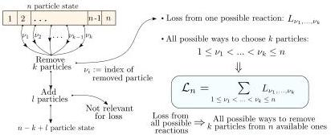
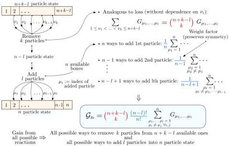
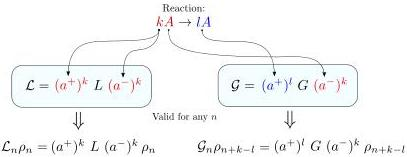

Journal of Mathematical Physics

[Non-Text]

AIP

Publishing

RESEARCH ARTICLE | JANUARY 20 2023

# Chemical diffusion master equation: Formulations of reaction–diffusion processes on the molecular level

Special Collection: Cascades of Scales: Applications and Mathematical Methodologies

Mauricio J. del Razo 📧 iD ; Stefanie Winkelmann 📧 iD ; Rupert Klein iD ; Felix Höfling iD

Check for updates

J. Math. Phys. 64, 013304 (2023)

https://doi.org/10.1063/5.0129620

View Online

Export Citation

## Articles You May Be Interested In

Novel dissipative properties of the master equation

J. Math. Phys. (October 2016)

Diffusion equations from master equations—A discrete geometric approach

J. Math. Phys. (November 2020)

The Markov process admits a consistent steady-state thermodynamic formalism

J. Math. Phys. (January 2018)

AIP Publishing

## Special Topics Open for Submissions

Learn More

14 November 2020 21:31:15

Journal of Mathematical Physics

ARTICLE

scitation.org/journal/jmp

# Chemical diffusion master equation: Formulations of reaction-diffusion processes on the molecular level

Cite as: J. Math. Phys. 64, 013304 (2023); doi: 10.1063/5.0129620

Submitted: 6 October 2022 • Accepted: 2 January 2023 •

Published Online: 20 January 2023

View Online

Export Citation

CrossMark

Mauricio J. del Razo,\(^{1,2,a)}\) Stefanie Winkelmann,\(^{3,a)}\) Rupert Klein,\(^{1}\) and Felix Höfling\(^{1,3}\)

## AFFILIATIONS

\( ^{1} \) Department of Mathematics and Computer Science, Freie Universität Berlin, Berlin, Germany
\( ^{2} \) Dutch Institute for Emergent Phenomena, 1090GL Amsterdam, The Netherlands
\( ^{3} \) Zuse Institute Berlin, Takustr. 7, 14195 Berlin, Germany

Note: Paper published as part of the Special Topic on Cascades of Scales: Applications and Mathematical Methodologies.

a) Authors to whom correspondence should be addressed: m.delrazo@fu-berlin.de and winkelmann@zib.de

## ABSTRACT

The chemical diffusion master equation (CDME) describes the probabilistic dynamics of reaction–diffusion systems at the molecular level [del Razo et al., Lett. Math. Phys. 112, 49 (2022)]; it can be considered as the master equation for reaction–diffusion processes. The CDME consists of an infinite ordered family of Fokker–Planck equations, where each level of the ordered family corresponds to a certain number of particles and each particle represents a molecule. The equations at each level describe the spatial diffusion of the corresponding set of particles, and they are coupled to each other via reaction operators—linear operators representing chemical reactions. These operators change the number of particles in the system and, thus, transport probability between different levels in the family. In this work, we present three approaches to formulate the CDME and show the relations between them. We further deduce the non-trivial combinatorial factors contained in the reaction operators, and we elucidate the relation to the original formulation of the CDME, which is based on creation and annihilation operators acting on many-particle probability density functions. Finally, we discuss applications to multiscale simulations of biochemical systems among other future prospects.

© 2023 Author(s). All article content, except where otherwise noted, is licensed under a Creative Commons Attribution (CC BY) license (http://creativecommons.org/licenses/by/4.0/). https://doi.org/10.1063/5.0129620

## I. INTRODUCTION

It is a well-established paradigm to consider biochemical dynamics as an interplay between the spatial transport (diffusion) of molecules and their chemical kinetics (reaction), both of which are inherently stochastic. There exist different approaches for modeling and mathematically formalizing such reaction–diffusion processes, ranging from reaction–diffusion master equations, \( ^{1-5} \)  where spatial transport is modeled by diffusive jumps between local compartments, to concentration-based approaches, such as deterministic \( ^{6-9} \)  or stochastic partial differential equations \( ^{10} \)  and partial integro-differential equations. \( ^{11} \)  The preceding modeling approaches may be regarded as approximations or limiting cases of particle-based reaction–diffusion (PBRD) models, which explicitly resolve the diffusive trajectories of individual particles in space and time, as well as reactions between them. In the standard PBRD models, particles move freely in space following Brownian motion, or any other form of diffusion process, \( ^{12,13} \)  and can undergo chemical reactions, which involve one, two, or more reactants in such a way that the reaction rate can depend on the positions or relative positions between the reactants. \( ^{14,15} \)  Because of their high complexity, PBRD systems are mostly studied numerically by means of Monte Carlo simulations of the underlying stochastic reaction–diffusion process.

The mathematical formalization and analysis of PBRD models, however, are difficult because reactions constantly change the number of particles of each species, changing the dimension and composition of the system. Recent work presents a probabilistic framework and the characteristic evolution equation for PBRD termed chemical diffusion master equation (CDME). \( ^{16} \)  The CDME consists of an infinite ordered family of Fokker–Planck equations (i.e., an enumerated collection), where each equation corresponds to a certain number of particles

J. Math. Phys. 64, 013304 (2023); doi: 10.1063/5.0129620

© Author(s) 2023

64, 013304-1

14 November 2026 21:31:15

Journal of Mathematical Physics

ARTICLE

scitation.org/journal/jmp

\(n = 0,1,2,\ldots\). The equations, for each fixed \(n\), describe the spatial diffusion for the corresponding \(n\)-particle probability distribution, and they are coupled via reaction operators that express the changes in the system's state due to chemical reactions. These operators change the number of particles in the system, and thus, they can be conveniently expressed in terms of creation and annihilation operators,\(^{16}\) following a classical analog of the quantum mechanical Fock space concept.\(^{17-18}\) First steps toward solving the CDME analytically by means of the Malliavin calculus were taken recently.\(^{19}\) A more comprehensive introduction on the topic can be found in Ref. 16.

In this work, we explore the CDME from several perspectives and present three approaches to motivate and formulate it. This work not only improves our understanding of how to formulate the CDME but also provides a more illustrative and accessible approach to practitioners than the original work. \( ^{16} \)  In general, the CDME is composed of a diffusion operator and several reaction operators (one for each included reaction), all of them acting on a symmetric many-particle distribution function. In analogy to the well-known chemical master equation, \( ^{20-23} \)  which characterizes spatially well-mixed stochastic reaction kinetics, each reaction operator consists of a loss term describing the probabilistic outflow from a given configuration state by the reaction and a gain term that captures the probabilistic inflow from other configuration states due to the reaction. The crucial part is to determine these loss and gain operators for different types of reactions in the absence of a spatially well-mixed setting; examples are binding and unbinding, creation and degradation, and mutual annihilation. Here, non-trivial combinatorial factors enter for preserving symmetry and normalization of the many-particle distribution functions under time evolution. The local rate function, which defines the probability per unit of time for a reaction to take place depending on the spatial positions of its reactants and products, has to be transformed into an expression that takes the whole system state into account. This issue is addressed via the following three approaches:

1. We use the local rate functions to specify also the loss and gain operators on a local scale (acting on subsets of reactants and products) and then combine them into global operators taking all combinations of reacting subgroups into account. The combinatorial factors included in the operators are motivated by an inductive argument. The CDME may then directly be expressed in terms of these global loss and gain operators (Sec. II).
2. The global loss and gain operators are expressed in terms of many-particle propensity functions, which define the probability per unit of time for a reaction to occur as a function of the whole system state. We explicitly derive these many-particle propensity functions from the given local rate functions using permutations and Dirac \(\delta\)-distributions. For the exemplary settings of decay and binding, it will be shown that the resulting CDME agrees with the one of the first approach (Sec. III).
3. The operators in the CDME are expressed as expansions in terms of creation and annihilation operators as in Ref. 16. These expansions can be condensed in a compact notation that allows us to write the CDME, for a given system of reactions, in a simple, fast, and straightforward manner. The combinatorial factors do not appear explicitly; instead, they are naturally encoded in the creation and annihilation operators (Sec. IV). A dictionary specifying the relation between the compact notation for the expansions and the concrete algebraic expressions in the classical representation is provided in the Appendix.

In all three approaches, we start with a simplified setting containing only one molecular species, which drastically simplifies the notation, and then generalize to reactions involving several species, such as complex formation and general association reactions.

## II. THE CHEMICAL DIFFUSION MASTER EQUATION: AN INTUITIVE FORMULATION

We consider an open system of a varying number of diffusing particles of the same chemical species in a finite space domain \(\mathbb{X} \in \mathbb{R}^d\). The diffusion process changes the spatial configuration of the particles, while the reaction process can change the number of particles in the system. The configuration of the system is thus given by the numbers of particles and their positions. The probability distribution of such a system is given as an ordered family of probability density functions,

\[
\rho = \left(\rho_ {0}, \rho_ {1}, \rho_ {2}, \dots , \rho_ {n}, \dots\right), \tag {1}
\]

where \(\rho_{n}(x^{(n)})\) is the probability density of finding \(n\) particles at the positions \(x^{(n)} = (x_1^{(n)},\dots ,x_n^{(n)})\) for \(n\geqslant 1\), while \(\rho_0\) is the probability for no particles being present. As the particles are statistically indistinguishable from each other, the densities must be symmetric with respect to permutations of particle labels, e.g., \(\rho_{2}(y,z) = \rho_{2}(z,y)\) for all \(y,z\in \mathbb{X}\), and more generally,

\[
\rho_ {n} \left(x ^ {(n)}\right) = \rho_ {n} \left(P x ^ {(n)}\right) \quad \text { for   all } P \in \mathcal {P} _ {n}, \tag {2}
\]

where \(\mathcal{P}_n\) is the set of all permutations of an \(n\)-tuple. The normalization condition is

\[
\rho_ {0} + \sum_ {n = 1} ^ {\infty} \int_ {\mathbb {R} ^ {n}} \rho_ {n} (x ^ {(n)}) d x ^ {(n)} = 1. \tag {3}
\]

In general,  \( \rho \)  will also depend on time,  \( \rho_{n} = \rho_{n}(t, x^{(n)}) \) , but we will omit t for simplicity. As a remark, the distribution  \( \rho \)  is an element of a linear function space similar to the Fock space of quantum mechanics; see Refs. 16–18 and Sec. IV.

J. Math. Phys. 64, 013304 (2023); doi: 10.1063/5.0129620

© Author(s) 2023

64, 013304-2

14 November 2026 21:31:15

Journal of Mathematical Physics

ARTICLE

scitation.org/journal/jmp

Given that there are \(M \in \mathbb{N}\) reactions, the CDME has the general form

\[
\frac {\partial \rho}{\partial t} = \left(\mathcal {D} + \sum_ {r = 1} ^ {M} \mathcal {R} ^ {(r)}\right) \rho \tag {4}
\]

for a diffusion operator \(\mathcal{D}\) and reaction operators \(\mathcal{R}^{(r)}\). Each of the reaction operators \(\mathcal{R}^{(r)}\) corresponds to one possible reaction, and it is conveniently split into loss and gain operators,

\[
\mathcal {R} ^ {(r)} = \mathcal {G} ^ {(r)} - \mathcal {L} ^ {(r)}, \tag {5}
\]

similarly; the reaction operator in Ref. 16 was split into a particle conserving part (the loss operator) and a non-conserving part (the gain operator), In the following, we will construct these loss and gain operators at first for reactions of a single species and then for a multi-species scenario. In each case, we consider a system with only one reaction such that the index \( r \) can be skipped. For systems with several reactions, the results may simply be combined by summing up these operators as in Eq. (4).

### A. One species

To start with, we assume that there is only one chemical species \( A \). The most general reaction in this case is of the form

\[
k A \rightarrow l A \tag {6}
\]

for \( k, l \in \mathbb{N}_0 \). The rate at which a reaction event occurs is given by \( \lambda(y^{(l)}; x^{(k)}) > 0 \), and it depends on the positions \( x^{(k)} \in \mathbb{X}^k \) of the reactants and the positions \( y^{(l)} \in \mathbb{X}^l \) of the products. Note that the rate function \( \lambda \) should be symmetric with respect to pair exchanges in both of its arguments.

We can now write the nth component of the CDME as

\[
\frac {\partial \rho_ {n}}{\partial t} = \mathcal {D} _ {n} \rho_ {n} + \mathcal {G} _ {n} \rho_ {n + k - l} - \mathcal {L} _ {n} \rho_ {n} \tag {7}
\]

for appropriate operators \(\mathcal{D}_n, \mathcal{G}_n\), and \(\mathcal{L}_n\) referring to diffusion, gain, and loss, respectively. Note that in Ref. 16, the loss operator is denoted by \(\mathcal{R}^{(k)}\) and the gain operator by \(\mathcal{R}^{(k,l)}\); however, we find the new notation less cumbersome. Reactions at the \(n\)-particle state produce a transition to the \((n - k + l)\)-particle state. Thus, the loss of probability for the \(n\)-particle state \(\rho_n\) depends only on itself. Similarly, reactions at the \((n + k - l)\)-particle state produce a transition to the \(\rho_n\) state. Thus, the gain of probability for the \(n\)-particle state depends on \(\rho_{n + k - l}\).

For physically non-interacting particles, the diffusion operator \(\mathcal{D}_n\) can be expressed in terms of the one-particle diffusion \(D_{\nu}\) applied to the \(v\)th particle,

\[
\mathcal {D} _ {n} = \sum_ {\nu = 1} ^ {n} D _ {\nu}, \tag {8}
\]

where  \( D_{\nu} \)  is the infinitesimal generator of the one-particle Fokker–Planck equation. For example, one may think of  \( D_{\nu} \)  as something as simple as the d-dimensional Laplacian,  \( D_{\nu} = \nabla_{x_{\nu}}^{2} \) . Ignoring the reaction operators and assuming that there is no exchange of particles with a reservoir outside of X, \( ^{24} \)  all the resulting equations are uncoupled and one obtains a family of uncoupled Fokker–Planck equations unless there is an exchange of particles with the world outside of X, in which case one ends up again with a similar family of many-particle densities, albeit with a different structure of the coupling between its levels. \( ^{25} \)  For simplicity of the exposition, we assume reflecting boundaries for X from here on, i.e., a confinement by rigid walls.

The loss operator acting on the \(n\)-particle density will output the total rate of probability loss of \(\rho_{n}\) due to all possible combinations of reactants. It is given in terms of the loss per reaction \(L_{\nu_1,\dots,\nu_k}\) (local loss), which acts on \(k\) particles at a time, with \((\nu_1,\dots,\nu_k)\) denoting the indices of the particles that it acts on. The loss per reaction quantifies how much probability is lost to the current state due to one reaction; it is thus the integral over the density and the rate function \(\lambda\) over all the possible positions of the products,

\[
\left(L _ {\nu_ {1}, \dots , \nu_ {k}} \rho_ {n}\right) \left(x ^ {(n)}\right) = \rho_ {n} \left(x ^ {(n)}\right) \int_ {\mathbb {X} ^ {l}} \lambda \left(y ^ {(l)}; x _ {\nu_ {1}, \dots , \nu_ {k}} ^ {(n)}\right) d y ^ {(l)}, \tag {9}
\]

where  \( x_{\nu_{1},\ldots,\nu_{k}}^{(n)} := (x_{\nu_{1}}^{(n)}, \ldots, x_{\nu_{k}}^{(n)}) \) . The total loss is then the sum of the loss per reaction over all possible reactions,

\[
\mathcal {L} _ {n} = \sum_ {1 \leqslant \nu_ {1} <   \dots <   \nu_ {k} \leqslant n} L _ {\nu_ {1}, \dots , \nu_ {k}}. \tag {10}
\]

The form of the ordered sum guarantees that we count all the possible ways of picking up \( k \) particles without double counting; see Fig. 1 for a diagram of the calculation. For the special case of \( k = 0 \), we have

\[
\left(\mathcal {L} _ {n} \rho_ {n}\right) \left(x ^ {(n)}\right) = \rho_ {n} \left(x ^ {(n)}\right) \int_ {\mathbb {X} ^ {l}} \lambda \left(y ^ {(l)}\right) d y ^ {(l)}. \tag {11}
\]

J. Math. Phys. 64, 013304 (2023); doi: 10.1063/5.0129620

© Author(s) 2023

64, 013304-3

14 November 2026 21:31:15

Journal of Mathematical Physics

ARTICLE

scitation.org/journal/jmp

FIG. 1. Diagram representing the loss of probability from the \(n\)-particle state due to the reaction \(kA \rightarrow lA\) [Eq. (10)]. The particle states are represented by a set of boxes, where each box corresponds to the index of a particle.

Similarly, the gain operator acting on the n-particle density will output the total rate of probability gain of  \( \rho_{n} \) . It can be expressed in terms of the gain per reaction (local gain) resulting from k reacting particles with indices  \( (\nu_{1},\ldots,\nu_{k}) \)  producing l products with indices  \( (\mu_{1},\ldots,\mu_{l}) \) , termed  \( G_{\mu_{1},\ldots,\mu_{l}} \) . The gain per reaction quantifies how much probability is gained by the current state due to one reaction; it is thus the integral over the density and the rate function  \( \lambda \)  over all the possible positions of the reactants,

\[
\left(G _ {\mu_ {1}, \dots , \mu_ {l}} \rho_ {n + k - l}\right) \left(x ^ {(n)}\right) = \int_ {\mathbb {R} ^ {n}} \lambda \left(x _ {\mu_ {1}, \dots , \mu_ {l}} ^ {(n)}; z ^ {(k)}\right) \rho_ {n + k - l} \left(x _ {\backslash \{\mu_ {1}, \dots , \mu_ {l} \}} ^ {(n)}, z ^ {(k)}\right) d z ^ {(k)}, \tag {12}
\]

where the subscript  \( \backslash\{\mu_{1},\ldots,\mu_{l}\} \)  means that the entries with indices  \( \mu_{1},\ldots,\mu_{l} \)  are excluded from the tuple  \( x^{(n)} \)  of particle positions. Note that the indices of the reacting particles  \( v_{1},\ldots,v_{k} \)  are not relevant for the gain since the reactants' positions are integrated out (and both the density and the rate function are symmetric). The total gain is then the sum of the gain per reaction over all possible reactions,

\[
\mathcal {G} _ {n} = \frac {(n - l) !}{n !} \binom {n + k - l} {k} \sum_ {\substack {\mu_ {1}, \dots \mu_ {l} = 1 \\ \mu_ {i} = \mu_ {l} \forall i, j}} ^ {n} G _ {\mu_ {1}, \dots , \mu_ {l}} \tag{13a}
\]

\[
= \binom {n} {l} ^ {- 1} \binom {n + k - l} {k} \sum_ {1 \leqslant \mu_ {1} <   \dots <   \mu_ {l} \leqslant n} G _ {\mu_ {1}, \dots , \mu_ {l}}, \tag {13b}
\]

where we used the symmetry of \( G_{\mu_1, \ldots, \mu_l} \) with respect to the indices. The complicated form of the gain operator is due to the fact that it needs to consider all the possible ways to pick up \( k \) particles from the \( (n + k - l) \)-particle state, just as the loss operator, but, in addition, it also needs to consider all the possible ways of incorporating \( l \) particles into the current state in a symmetry-preserving manner; see Fig. 2 for a diagram illustrating the calculation. Note that the output of the loss and gain operators is also symmetric.

Let us use the preceding formulas for general reactions involving one species to derive the CDME for some common reactions [for simplicity, we write \(\rho_{n}(x^{n},t)\) as \(\rho_{n}(x^{n})\)]:

- Degradation \( A \to \emptyset \): This case is recovered with \( k = 1, l = 0 \) using the rate function \( \lambda_d(x) = \lambda_d(; x) \). The CDME reads

\[
\frac {\partial \rho_ {n}}{\partial t} (x ^ {n}) = \sum_ {v = 1} ^ {n} D _ {v} \rho_ {n} (x ^ {n}) + (n + 1) \int_ {\mathbb {R}} \lambda_ {d} (z) \rho_ {n + 1} (x ^ {(n)}, z) d z - \rho_ {n} (x ^ {(n)}) \sum_ {v = 1} ^ {n} \lambda_ {d} (x _ {v} ^ {(n)}). \tag {14}
\]

- Creation \(\emptyset \to A\): Here, we set \(k = 0\), \(l = 1\) using the rate function \(\lambda_c(y) = \lambda_c(y_i)\); then, the CDME is

\[
\frac {\partial \rho_ {n}}{\partial t} (x ^ {n}) = \sum_ {v = 1} ^ {n} D _ {v} \rho_ {n} (x ^ {n}) + \frac {1}{n} \sum_ {\mu = 1} ^ {n} \rho_ {n - 1} \left(x _ {\backslash \{\mu \}} ^ {(n)}\right) \lambda_ {c} (x _ {\mu} ^ {(n)}) - \rho_ {n} (x ^ {(n)}) \int_ {\mathbb {R}} \lambda_ {c} (y) d y. \tag {15}
\]

- Mutual annihilation \( A + A \to \emptyset \): In this case, we have \( k = 2 \), \( l = 0 \) with the rate function \( \lambda_a(x_1, x_2) = \lambda_a(; x_1, x_2) \). Then,

\[
\begin{array}{l} \frac {\partial \rho_ {n}}{\partial t} (x ^ {n}) = \sum_ {v = 1} ^ {n} D _ {v} \rho_ {n} (x ^ {n}) + \frac {(n + 2) (n + 1)}{2} \int_ {\mathbb {R} ^ {2}} \lambda_ {a} (z _ {1}, z _ {2}) \rho_ {n + 2} (x ^ {(n)}, z _ {1}, z _ {2}) d z _ {1} d z _ {2} \\ - \rho_ {n} (x ^ {(n)}) \sum_ {1 \leqslant v _ {1} <   v _ {2} \leqslant n} \lambda_ {a} (x _ {v _ {1}} ^ {(n)}, x _ {v _ {2}} ^ {(n)}). \tag {16} \\ \end{array}
\]

J. Math. Phys. 64, 013304 (2023); doi: 10.1063/5.0129620

64, 013304-4

© Author(s) 2023

14 November 2026 21:31:15

Journal of Mathematical Physics

ARTICLE

scitation.org/journal/jmp

FIG. 2. Diagram representing the gain of probability for the n-particle state for the reaction  \( kA \rightarrow lA \)  [Eq. (10)]. The particle states are represented by a set of boxes, where each box corresponds to the index of a particle. The final expression can be further simplified; see Eq. (13b).

- Trimolecular reaction: \(3A \to 2A\): Here, \(k = 3\), \(l = 2\), and the rate function is \(\lambda(y^{(2)}; x^{(3)})\); then,

\[
\begin{array}{l} \frac {\partial \rho_ {n}}{\partial t} (x ^ {n}) = \sum_ {v = 1} ^ {n} D _ {v} \rho_ {n} (x ^ {n}) + \frac {n + 1}{3} \sum_ {1 \leqslant \mu_ {1} <   \mu_ {2} \leqslant n} \int_ {\mathbb {R} ^ {3}} \lambda (y ^ {(2)}; z ^ {(3)}) \rho_ {n + 1} (x _ {\backslash (\mu_ {1} \cdot \mu_ {2})} ^ {(n)}, z ^ {(3)}) d z ^ {(3)} \\ - \rho_ {n} (x ^ {(n)}) \sum_ {1 \leqslant v _ {1} <   v _ {2} <   v _ {3} \leqslant n} \int_ {\mathbb {R} ^ {3}} \lambda (y ^ {(2)}; x _ {v _ {1}} ^ {(n)}, x _ {v _ {2}} ^ {(n)}, x _ {v _ {3}} ^ {(n)}) d y ^ {(2)}. \tag {17} \\ \end{array}
\]

Several reactions: Given a system with several reactions of the form \( k_rA \to l_rA \) for different \( k_r, l_r \in \mathbb{N}_0, r = 1, \ldots, M \), the \( n \)th component of the CDME is given by a sum of the form

\[
\frac {\partial \rho_ {n}}{\partial t} = \mathcal {D} _ {n} \rho_ {n} + \sum_ {r = 1} ^ {M} \left(\mathcal {G} _ {n} ^ {(r)} \rho_ {n + k _ {r} - l _ {r}} - \mathcal {L} _ {n} ^ {(r)} \rho_ {n}\right) \tag {18}
\]

with accordingly defined operators  \( \mathcal{G}_{n}^{(r)} \)  and  \( \mathcal{L}_{n}^{(r)} \) . Special cases of this type of equation were proposed earlier in the context of pattern formation \( ^{26,27} \)  as models for adsorption/desorption processes and for the dynamics of agents with internal states; these dynamics can be interpreted as reactions of orders 0 and 1 (creation, degradation, and unimolecular reactions, respectively).

As one can see from the expressions above, the explicit formulation of the loss and gain operators can become quite complex due to the combinatorics. This issue worsens when several species are involved. Thus, it appears convenient to have a formalism where the combinatorial factors are intrinsically built-in, \( ^{16} \)  and we will present such an approach in Sec. IV. Beforehand, we will explore one example with multiple species and an alternative explicit representation of the CDME.

### B. Multiple species

Consider the reaction

\[
A + B \rightarrow C \tag {19}
\]

with rate function \(\lambda(y; x_A, x_B)\), where \(x_A\) and \(x_B\) are the locations of one pair of reactants and \(y\) is the location of the product. The stochastic dynamics of the system is described in terms of the distributions \(\rho_{a,b,c}\left(x^{(a)}, x^{(b)}, x^{(c)}\right)\), where \(a, b, c\) indicate the numbers of \(A\), \(B\), and \(C\)

J. Math. Phys. 64, 013304 (2023); doi: 10.1063/5.0129620

64, 013304-5

© Author(s) 2023

14 November 2026 21:31:15

Journal of Mathematical Physics

ARTICLE

scitation.org/journal/jmp

particles, respectively, and $x^{(a)}$ indicates the positions of the $A$ particles, $x^{(b)}$ indicates the positions of the $B$ particles, and $x^{(c)}$ indicates the positions of the $C$ particles. The normalization condition [Eq. (3)] generalizes to

$$\sum_{a,b,c=0}^{\infty} \int_{\mathbb{X}^a \times \mathbb{X}^b \times \mathbb{X}^c} \rho_{a,b,c} \left( x^{(a)}, x^{(b)}, x^{(c)} \right) dx^{(a)} \, dx^{(b)} \, dx^{(c)} = 1. \tag{20}$$

The CDME for this reaction has the same structure as before, namely, $\partial\rho/\partial t = \mathcal{D}\rho + \mathcal{R}\rho$ for a diffusion operator $\mathcal{D}$ and a reaction operator $\mathcal{R}$. Writing the equation component-wise and separating the reaction operator into its total loss and gain operators, we obtain

$$\frac{\partial\rho_{a,b,c}}{\partial t} = \mathcal{D}\rho_{a,b,c} + \mathcal{G}_{a,b,c}\rho_{a+1,b+1,c-1} - \mathcal{L}_{a,b}\rho_{a,b,c}. \tag{21}$$

The total loss and gain operators can be written explicitly by defining them per reaction (locally) and applying them to all possible combinations of reactors and products in the corresponding state (globally). Following the same logic as in Fig. 1, the loss operator is given by

$$\mathcal{L}_{a,b} = \sum_{\mu=1}^{a} \sum_{\nu=1}^{b} L_{\mu,\nu} \tag{22}$$

with

$$\left( L_{\mu,\nu} \, \rho_{a,b,c} \right) \left( x^{(a)}, x^{(b)}, x^{(c)} \right) = \rho_{a,b,c} \left( x^{(a)}, x^{(b)}, x^{(c)} \right) \int_{\mathbb{X}} \lambda \left( y; x_{\mu}^{(a)}, x_{\nu}^{(b)} \right) dy. \tag{23}$$

Note that for the loss, the positions of the products are not relevant, so $L_{\mu,\nu}$ just depends on the indices $\mu, \nu$ of the reactants. Moreover, in contrast to Eq. (10), the sum is not ordered since the reaction involves different species. Analogously, we can write the gain, but it is usually more complex since now the location of the products does matter. In analogy to Fig. 2, the gain operator is given by

$$\mathcal{G}_{a,b,c} = \frac{1}{c} \sum_{\xi=1}^{c} \sum_{\mu=1}^{a+1} \sum_{\nu=1}^{b+1} G_{\xi} = (a+1)(b+1) \frac{1}{c} \sum_{\xi=1}^{c} G_{\xi} \tag{24}$$

with

$$\left( G_{\xi} \rho_{a+1,b+1,c-1} \right) \left( x^{(a)}, x^{(b)}, x^{(c)} \right) = \int_{\mathbb{X}^2} \lambda \left( x_{\xi}^{(c)}; z, z' \right) \rho_{a+1,b+1,c-1} \left( \left( x^{(a)}, z \right), \left( x^{(b)}, z' \right), x_{\backslash\{\xi\}}^{(c)} \right) dz \, dz'. \tag{25}$$

Gathering the terms and incorporating the diffusion term in the same way as before for each species, we obtain the CDME,

$$\begin{aligned} \frac{\partial\rho_{a,b,c}}{\partial t} &= \sum_{\mu=1}^{a} D_{\mu}^{A} \rho_{a,b,c} + \sum_{\nu=1}^{b} D_{\nu}^{B} \rho_{a,b,c} + \sum_{\xi=1}^{c} D_{\xi}^{C} \rho_{a,b,c} \\ &+ \frac{(a+1)(b+1)}{c} \sum_{\xi=1}^{c} \int_{\mathbb{X}^2} \lambda \left( x_{\xi}^{(c)}; z, z' \right) \rho_{a+1,b+1,c-1} \left( \left( x^{(a)}, z \right), \left( x^{(b)}, z' \right), x_{\backslash\{\xi\}}^{(c)} \right) dz \, dz' \\ &- \rho_{a,b,c} \left( x^{(a)}, x^{(b)}, x^{(c)} \right) \sum_{\mu=1}^{a} \sum_{\nu=1}^{b} \int_{\mathbb{X}} \lambda \left( y; x_{\mu}^{(a)}, x_{\nu}^{(b)} \right) dy, \end{aligned} \tag{26}$$

where the dependence of $\rho_{a,b,c}$ on the positions $\left( x^{(a)}, x^{(b)}, x^{(c)} \right)$ and time $t$ has been skipped in the first line to simplify notation.

We see again that the main difficulty in writing down the CDME correctly is to come up with expressions that relate the loss and gain operators acting on a subset of particles to the loss and gain operators acting on the whole system. This is expected as the operators need to account for all possible combinations of particles that can undergo a certain reaction.

### III. CDME FORMULATION USING MANY-PARTICLE PROPENSITIES

In this section, we provide another justification of the form of the gain and loss operators (especially of the combinatorial factors) by utilizing permutations and Dirac $\delta$-distributions to mathematically describe the particle selection process and by transforming the local rate function into many-particle propensity functions.

For the simplicity of the notation, we again restrict to the case of only one chemical species as in Sec. II A; a case with multiple species will be discussed in Sec. III B. Given the component-wise formulation [Eq. (18)] of the CDME, we would like to express the gain and loss operators by means of global many-particle propensities, which express the likeliness for a reaction to take place depending on the whole system state. More concretely, given a single reaction of the form $kA \to lA$, we consider for each $n$ the propensity functions $\Lambda_n : \mathbb{X}^{n-k+l} \times \mathbb{X}^n \to [0, \infty)$,

J. Math. Phys. 64, 013304 (2023); doi: 10.1063/5.0129620

64, 013304-6

© Author(s) 2023

14 November 2026 21:31:15

Journal of Mathematical Physics

ARTICLE

scitation.org/journal/jmp

where $\Lambda_{n}(y^{(n-k+l)}; x^{(n)})$ refers to the probability per unit of time that a system with $n$ particles in the ordered positions $x_{1}^{(n)}, \ldots, x_{n}^{(n)}$ gets to be transformed into a system with $n - k + l$ particles in the ordered positions $y_{1}^{(n-k+l)}, \ldots, y_{n-k+l}^{(n-k+l)}$. Reflecting the assumption that particles of a single species are modeled as indistinguishable, the many-particle propensities are required to be symmetric with respect to pair exchanges in both of their arguments.

In terms of the many-particle propensities $\Lambda_{n}$, the loss and gain operators are given by

$$\left(\mathcal{L}_{n}\rho_{n}\right)\left(x^{(n)}\right)=\rho_{n}\left(x^{(n)}\right)\int_{\mathbb{X}^{n-k+l}}\Lambda_{n}\left(y^{(n-k+l)}; x^{(n)}\right)dy^{(n-k+l)},$$ (27a)

$$\left(\mathcal{G}_{n}\rho_{n+k-l}\right)\left(y^{(n)}\right)=\int_{\mathbb{X}^{n+k-l}}\Lambda_{n+k-l}\left(y^{(n)}; x^{(n+k-l)}\right)\rho_{n+k-l}\left(x^{(n+k-l)}\right)dx^{(n+k-l)},$$ (27b)

in analogy to the operators given in Sec. II A. These expressions are symmetry preserving owing to the symmetry properties of the densities and of the propensities. They are probability preserving, too, because taking into account that $\mathcal{L}_{n}\rho_{n}$ is a loss for $\rho_{n}$ while $\mathcal{G}_{n-k+l}\rho_{n}$ is a gain for $\rho_{n-k+l}$, the sum of the changes of the total probability in the $n$- and $n-k+l$-particle spaces due to the considered reaction is

$$\int_{\mathbb{X}^{n}}\left(\mathcal{L}_{n}\rho_{n}\right)\left(x^{(n)}\right)dx^{(n)}-\int_{\mathbb{X}^{n-k+l}}\left(\mathcal{G}_{n-k+l}\rho_{n}\right)\left(y^{(n-k+l)}\right)dy^{(n-k+l)}=0.$$ (28)

If the densities $\rho_{n}$ are symmetric with respect to arbitrary particle permutations initially, the loss and gain operations from Eqs. (27a) and (27b) will preserve this property. Moreover, owing to the way the densities are normalized in Eq. (3), no normalizing combinatorial factors arise in Eqs. (27) and (28); rather, the combinatorics is hidden in the definition of $\Lambda_{n}$. Thus, we conclude that conservation of symmetry and probability is straightforwardly ensured when working with the many-particle propensities $\Lambda_{n}$.

Given a finite number $M$ of reactions of the form $k_{r}A \to l_{r}A$, we denote the propensity functions of the $r$th reaction by $\Lambda_{n}^{(r)}$ and the corresponding loss and gain operators by $\mathcal{L}_{n}^{(r)}$ and $\mathcal{G}_{n}^{(r)}$. Inserting into Eq. (18), we obtain the $n$th component of the CDME in terms of the many-particle propensities $\Lambda_{n}^{(r)}$.

The next step is to derive the concrete form of the many-particle propensity $\Lambda_{n}$ for specific reactions and relate them to the local rate functions $\lambda$. Remember that, in contrast to the propensities $\Lambda_{n}$, the rate functions $\lambda$ define the rate for a reaction taking place solely depending on the positions of reactants and products. More concretely, $\lambda(y^{(l)}, x^{(k)})$ defines the probability per unit of time for $k$ particles located at $x_{1}^{(k)}, \ldots, x_{k}^{(k)}$ to be fully replaced due to the reaction $kA \to lA$ by $l$ particles located at $y_{1}^{(l)}, \ldots, y_{l}^{(l)}$. In contrast, the global many-particle propensities $\Lambda_{n}$ depend on the complete system state before and after the reactions and already contain combinatorial factors and symmetrization. As a first scenario, we consider the example of simple decay.

### A. Many-particle propensity for simple decay

Here, we develop an explicit formula that relates the reaction rate $\lambda_{d}(x)$ of the decay process, see Eq. (14), to the associated many-particle propensity $\Lambda_{n+1}: \mathbb{X}^{n} \times \mathbb{X}^{n+1} \to [0, \infty)$. The following formula captures the essence of the remaining many-particle propensities but does not yet respect the required symmetries and the normalization:

$$\Lambda_{n+1}^{\mathrm{bs}}\left(y^{(n)}, x^{(n+1)}\right)=\sum_{\nu=1}^{n+1}\lambda_{d}\left(x_{\nu}^{(n+1)}\right)\delta^{n}\left(x_{\setminus\{\nu\}}^{(n+1)}-y^{(n)}\right),$$ (29)

where the superscript "bs" stands for "before symmetrization" and $\delta^{n}$ refers to the Dirac distribution in $n$ dimensions; in particular,

$$\delta^{n}\left(x_{\setminus\{\nu\}}^{(n+1)}-y^{(n)}\right)=\prod_{\mu=1}^{\nu-1}\delta\left(x_{\mu}^{(n+1)}-y_{\mu}^{(n)}\right)\prod_{\mu=\nu}^{n}\delta\left(x_{\mu+1}^{(n+1)}-y_{\mu}^{(n)}\right).$$ (30)

The term under the sum in Eq. (29) describes (i) the probability per unit time that the $v$th particle disappears from position $x_{\nu}^{(n+1)}$ and (ii) the fact that the rest of the configuration remains unchanged so that its probability is transferred from $\rho_{n+1}\left(x^{(n+1)}\right)$ to $\rho_{n}\left(x_{1}^{(n+1)}, \ldots, x_{\nu-1}^{(n+1)}, x_{\nu+1}^{(n+1)}, \ldots, x_{n+1}^{(n+1)}\right)$. The summation over $\nu$ accounts for the fact that any of the particles out of configuration $x^{(n+1)}$ might decay.

The properly symmetrized version of Eq. (29) is obtained by averaging over all permutations of the target space configurations $y^{(n)}$, i.e.,

$$\Lambda_{n+1}\left(y^{(n)}, x^{(n+1)}\right)=\frac{1}{n!}\sum_{P \in \mathcal{P}_{n}} \Lambda_{n+1}^{\mathrm{bs}}\left(P y^{(n)}, x^{(n+1)}\right).$$ (31)

Owing to the summation over $\nu$ in Eq. (29), this formula is already symmetric with respect to permutations of the second argument $x^{(n+1)}$. In turn, averaging over the permutations in $\mathcal{P}_{n}$ guarantees that the probability associated with a particle disappearing from the $(n+1)$-particle configuration $x^{(n+1)}$ is distributed symmetrically to that of all equivalent $n$-particle configurations on the receiving end.

J. Math. Phys. 64, 013304 (2023); doi: 10.1063/5.0129620

© Author(s) 2023

64, 013304-7

14 November 2026 21:31:15

Journal of Mathematical Physics

ARTICLE

scitation.org/journal/jmp

Now, the crucial step is to insert the propensities into Eq. (27) and translate the expressions given in Eq. (31) into combinatorial factors. Due to the particle exchange symmetry of $\rho_{n+1}$, the contribution of any of the terms under the sum in Eq. (31) to $(\mathcal{G}_n\rho_{n+1})(y^{(n)})$ from Eq. (27b) obeys [see also Eq. (29)]

$$\begin{array}{l} \int_{\mathbb{X}^{n+1}} \lambda_d \left(x_\nu^{(n+1)}\right) \delta^n \left(x_{\{\nu\}}^{(n+1)} - P y^{(n)}\right) \rho_{n+1} \left(x^{(n+1)}\right) dx^{(n+1)} \\ = \int_{\mathbb{X}} \lambda_d(x) \rho_{n+1} \left(\left(P y^{(n)}\right)_1, \dots, \left(P y^{(n)}\right)_{\nu-1}, x, \left(P y^{(n)}\right)_\nu, \dots, \left(P y^{(n)}\right)_n\right) dx \\ = \int_{\mathbb{X}} \lambda_d(x) \rho_{n+1} \left(P y^{(n)}, x\right) dx = \int_{\mathbb{X}} \lambda_d(x) \rho_{n+1} \left(y^{(n)}, x\right) dx, \end{array} \tag{32}$$

i.e., they are all the same. Summation of this expression over $\nu$ [see Eq. (29)] yields a factor of $(n+1)$, and summation over the $n$-particle permutations $P \in \mathcal{P}_n$ together with the division by $n!$ [see Eq. (31)] ensures that the $(n+1)$-particle probability is distributed symmetrically over the $n$-particle space.

A similar calculation for the loss $(\mathcal{L}_n\rho_n)(x^{(n)})$ reads

$$\rho_n \left(x^{(n)}\right) \lambda_d \left(x_\nu^{(n)}\right) \int_{\mathbb{X}^{n-1}} \delta^{n-1} \left(x_{\{\nu\}}^{(n)} - P y^{(n-1)}\right) dy^{(n-1)} = \rho_n \left(x^{(n)}\right) \lambda_d \left(x_\nu^{(n)}\right) \tag{33}$$

for each permutation $P$ and each index $\nu$, where we translated formula (31) for $\Lambda_{n+1}$ to $\Lambda_n$ by a shift in $n$. Summation over the $n$-particle permutations $P \in \mathcal{P}_n$ cancels the factor $1/n!$. By the summation over $\nu$ and combining with the result for the gain, we obtain the evolution equation for the $n$-particle density under a simple decay process,

$$\partial_t \rho_n \left(x^{(n)}\right) = (n+1) \int_{\mathbb{X}} \lambda_d(y) \rho_{n+1} \left(x^{(n)}, y\right) dy - \rho_n \left(x^{(n)}\right) \sum_{\nu=1}^n \lambda_d \left(x_\nu^{(n)}\right), \tag{34}$$

and this is in line with the reaction terms in Eq. (14).

### B. Many-particle propensity for multiple species

We continue with the scenario of multiple species as described in Sec. II B. Let $\lambda(y; x_A, x_B)$ again denote the conditional probability per unit time that the reaction $A + B \to C$ occurs with a product particle of species $C$ appearing in $y$, given that two reactants $A$ and $B$ reside in $x_A$ and $x_B$, respectively. Then, we are interested in the associated many-particle propensities,

$$\Lambda \left(y^{(a-1)}, y^{(b-1)}, y^{(c+1)}; x^{(a)}, x^{(b)}, x^{(c)}\right), \tag{35}$$

which denotes the transfer of probability density per unit time from $\rho_{a,b,c}$ to $\rho_{a-1,b-1,c+1}$ due to the considered reaction. Note that we have here suppressed subscripts $a, b, c$ on $\Lambda$ to simplify notation.

At first, we define for each tuple of indices $\nu, \mu, \xi$ the propensity

$$\Lambda_{\nu,\mu,\xi} \left(y^{(a-1)}, y^{(b-1)}, y^{(c+1)}; x^{(a)}, x^{(b)}, x^{(c)}\right) = \lambda \left(y_\xi^{(c+1)}; x_\mu^{(a)}, x_\nu^{(b)}\right) \delta^{a-1} \left(x_{\{\mu\}}^{(a)} - y^{(a-1)}\right) \delta^{b-1} \left(x_{\{\nu\}}^{(b)} - y^{(b-1)}\right) \delta^c \left(x^{(c)} - y_{\{\xi\}}^{(c+1)}\right). \tag{36}$$

The interpretation of the expression in Eq. (36) is as follows: Given the reactant and product tuples in the source and target spaces, $\left(x^{(a)}, x^{(b)}, x^{(c)}\right)$ and $\left(y^{(a-1)}, y^{(b-1)}, y^{(c+1)}\right)$, respectively, it assigns the (probability) transfer rate $\lambda(y_\xi^{(c+1)}; x_\mu^{(a)}, x_\nu^{(b)})$ to the reaction occurring between the reactants located at $x_\mu^{(a)}, x_\nu^{(b)}$ and producing a product particle in $y_\xi^{(c+1)}$. The products of $\delta$-distributions make sure that in the transfer, all other particle positions remain those from the source space tuples.

In analogy to Eq. (29), we can now write down the many particle propensity before symmetrization as

$$\Lambda^{\text{br}} \left(y^{(a-1)}, y^{(b-1)}, y^{(c+1)}; x^{(a)}, x^{(b)}, x^{(c)}\right) = \frac{1}{c+1} \sum_{\mu=1}^a \sum_{\nu=1}^b \sum_{\xi=1}^{c+1} \Lambda_{\nu,\mu,\xi} \left(y^{(a-1)}, y^{(b-1)}, y^{(c+1)}; x^{(a)}, x^{(b)}, x^{(c)}\right). \tag{37}$$

The prefactor of $1/(c+1)$ is to be included for the following reason: If $y^{(a-1)}, y^{(b-1)}$ are the same as $x^{(a)}, x^{(b)}$ after the removal of $x_\mu^{(a)}, x_\nu^{(b)}$ and if $y^{(c+1)}$ after the removal of $y_\xi^{(c+1)}$ agrees with $x^{(c)}$, then there are $c+1$ possibilities of augmenting $x^{(c)}$ with the target position $y_\xi^{(c+1)}$ to generate a $(c+1)$-tuple. The probability that out of the reaction of reactants at $x_\mu^{(a)}, x_\nu^{(b)}$ emerges a particle in $y_\xi^{(c+1)}$ must be equi-distributed over these equivalent configurations of $c+1$ product particles to retain the required particle exchange symmetry.

J. Math. Phys. 64, 013304 (2023); doi: 10.1063/5.0129620

© Author(s) 2023

64, 013304-8

14 November 2026 21:31:15

Journal of Mathematical Physics

ARTICLE

scitation.org/journal/jmp

Regarding the symmetrization, we observe that there are \((a - 1)!(b - 1)!(c + 1)!\) equivalent configurations in the target space over which the probability of being transferred to has to be distributed. In analogy to Eq. (31), we obtain

\[
\Lambda \left(y ^ {(a - 1)}, y ^ {(b - 1)}, y ^ {(c + 1)}; x ^ {(a)}, x ^ {(b)}, x ^ {(c)}\right) = \sum_ {P \in \mathcal {P} _ {a - 1}} \sum_ {Q \in \mathcal {P} _ {b - 1}} \sum_ {R \in \mathcal {P} _ {c + 1}} \frac {\Lambda^ {\mathrm{bs}} \left(P y ^ {(a - 1)} , Q y ^ {(b - 1)} , R y ^ {(c + 1)} ; x ^ {(a)} , x ^ {(b)} , x ^ {(c)}\right)}{(a - 1) ! (b - 1) ! (c + 1) !}. \tag {38}
\]

The formula in Eq. (38) is obviously symmetric with respect to the target space configurations by construction. It is also symmetric with respect to the source space configurations because of the summation over all possible pairs of reactant particles in Eq. (37) and the symmetrization over the target space configurations in Eq. (38).

Let us now derive the structure of the loss and gain expressions analogous to those in Eq. (27) for this representation of the many-particle propensity.

#### 1. The loss term \(\mathcal{L}\)

Extending the definition in Eq. (27a) to the two-species reaction and dropping the superscript on \(\mathcal{L}\) as it is clear from the context, we have

\[
\left(\mathcal {L} \rho_ {a, b, c}\right) \left(x ^ {(a)}, x ^ {(b)}, x ^ {(c)}\right) = \rho_ {a, b, c} \left(x ^ {(a)}, x ^ {(b)}, x ^ {(c)}\right) \sum_ {\mu = 1} ^ {a} \sum_ {\nu = 1} ^ {b} \int_ {\mathbb {X}} \lambda \left(y; x _ {\mu} ^ {(a)}, x _ {\nu} ^ {(b)}\right) d y. \tag {39}
\]

To obtain this result, we have used that integration over just one of the terms in the multiple sum over particle indices in Eq. (37) and permutations in Eq. (38) may be summarized as follows: Dropping the prefactors of \(1 / (c + 1)\) and \(\rho_{a,b,c}(x^{(a)},x^{(b)},x^{(c)}) / (a - 1)!\) \((b - 1)!\) \((c + 1)!\) for the moment, we consider only the terms relevant for the integration, i.e.,

\[
\begin{array}{l} \int_ {\mathbb {X} ^ {a - 1} \times \mathbb {X} ^ {b - 1} \times \mathbb {X} ^ {c + 1}} \Lambda_ {\nu , \mu , \xi} \left(P y ^ {(a - 1)}, Q y ^ {(b - 1)}, R y ^ {(c + 1)}; x ^ {(a)}, x ^ {(b)}, x ^ {(c)}\right) d y ^ {(a - 1)} d y ^ {(b - 1)} d y ^ {(c + 1)} \\ = \int_ {\mathbb {X} ^ {a - 1} \times \mathbb {X} ^ {b - 1} \times \mathbb {X} ^ {c + 1}} \Lambda_ {\nu , \mu , \xi} \left(y ^ {(a - 1)}, y ^ {(b - 1)}, y ^ {(c + 1)}; x ^ {(a)}, x ^ {(b)}, x ^ {(c)}\right) d y ^ {(a - 1)} d y ^ {(b - 1)} d y ^ {(c + 1)} \tag {40} \\ = \int_ {\mathbb {X}} \lambda \left(y; x _ {\mu} ^ {(a)}, x _ {\nu} ^ {(b)}\right) d y. \\ \end{array}
\]

Here, the first equality follows by a transformation of the integration variables from the components of \(\left(y^{(a - 1)},y^{(b - 1)},y^{(c + 1)}\right)\) to the components of \(\left(Py^{(a - 1)},Qy^{(b - 1)},Ry^{(c + 1)}\right)\) and relabeling. The second equality follows because all the \(\delta\)-distributions in Eq. (36) will generate unity once upon the integrations over \(y_{i}^{(a - 1)}\) (\(i = 1,\dots ,a - 1\)), \(y_{j}^{(b - 1)}\) (\(j = 1,\dots ,b - 1\)), and \(y_{k}^{(c + 1)}\) (\(k = 1,\dots ,\xi -1,\xi +1,c + 1\)), whereas the integration over \(y = y_{\xi}^{(c + 1)}\) remains non-trivial. Thus, we observe that all these terms are identical for any of the \(c + 1\) terms in the sum over \(\xi\) in Eq. (37) and also for any of the permutations in Eq. (38). Carrying out the summation over the permutations yields a factor of \((a - 1)!(b - 1)!(c + 1)!\), which cancels the denominator in Eq. (38), while summing over \(\xi\) in Eq. (37) cancels the factor of \(1 / (c + 1)\) in that equation. This establishes Eq. (39).

#### 2. The gain term \(\mathcal{G}\)

To calculate the gain operator \(\mathcal{G}\) for the target space, \(\mathbb{X}^a\times \mathbb{X}^b\times \mathbb{X}^c\), of the reaction, we have to compute the expectation of the propensity over the source space, \(\mathbb{X}^{a + 1}\times \mathbb{X}^{b + 1}\times \mathbb{X}^{c - 1}\), in analogy with Eq. (27b). The associated density-weighted integration over \(\left(x^{(a + 1)},x^{(b + 1)},x^{(c - 1)}\right)\) of \(\Lambda_{\nu ,\mu ,\xi}\) in Eq. (36) yields

\[
\begin{array}{l} \int_ {\mathbb {X} ^ {a} \times \mathbb {X} ^ {b} \times \mathbb {X} ^ {c}} \Lambda_ {\nu , \mu , \xi} \left(y ^ {(a - 1)}, y ^ {(b - 1)}, y ^ {(c + 1)}; x ^ {(a)}, x ^ {(b)}, x ^ {(c)}\right) \rho_ {a, b, c} \left(x ^ {(a)}, x ^ {(b)}, x ^ {(c)}\right) d x ^ {(a)} d x ^ {(b)} d x ^ {(c)} \\ = \int_ {\mathbb {X} ^ {b}} \lambda (y _ {\xi} ^ {(c + 1)}; z, z ^ {\prime},) \rho_ {a, b, c} \Big (\Big (y ^ {(a - 1)}, z \Big), \Big (y ^ {(b - 1)}, z ^ {\prime} \Big), y _ {\backslash (\xi)} ^ {(c + 1)} \Big) d z d z ^ {\prime}. \tag {41} \\ \end{array}
\]

Here, we have already used the symmetry properties of \(\rho_{a,b,c}\) to shift the remaining integration variables \(z\) and \(z'\) to the end of the tuples of its first two arguments. These calculations show that the result is again independent of the summation indices \(\mu, \nu\) so that the summation over these indices in Eq. (37) just generates a prefactor of \(ab\). Summation over \(\xi\) guarantees that the configuration \(\left(y^{(a-1)}, y^{(b-1)}, y^{(c+1)}\right)\) receives its appropriate share of probability transfer from all reactions that produce a particle in any of the positions collected in the tuple \(y^{(c+1)}\).

J. Math. Phys. 64, 013304 (2023); doi: 10.1063/5.0129620

64, 013304-9

© Author(s) 2023

14 November 2026 21:31:15

Journal of Mathematical Physics

ARTICLE

scitation.org/journal/jmp

Any permutation of \( y^{(a - 1)} \) or \( y^{(b - 1)} \) will not change the result either owing to the symmetry of \( \rho_{a,b,c} \) in its first two arguments. Therefore, the averaging over these permutations will just cancel the prefactor of \( 1 / (a - 1)!(b - 1)! \) in Eq. (38). After the summation over \( \xi \) in Eq. (37), the resulting expression is also invariant under permutations of \( y^{(c + 1)} \) owing to the symmetry of \( \rho_{a,b,c} \) in its last argument. Thus, the summation over these permutations will just generate a factor of \( (c + 1)! \), canceling the remaining factor in the denominator of Eq. (38). Note, however, that the factor of \( 1 / (c + 1) \) from Eq. (37) is retained in the process.

The result for the gain function reads

\[
\left(\mathcal {G} \rho_ {a, b, c}\right) \left(y ^ {(a - 1)}, y ^ {(b - 1)}, y ^ {(c + 1)}\right) = \frac {a b}{c + 1} \sum_ {\xi = 1} ^ {c + 1} \int_ {\mathbb {X} ^ {2}} \lambda \left(y _ {\xi} ^ {(c + 1)}; z, z ^ {\prime}\right) \rho_ {a, b, c} \left(\left[ y ^ {(a - 1)}, z \right], \left[ y ^ {(b - 1)}, z ^ {\prime} \right], y _ {\backslash \{\xi \}} ^ {(c + 1)}\right) d z d z ^ {\prime}. \tag {42}
\]

After a shift from \((a,b,c)\) to \((a + 1,b + 1,c - 1)\), we obtain an operator that agrees with the mid-term in Eq. (26).

Conservation of the total probability under the loss and gain functions in Eqs. (39) and (42) is guaranteed as we have

\[
\begin{array}{l} \int_ {\mathbb {X} ^ {a} \times \mathbb {X} ^ {b} \times \mathbb {X} ^ {c}} (\mathcal {L} \rho_ {a, b, c}) (x ^ {(a)}, x ^ {(b)}, x ^ {(c)}) d x ^ {(a)} d x ^ {(b)} d x ^ {(c)} \\ = \int_ {\mathbb {X} ^ {a - 1} \times \mathbb {X} ^ {b - 1} \times \mathbb {X} ^ {c + 1}} \left(\mathcal {G} \rho_ {a, b, c}\right) \left(y ^ {(a - 1)}, y ^ {(b - 1)}, y ^ {(c + 1)}\right) d y ^ {(a - 1)} d y ^ {(b - 1)} d y ^ {(c + 1)} (43) \\ = a b \int_ {\mathbb {X} ^ {b}} \lambda (y; z, z ^ {\prime}) \int_ {\mathbb {X} ^ {a - 1} \times \mathbb {X} ^ {b - 1} \times \mathbb {X} ^ {c}} \rho_ {a, b, c} ((\xi , z), (\eta , z ^ {\prime}), \zeta) d \xi d \eta d \zeta d y d z d z ^ {\prime}. (44) \\ \end{array}
\]

Collecting the loss and gain terms and adding the diffusion terms, we obtain again the CDME given by Eq. (26).

In total, we end up with the same equation, but the way to get there is different: In Sec. II, we have expressed the loss and gain operators as sums of local operators (acting on subsets of particles), while here in Sec. III, we have translated the local rate functions into many-particle propensities. In Sec. IV, the combinatorics will be encoded in the annihilation and creation operators, again ending up in the same CDME.

## IV. CDME FORMULATION USING CREATION AND ANNIHILATION OPERATORS

Using creation and annihilation operators as presented in Ref. 16, we can formulate the CDME at once without having to worry about the combinatorial factors. Assuming a system involving only one chemical species, we introduce the creation and annihilation operators acting on an n-particle density  \( \rho_{n} \)  as \( ^{16} \)

\[
\left(a ^ {+} \{w \} \rho_ {n}\right) (x ^ {(n + 1)}) = \frac {1}{n + 1} \sum_ {j = 1} ^ {n + 1} w (x _ {j} ^ {(n + 1)}) \rho_ {n} (x _ {\backslash \{j \}} ^ {(n + 1)}), \tag {45a}
\]

\[
\left(a ^ {-} \{f \} \rho_ {n}\right) (x ^ {(n - 1)}) = n \int_ {\mathbb {X}} f (y) \rho_ {n} \left(x ^ {(n - 1)}, y\right) d y. \tag {45b}
\]

The creation operator \( a^{+}\{w\} \) adds a particle of species \( A \) with distribution \( w \) by multiplying the single-particle density \( w \) with the density \( \rho_{n} \). The resulting density is a function of \( n + 1 \) positions, \( x^{(n + 1)} \), and the sum over \( j \) and the prefactor are required to render the result symmetric with respect to permutations of particle labels. The annihilation operator \( a^{-}\{f\} \) removes a particle at \( x \) with the rate \( f(x) \) by marginalization of the density with the weight function \( f \). As \( \rho_{n} \) is symmetric, we can simply integrate against the last variable. The resulting density is a function of \( x^{(n - 1)} \). As there are \( n \) possible ways to remove a particle, the factor of \( n \) appears in front of the integral. In Ref. 16, it was shown that the creation and annihilation operators satisfy some special properties that are useful for calculations, including the commutation relations,

\[
\left[ a ^ {-} \{f \}, a ^ {+} \{w \} \right] = \langle f, w \rangle , \quad \left[ a ^ {-} \{f \}, a ^ {-} \{g \} \right] = \left[ a ^ {+} \{w \}, a ^ {+} \{\nu \} \right] = 0, \tag {46}
\]

where \(\langle u,v\rangle := \int_{\mathbb{X}}u(x)v(x)dx\) for suitable functions \(u,v\) and \([a,b] := ab - ba\) for operators \(a,b\). Furthermore, the definitions of \(a^{+}\) and \(a^{-}\) extend naturally to the family of \(n\)-particle densities by operating element-wise, e.g., \(a^{+}\{w\} (\rho_{0},\rho_{1},\ldots) = (a^{+}\{w\} \rho_{0},a^{+}\{w\} \rho_{1},\ldots)\).

The following representation of the CDME will be given in terms of a basis \(\langle u_1, u_2, \ldots \rangle\) of the space of single-particle densities. We emphasize that the obtained results are independent of the specific basis chosen although the expansion coefficients will naturally depend on the choice of the basis. For a concrete application, the basis functions can be adapted to the problem and reflect some physical properties, e.g., possible symmetries. We recall that, in quantum mechanics, the common expansions in terms of spherical harmonics and associated polynomials are motivated by the isotropy of atoms. For keeping the presentation concise, we restrict here to square-integrable probability densities, which form the separable Hilbert space \(L^2(\mathbb{X})\), and we require that the basis is orthonormal, i.e., \(\langle u_n, u_\beta \rangle = \delta_{\alpha,\beta}\), where \(\langle \cdot, \cdot \rangle\) denotes the inner product in \(L^2(\mathbb{X})\). More generally, one uses the Banach space \(L^1(\mathbb{X})\) of integrable functions as it was done in Ref. 16. However,

J. Math. Phys. 64, 013304 (2023); doi: 10.1063/5.0129620

64, 013304-10

© Author(s) 2023

14 November 2026 21:31:15

Journal of Mathematical Physics

ARTICLE

scitation.org/journal/jmp

this adds a number of technical issues, and there are no relevant differences in the final expressions. In both cases, the existence of a basis \((u_{1}, u_{2}, \ldots)\) is granted, and in the \(L^{1}(\mathbb{X})\) case, the representations are exact in the sense that every probability density can be expanded in such a basis.

### A. One species

Let us consider again a general one-species reaction  \( kA \rightarrow lA \)  with rate function  \( \lambda(y^{(l)}; x^{(k)}) \) . Under the assumption of independently and identically diffusing particles, following Eq. (8), the diffusion operator  \( D_{n} \)  decomposes into a sum of single-particle diffusions  \( D_{v} \)  applied to the vth particle, which was shown to have an expansion in terms of creation and annihilation operators, \( ^{16} \)

\[
\begin{array}{l} \mathcal {D} _ {n} = \sum_ {\nu = 1} ^ {n} D _ {\nu} \\ = \sum_ {\alpha , \beta} \left\langle u _ {\alpha}, D _ {1} u _ {\beta} \right\rangle a _ {\alpha} ^ {+} a _ {\beta} ^ {-}, \tag {47} \\ \end{array}
\]

where we used the compressed notations  \( a_{\alpha}^{+} := a^{+}\left\{u_{\alpha}\right\} \)  and  \( a_{\beta}^{-} := a^{-}\left\{u_{\beta}\right\} \) . One observes that the expansion in Eq. (47) does not depend explicitly on the particle number n, and thus, formally, it represents the full diffusion operator acting on the whole family  \( \rho = (\rho_{0}, \rho_{1}, \ldots) \) . In the presence of pair interactions between the particles, the diffusion operator is made of two-particle operators, which can be expanded into products  \( a_{\alpha}^{+}a_{\beta}^{+}a_{\gamma}^{+}a_{\delta}^{-} \) ; see Sec. 4.1.2 of Ref. 16. Equation (47) is easily seen for the case n = 1. For an arbitrary single-particle density  \( \rho_{1} \) , we have the basis expansion  \( \rho_{1} = \sum_{\alpha}\langle u_{\alpha}, \rho_{1} \rangle u_{\alpha} \) , and for the action of  \( D_{1} \) , one finds

\[
\mathcal {D} _ {1} \rho_ {1} = \sum_ {\alpha} \left\langle u _ {\alpha}, D _ {1} \rho_ {1} \right\rangle u _ {\alpha} = \sum_ {\alpha \beta} \left\langle u _ {\alpha}, D _ {1} u _ {\beta} \right\rangle \left\langle u _ {\beta}, \rho_ {1} \right\rangle u _ {\alpha}, \tag {48}
\]

which corresponds to Eq. (47) upon verifying that  \( a_{\alpha}^{+}a_{\beta}^{-}\rho_{1}=u_{\alpha}\langle u_{\beta},\rho_{1}\rangle \)  from (45). The general case of an n-particle density  \( \rho_{n} \)  is obtained by noting the representation  \( \rho_{n}=\sum_{\alpha_{1}\in\cdots\in\alpha_{n}}c_{\alpha_{1},\ldots,\alpha_{n}}a_{\alpha_{1}}^{+}\cdots a_{\alpha_{n}}^{+}\rho_{vac} \) , where  \( c_{\alpha_{1},\ldots,\alpha_{n}} \)  are the expansion coefficients and  \( \rho_{vac}=1 \)  denotes the vacuum state (n=0).

We now need to expand the loss and gain operators in the same manner. First, we consider the loss and gain operators per reaction from Eqs. (9) and (12), which are linear operators and are thus fully specified by their action on products of single-particle basis functions,

\[
\left(L \left(u _ {\beta_ {1}} \otimes \dots \otimes u _ {\beta_ {k}}\right)\right) \left(x ^ {(k)}\right) := \left(u _ {\beta_ {1}} \otimes \dots \otimes u _ {\beta_ {k}}\right) \left(x ^ {(k)}\right) \int_ {\mathbb {X} ^ {l}} \lambda \left(y ^ {(l)}; x ^ {(k)}\right) d y ^ {(l)}, \tag {49}
\]

\[
\left(G \left(u _ {\beta_ {1}} \otimes \dots \otimes u _ {\beta_ {k}}\right)\right) \left(y ^ {(l)}\right) := \int_ {\mathbb {X} ^ {k}} \lambda \left(y ^ {(l)}; x ^ {(k)}\right) \left(u _ {\beta_ {1}} \otimes \dots \otimes u _ {\beta_ {k}}\right) \left(x ^ {(k)}\right) d x ^ {(k)}, \tag {50}
\]

with the tensor product  \( v_{1} \otimes \cdots \otimes v_{n} = \bigotimes_{j=1}^{n} v_{j} \)  defined as  \( (v_{1} \otimes \cdots \otimes v_{n})(x^{(n)}) := v_{1}(x_{1}^{(n)}) \cdots v_{n}(x_{n}^{(n)}) \) . One can show that  \( (u_{\alpha_{1}} \otimes \cdots \otimes u_{\alpha_{n}})_{\alpha_{i} \in \mathbb{N}} \)  is a basis of the corresponding tensor space of Hilbert spaces, which is itself a Hilbert space, referred to as a Fock space. Analogous to the diffusion operator, the total loss and gain over all possible reactions from Eqs. (10) and (13) also have expansions in terms of creation and annihilation operators, \( ^{16} \)

\[
\mathcal {L} _ {n} = \frac {1}{k !} \sum_ {\substack {\alpha_ {1}, \dots , \alpha_ {k} \\ \beta_ {1}, \dots , \beta_ {k}}} \left\langle \bigotimes_ {i = 1} ^ {k} u _ {\alpha_ {i}}, L \bigotimes_ {j = 1} ^ {k} u _ {\beta_ {j}} \right\rangle \prod_ {i = 1} ^ {k} a _ {\alpha_ {i}} ^ {+} \prod_ {j = 1} ^ {k} a _ {\beta_ {j}} ^ {-}, \tag{51}
\]

\[
\mathcal {G} _ {n} = \frac {1}{k !} \sum_ {\substack {\alpha_ {1}, \dots , \alpha_ {l} \\ \beta_ {1}, \dots , \beta_ {k}}} \left\langle \bigotimes_ {i = 1} ^ {l} u _ {\alpha_ {i}}, G \bigotimes_ {j = 1} ^ {k} u _ {\beta_ {j}} \right\rangle \prod_ {i = 1} ^ {l} a _ {\alpha_ {i}} ^ {+} \prod_ {j = 1} ^ {k} a _ {\beta_ {j}} ^ {-}. \tag{52}
\]

These expansions seem to be rather involved at first sight, yet they is a key element to develop a straightforward formulation of the CDME even for complex reaction–diffusion networks. The structure of the expressions becomes more transparent by introducing the following short-hand notation. Let  \( \mathrm{a}^{+} = (a^{+}\left\{u_{\alpha}\right\})_{\alpha \in \mathbb{N}} \)  denote the family of creation operators for the basis  \( (u_{\alpha}) \) , and analogously,  \( \mathrm{a}^{-} = (a^{-}\left\{u_{\beta}\right\})_{\beta \in \mathbb{N}} \) . For the coefficients of  \( D_{n} \)  in Eq. (47), we arrange them as  \( \mathrm{D} = (\left\langle u_{\alpha}, Du_{\beta}\right\rangle)_{(\alpha,\beta) \in \mathbb{N}^{l}} \) , which is reminiscent of a tensor of rank 2. The expansion of  \( D_{n} \)  then reads

\[
\mathcal {D} = \mathrm{a} ^ {+} \mathrm{Da} ^ {-}, \tag {53}
\]

where the products between the symbols in upright font face imply full contractions of “tensor” indices  \( \alpha \)  and  \( \beta \) ; see Eq. (47); here, we have dropped the subscript n from  \( D_{n} \)  noting again that the right-hand side holds for any n. For the loss and gain terms, we make use of multi-indices  \( \boldsymbol{\alpha} = (\alpha_{1}, \ldots, \alpha_{k}) \)  and write  \( (\mathrm{a}^{+})^{k} = (a^{+}\left\{u_{\alpha_{1}}\right\} \cdots a^{+}\left\{u_{\alpha_{k}}\right\})_{\boldsymbol{\alpha} \in \mathbb{N}^{k}} \)  and analogously for  \( (\mathrm{a}^{-})^{l} \) . The coefficients of  \( L_{n} \)  in Eq. (51) are denoted

J. Math. Phys. 64, 013304 (2023); doi: 10.1063/5.0129620

64, 013304-11

© Author(s) 2023

14 November 2026 21:31:15

Journal of Mathematical Physics

ARTICLE

scitation.org/journal/jmp

as  \( L = \left( \left\langle u_{\alpha_1} \otimes \cdots \otimes u_{\alpha_k}, Lu_{\beta_1} \otimes \cdots \otimes u_{\beta_k} \right\rangle \right)_{\alpha\beta} \) . With this compact notation, the expansions of the gain and loss operators in Eqs. (51) and (52) take the form (Fig. 3)

\[
\mathcal {L} = \left(\mathrm{a} ^ {+}\right) ^ {k} \mathrm{L} \left(\mathrm{a} ^ {-}\right) ^ {k} \quad \text { and } \quad \mathcal {G} = \left(\mathrm{a} ^ {+}\right) ^ {l} \mathrm{G} \left(\mathrm{a} ^ {-}\right) ^ {k}, \tag {54}
\]

with products implying contractions over multi-indices  \( \alpha \)  and  \( \beta \) ; additionally, we agree that contractions involving several annihilation operators  \( (a^{-})^{k} \)  introduce a factor of  \( k! \) , corresponding to the length of the multi-index  \( \beta \) . Then, the CDME in its compact form is

\[
\frac {\partial \rho}{\partial t} = \left(\mathrm{a} ^ {+} \mathrm{Da} ^ {-} + \left(\mathrm{a} ^ {+}\right) ^ {l} \mathrm{G} \left(\mathrm{a} ^ {-}\right) ^ {k} - \left(\mathrm{a} ^ {+}\right) ^ {k} \mathrm{L} \left(\mathrm{a} ^ {-}\right) ^ {k}\right) \rho . \tag {55}
\]

To recover the explicit form of the equation (as derived in Secs. II and III), one must explicitly evaluate the expressions containing the creation and annihilation operators. To circumvent these often cumbersome calculations, we provide a dictionary of the expansions for common reactions in the Appendix, where we can easily verify that the \( n \)th component of this equation matches that of Eq. (7), where the loss operator always acts on \( \rho_{n} \) and the gain operator acts on \( \rho_{n + k - l} \).

The compact notation has a very intuitive logic behind (Fig. 3): Given the reaction \( kA \to lA \), the loss acts on the \( k \) reactants at once, so it involves \( k \) creation and \( k \) annihilation operators. As the gain depends on both reactants and products, it consists of \( k \) annihilation and \( l \) creation operators. The diffusion operator, as it acts on solely one particle at a time, involves only one annihilation and one creation operator. If diffusion incorporated physical pair interactions, it would act on two particles at a time, so it would involve two creation and two annihilation operators.

### B. Bimolecular reactions

For reaction systems involving multiple species, it is equally easy to obtain the desired equation. We only need to use different creation and annihilation operators for each species. For examples, for the reaction

\[
A + B \rightarrow C, \tag {56}
\]

with rate function \(\lambda(y_C; x_A, x_B)\), where \(x_A\) and \(x_B\) are the locations of the reactants and \(y_C\) is the location of the product, we immediately obtain

\[
\frac {\partial \rho}{\partial t} = \left(a ^ {+} D ^ {A} a ^ {-} + b ^ {+} D ^ {B} b ^ {-} + c ^ {+} D ^ {C} c ^ {-} + c ^ {+} G a ^ {-} b ^ {-} - a ^ {+} b ^ {+} L a ^ {-} b ^ {-}\right) \rho , \tag {57}
\]

where  \( \rho \)  is the family of n-particle densities of the form  \( \rho_{a,b,c}(x^{(a)},x^{(b)},x^{(c)}) \)  for all possible values of the particle numbers a, b, and c. The creation and annihilation operators for each species are denoted by the corresponding lower case letter. The first three terms describe the diffusion of the different species, the fourth term is the total loss due to reactions, and the last term is the total gain. Note that the loss of probability will only depend on the number of reactants of the current state; thus, it only contains operators for the A and B species. On the other hand, the gain will depend on the number of reactants in another state and the products needed to bring the system to the current state. These terms have the following expansions: \( ^{16} \)

\[
\mathrm{a} ^ {+} \mathrm{b} ^ {+} \mathrm{L} \mathrm{a} ^ {-} \mathrm{b} ^ {-} = \frac {1}{2} \sum_ {\substack {a _ {1}, a _ {2} \\ \beta_ {1}, \beta_ {2}}} \left\langle u _ {a _ {1}} \otimes u _ {a _ {2}}, L \left(u _ {\beta_ {1}} \otimes u _ {\beta_ {2}}\right) \right\rangle a ^ {+} \left\{u _ {a _ {1}} \right\} b ^ {+} \left\{u _ {a _ {2}} \right\} a ^ {-} \left\{u _ {\beta_ {1}} \right\} b ^ {-} \left\{u _ {\beta_ {2}} \right\}, \tag{58}
\]

\[
\mathrm{c} ^ {+} \mathrm{Ga} ^ {-} \mathrm{b} ^ {-} = \frac {1}{2} \sum_ {\substack {a, \beta_ {1} \\ \beta_ {1}, \beta_ {2}}} \left\langle u _ {a}, G \left(u _ {\beta_ {1}} \otimes u _ {\beta_ {2}}\right) \right\rangle c ^ {+} \left\{u _ {a} \right\} a ^ {-} \left\{u _ {\beta_ {1}} \right\} b ^ {-} \left\{u _ {\beta_ {2}} \right\}, \tag{59}
\]

FIG. 3. Diagram representing how to write the loss and gain operators for the reaction \( kA \to lA \) in the compact notation using creation and annihilation operators. The operators \( L \) and \( G \) represent the local loss and gain operators; the operators \( \mathcal{L} \) and \( \mathcal{G} \) represent the global loss and gain operators.

J. Math. Phys. 64, 013304 (2023); doi: 10.1063/5.0129620

64, 013304-12

© Author(s) 2023

14 November 2026 21:31:15

Journal of Mathematical Physics

ARTICLE

scitation.org/journal/jmp

recalling the short-hand $a_{u_1}^+ = a^+ \{u_{a_1}\}$, etc. The local loss and gain operators are given in terms of the rate function $\lambda$ as

$$\left(L\left(u_{\beta_1} \otimes u_{\beta_2}\right)\right)\left(x_A, x_B\right) := \left(u_{\beta_1} \otimes u_{\beta_2}\right)\left(x_A, x_B\right) \int_{\mathbb{X}} \lambda\left(y_C; x_A, x_B\right) dy_C, \tag{60}$$

$$\left(G\left(u_{\beta_1} \otimes u_{\beta_2}\right)\right)\left(y_C\right) := \int_{\mathbb{X}^2} \left(u_{\beta_1} \otimes u_{\beta_2}\right)\left(x_A, x_B\right) \lambda\left(y_C; x_A, x_B\right) dx_A dx_B, \tag{61}$$

in analogy to Eqs. (49) and (50).

Using the dictionary of the Appendix, it is straightforward to transform Eq. (57) into the explicit integral notation,

$$\begin{aligned} \frac{\partial \rho_{a,b,c}}{\partial t} &= \sum_{\mu=1}^a D_\mu^A \rho_{a,b,c} + \sum_{\nu=1}^b D_\nu^B \rho_{a,b,c} + \sum_{\xi=1}^c D_\xi^C \rho_{a,b,c} \\ &\quad + \frac{(a+1)(b+1)}{c} \sum_{\xi=1}^c \left( \int_{\mathbb{X}^2} \lambda\left(x_\xi^{(c)}; z, z'\right) \rho_{a+1,b+1,c-1} \left( (x^{(a)}, z), (x^{(b)}, z'), x_{\backslash(\xi)}^{(c)} \right) dz dz' \right) - \rho_{a,b,c} \sum_{\nu_1=1}^a \sum_{\nu_2=1}^b \int_{\mathbb{X}} \lambda\left(y; x_{\nu_1}^{(a)}, x_{\nu_2}^{(b)}\right) dy, \end{aligned} \tag{62}$$

which is the same as Eq. (26).

### C. Enzyme kinetics

Before closing, we develop the CDME for a real-world example, namely, the Michaelis–Menten scheme for enzyme kinetics, which consists of three reactions and involves four species,

$$R_1 : E + S \to C, \tag{63a}$$

$$R_2 : C \to E + S, \tag{63b}$$

$$R_3 : C \to E + P. \tag{63c}$$

The scheme describes an enzyme $E$ that can bind a substrate molecule $S$ to form the complex $C$. This complex can either dissociate again or yield a product $P$ while releasing the original enzyme. The rate functions corresponding to these reactions are $\lambda_1(y_C; x_E, x_S)$, $\lambda_2(y_E, y_S; x_C)$, and $\lambda_3(y_E, y_P; x_C)$, respectively. The CDME is an evolution equation for the family $\rho$ of densities of the form $\rho_{e,s,p,c}(x^{(e)}, x^{(s)}, x^{(p)}, x^{(c)})$ for all possible values of $e, s, p$, and $c$, and it takes the form

$$\frac{\partial \rho}{\partial t} = \mathcal{D}\rho + \left( \sum_{r=1}^S \mathcal{R}^{(r)} \right) \rho \tag{64}$$

with the diffusion and reaction operators

$$\mathcal{D} = e^+ D^E e^- + s^+ D^S s^- + c^+ D^C c^- + p^+ D^P p^-, \tag{65a}$$

$$\mathcal{R}^{(1)} = c^+ G_1 e^- s^- - e^+ s^+ L_1 e^- s^-, \tag{65b}$$

$$\mathcal{R}^{(2)} = e^+ s^+ G_2 c^- - c^+ L_2 c^-, \tag{65c}$$

$$\mathcal{R}^{(3)} = e^+ p^+ G_3 c^- - c^+ L_3 c^-. \tag{65d}$$

The expansions of the operators, as well as the corresponding loss and gain operators for each reaction, are completely analogous to the previous examples. By virtue of the Appendix, we obtain the CDME in its integral notation,

$$\begin{aligned} \frac{\partial \rho_{e,s,p,c}}{\partial t} &= \sum_{\mu=1}^e D_\mu^E \rho_{e,s,p,c} + \sum_{\mu=1}^s D_\mu^S \rho_{e,s,p,c} + \sum_{\mu=1}^p D_\mu^P \rho_{e,s,p,c} + \sum_{\mu=1}^c D_\mu^C \rho_{e,s,p,c} \\ &\quad + \frac{(e+1)(s+1)}{c} \sum_{\xi=1}^c \left( \int_{\mathbb{X}^2} \rho_{e+1,s+1,p,c-1} \left( (x^{(e)}, z), (x^{(s)}, z'), x^{(p)}, x_{\backslash(\xi)}^{(c)} \right) \lambda_1 \left( x_\xi^{(c)}; z, z' \right) dz dz' \right) \\ &\quad + \frac{(c+1)}{es} \sum_{\mu=1}^e \sum_{\eta=1}^s \left( \int_{\mathbb{X}} \rho_{e-1,s-1,p,c+1} \left( x_{\backslash(\mu)}^{(e)}, x_{\backslash(\eta)}^{(s)}, x^{(p)}, (x^{(c)}, z) \right) \lambda_2 \left( x_\mu^{(e)}, x_\eta^{(s)}; z \right) dz \right) \\ &\quad + \frac{(c+1)}{ep} \sum_{\mu=1}^e \sum_{\eta=1}^p \left( \int_{\mathbb{X}} \rho_{e-1,s,p-1,c+1} \left( x_{\backslash(\mu)}^{(e)}, x^{(s)}, x_{\backslash(\eta)}^{(p)}, (x^{(c)}, z) \right) \lambda_3 \left( x_\mu^{(e)}, x_\eta^{(p)}; z \right) dz \right) \\ &\quad - \rho_{e,s,p,c} \left( \sum_{\nu_1=1}^e \sum_{\nu_2=1}^s \int_{\mathbb{X}} \lambda_1(y; x_{\nu_1}^{(e)}, x_{\nu_2}^{(s)}) dy + \sum_{\nu=1}^e \int_{\mathbb{X}^2} \lambda_2(y_1, y_2; x_{\nu}^{(c)}) dy_1 dy_2 + \sum_{\nu=1}^e \int_{\mathbb{X}^2} \lambda_3(y_1, y_3; x_{\nu}^{(c)}) dy_1 dy_3 \right). \end{aligned} \tag{66}$$

J. Math. Phys. 64, 013304 (2023); doi: 10.1063/5.0129620

64, 013304-13

© Author(s) 2023

14 November 2026 21:31:15

Journal of Mathematical Physics

ARTICLE

scitation.org/journal/jmp

### D. Non-rigorous extension to Dirac δ-distributions

According to (45) of the annihilation and creation operators, a particle is inserted with a spatial probability density $w(x)$ and removed with a position-dependent rate function $f(x)$. From a physics perspective, classical particles have a defined position, and so it should be possible to add and delete particles at a single point $y \in \mathbb{X}$ (in this case, $w$ would correspond to a point measure). To this end, we formally extend these operators to accept Dirac $\delta$-distributions as their arguments, ignoring here any mathematical difficulties associated with it. For $\delta_y(x) := \delta(x - y)$, we define

$$\left(a^+\{\delta_y\}\rho_n\right)\left(x^{(n+1)}\right) = \frac{1}{n+1} \sum_{j=1}^{n+1} \delta\left(x_j^{(n+1)} - y\right) \rho_n\left(x_{\backslash\{j\}}^{(n+1)}\right), \tag{67a}$$

$$\left(a^-\{\delta_y\}\rho_n\right)\left(x^{(n-1)}\right) = n \int_{\mathbb{X}} \delta(z-y) \rho_n\left(x^{(n-1)}, z\right) dz = n \rho_n\left(x^{(n-1)}, y\right). \tag{67b}$$

For brevity, we will write $a^+(y) = a^+\{\delta_y\}$ and $a^-(y) = a^-\{\delta_y\}$ in the following. By direct substitution and straightforward calculations analogous to the ones in Ref. 16, one proves that these operators satisfy the commutation relations [see also Eq. (46)],

$$\left[a^-(y_1), a^+(y_2)\right] = \delta(y_1 - y_2), \quad \left[a^-(y_1), a^-(y_2)\right] = \left[a^+(y_1), a^+(y_2)\right] = 0, \tag{68}$$

which agree with the corresponding expressions in quantum field theory.²⁸

In general, for an operator $A$ acting on a single particle at position $y$, such as diffusion, or an operator $B$ acting on two particles at positions $y_1$ and $y_2$, we obtain the following representations of the corresponding Fock space operators [see also Eqs. (60) and (64) in Ref. 16]:

$$\mathcal{A} = \int_{\mathbb{X} \times \mathbb{X}} dx dy \, a^+(x) \, \hat{A}(x; y) \, a^-(y), \tag{69}$$

$$\mathcal{B} = \frac{1}{2!} \int_{\mathbb{X}^2 \times \mathbb{X}^2} dx_1 dx_2 dy_1 dy_2 \, a^+(x_1) a^+(x_2) \, \hat{B}(x_1, x_2; y_1, y_2) \, a^-(y_1) a^-(y_2). \tag{70}$$

As a rule of thumb, given a basis expansion, such as Eq. (47), the functions $u_\alpha$ are replaced by $\delta_{x_\alpha}$, and the sums over $\alpha$ and $\beta$ are replaced by integrals over the continuous variables $x_\alpha$ and $y_\beta$, respectively. The integral kernels $\hat{A}$ and $\hat{B}$ generalize the coefficient matrices and read $\hat{A}(x; y) := \langle \delta_x, A\delta_y \rangle$ and $\hat{B}(x_1, x_2; y_1, y_2) := \langle \delta_{(x_1, x_2)}, B\delta_{(y_1, y_2)} \rangle$, respectively; here, $\delta_{(x_1, \dots, x_k)}(z_1, \dots, z_k) := \delta(x_1 - z_1) \cdots \delta(x_k - z_k)$ denotes the $k$-dimensional Dirac $\delta$-distribution.

In case of a "diagonal" operator, such as the loss operator $L$, the one-particle kernel reduces to $\hat{A}(x; y) = \hat{A}(y) \, \delta(x - y)$ for $\hat{A}(y) := \hat{A}(y, y)$ and Eq. (69) simplifies to [cf. Eq. (24) in Ref. 17]

$$\mathcal{A} = \int_{\mathbb{X}} dy \, a^+(y) \, \hat{A}(y) \, a^-(y). \tag{71}$$

If $A$ is a differential operator (e.g., the diffusion operator $D$), we note that $\hat{A}(x; y)$ has to be interpreted in a distributional sense,

$$\int dy \, \varphi(y) \hat{A}(x; y) = \int dy \, \varphi(y) \, \langle \delta_x, A\delta_y \rangle = \left\langle \delta_x, A\left(\int dy \, \varphi(y) \, \delta_y\right) \right\rangle = \langle \delta_x, A\varphi \rangle = (A\varphi)(x) \tag{72}$$

for suitable test functions $\varphi$.

For the global gain and loss operators of the reaction $kA \to lA$, we apply the same rules, starting from (51) and (52), respectively,

$$\mathcal{L} = \frac{1}{k!} \int_{\mathbb{X}^k \times \mathbb{X}^k} dx^{(k)} dy^{(k)} a^+(x^{(k)}) \, \hat{L}(x^{(k)}; y^{(k)}) \, a^-(y^{(k)}), \tag{73}$$

$$\mathcal{G} = \frac{1}{k!} \int_{\mathbb{X}^l \times \mathbb{X}^k} dx^{(l)} dy^{(k)} a^+(x^{(l)}) \, \hat{G}(x^{(l)}; y^{(k)}) \, a^-(y^{(k)}), \tag{74}$$

where $a^+(x^{(k)}) := a^+(x_1^{(k)}) \cdots a^+(x_k^{(k)})$ yields the insertion of $k$ particles at positions $x^{(k)} = (x_1^{(k)}, \dots, x_k^{(k)})$, and analogously $a^-(x^{(k)})$ for the removal of $k$ particles; we note that the factors in these products commute. The coefficient functions are readily calculated from the definitions of the local loss and gain operators, $L$ and $G$,

$$\hat{L}(x^{(k)}; y^{(k)}) := \langle \delta_{x^{(k)}}, L\delta_{y^{(k)}} \rangle \stackrel{(49)}{=} \delta(x^{(k)} - y^{(k)}) \int_{\mathbb{X}^l} dz^{(l)} \, \lambda(z^{(l)}; y^{(k)}), \tag{75}$$

$$\hat{G}(x^{(l)}; y^{(k)}) := \langle \delta_{x^{(l)}}, G\delta_{y^{(k)}} \rangle \stackrel{(50)}{=} \lambda(x^{(l)}; y^{(k)}). \tag{76}$$

These results together with Eqs. (73) and (74) agree with Doi's work.¹⁷

J. Math. Phys. 64, 013304 (2023); doi: 10.1063/5.0129620

© Author(s) 2023

64, 013304-14

14 November 2026 21:31:15

Journal of Mathematical Physics

ARTICLE

scitation.org/journal/jmp

For the action of products of the creation and annihilation operators, we find from Eq. (67) by induction

$$\begin{array}{l} (a^{+}(y^{(k)})\rho_{n-k})(x^{(n)}) = \left(a^{+}(y_{1}^{(k)})a^{+}(y_{\backslash\{1\}}^{(k)})\rho_{n}\right)(x^{(n)}) \\ = \frac{1}{n}\sum_{j_{1}=1}^{n}\delta(x_{j_{1}}^{(n)}-y_{1}^{(k)})\left(a^{+}(y_{\backslash\{1\}}^{(k)})\rho_{n-k}\right)(x_{\backslash\{j_{1}\}}^{(n)}) \\ = \frac{1}{n(n-1)}\sum_{j_{1}=1}^{n}\sum_{\substack{j_{2}=1 \\ j_{2}=j_{1}}}^{n}\delta(x_{j_{1}}^{(n)}-y_{1}^{(k)})\delta(x_{j_{2}}^{(n)}-y_{2}^{(k)})\left(a^{+}(y_{\backslash\{1,2\}}^{(k)})\rho_{n-k}\right)(x_{\backslash\{j_{1},j_{2}\}}^{(n)}) \\ = \frac{(n-k)!}{n!}\sum_{j_{1}=1}^{n}\cdots\sum_{\substack{j_{k}=1 \\ j_{k}=j_{1},\dots,j_{k-1}}}^{n}\delta(x_{j_{1}}^{(n)}-y_{1}^{(k)})\cdots\delta(x_{j_{k}}^{(n)}-y_{k}^{(k)})\rho_{n-k}(x_{\backslash\{j_{1},\dots,j_{k}\}}^{(n)}) \\ = \frac{k!(n-k)!}{n!}\sum_{1\leqslant j_{1}<\cdots<j_{k}\leqslant n}\delta(x_{j_{1}}^{(n)}-y_{1}^{(k)})\cdots\delta(x_{j_{k}}^{(n)}-y_{k}^{(k)})\rho_{n-k}(x_{\backslash\{j_{1},\dots,j_{k}\}}^{(n)}) \end{array} \tag{77}$$

and, more immediately,

$$(a^{-}(y^{(k)})\rho_{n})(x^{(n-k)}) = \frac{n!}{(n-k)!}\rho_{n}(x^{(n-k)}, y^{(k)}). \tag{78}$$

In combination with Eqs. (73) and (75), these results deliver the explicit form of the loss term of the CDME,

$$\begin{array}{l} (\mathcal{L}\rho_{n})(x^{(n)}) = \frac{1}{k!}\int_{\mathbb{X}'\times\mathbb{X}^{k}}\lambda(z^{(l)};y^{(k)})\left(a^{+}(y^{(k)})a^{-}(y^{(k)})\rho_{n}\right)(x^{(n)})dz^{(l)}dy^{(k)} \\ \stackrel{(77)}{=} \frac{(n-k)!}{n!}\sum_{1\leqslant j_{1}<\cdots<j_{k}\leqslant n}\int_{\mathbb{X}^{l}}\left(\int_{\mathbb{X}^{l}}\lambda(z^{(l)};y^{(k)})dz^{(l)}\right) \\ \quad \times \delta(x_{j_{1}}^{(n)}-q_{1}^{(k)})\cdots\delta(x_{j_{k}}^{(n)}-q_{k}^{(k)})\left(a^{-}(y^{(k)})\rho_{n}\right)(x_{\backslash\{j_{1},\dots,j_{k}\}}^{(n)})dy^{(k)} \\ = \frac{(n-k)!}{n!}\sum_{1\leqslant j_{1}<\cdots<j_{k}\leqslant n}\left(\int_{\mathbb{X}^{l}}\lambda(z^{(l)};x_{j_{1},\dots,j_{k}}^{(n)})dz^{(l)}\right)\left(a^{-}(x_{j_{1},\dots,j_{k}}^{(n)})\rho_{n}\right)(x_{\backslash\{j_{1},\dots,j_{k}\}}^{(n)}) \\ \stackrel{(79)}{=} \sum_{1\leqslant j_{1}<\cdots<j_{k}\leqslant n}\left(\int_{\mathbb{X}^{l}}\lambda(z^{(l)};x_{j_{1},\dots,j_{k}}^{(n)})dz^{(l)}\right)\rho_{n}(x^{(n)}). \end{array} \tag{79}$$

Thereby, we have recovered Eq. (10), showing consistency between this approach and the one introduced in Sec. II. We can repeat this exercise for the gain operator using Eq. (74),

$$\begin{array}{l} (\mathcal{G}\rho_{n+k-l})(x^{(n)}) = \frac{1}{k!}\int_{\mathbb{X}^{l}\times\mathbb{X}^{k}}\lambda(z^{(l)};y^{(k)})\left(a^{+}(z^{(l)})a^{-}(y^{(k)})\rho_{n+k-l}\right)(x^{(n)})dz^{(l)}dy^{(k)} \\ \stackrel{(77)}{=} \frac{l!(n-l)!}{n!k!}\sum_{1\leqslant j_{1}<\cdots<j_{l}\leqslant n}\int_{\mathbb{X}^{l}\times\mathbb{X}^{k}}\lambda(z^{(l)};y^{(k)}) \\ \quad \times \delta(x_{j_{1}}^{(n)}-z_{1}^{(l)})\cdots\delta(x_{j_{l}}^{(n)}-z^{(l)})\left(a^{-}(y^{(k)})\rho_{n+k-l}\right)(x_{\backslash\{j_{1},\dots,j_{l}\}}^{(n)})dz^{(l)}dy^{(k)} \\ = \frac{l!(n-l)!}{n!k!}\sum_{1\leqslant j_{1}<\cdots<j_{l}\leqslant n}\int_{\mathbb{X}^{k}}\lambda(x_{j_{1},\dots,j_{l}}^{(n)};y^{(k)})\left(a^{-}(y^{(k)})\rho_{n+k-l}\right)(x_{\backslash\{j_{1},\dots,j_{l}\}}^{(n)})dy^{(k)} \\ \stackrel{(79)}{=} \frac{l!(n+k-l)!}{n!k!}\sum_{1\leqslant j_{1}<\cdots<j_{l}\leqslant n}\int_{\mathbb{X}^{k}}\lambda(x_{j_{1},\dots,j_{l}}^{(n)};y^{(k)})\rho_{n+k-l}(x_{\backslash\{j_{1},\dots,j_{l}\}}^{(n)},y^{(k)})dy^{(k)} \\ = \binom{n}{l}^{-1}\binom{n+k-l}{k}\sum_{1\leqslant j_{1}<\cdots<j_{l}\leqslant n}\int_{\mathbb{X}^{k}}\lambda(x_{j_{1},\dots,j_{l}}^{(n)};y^{(k)})\rho_{n+k-l}(x_{\backslash\{j_{1},\dots,j_{l}\}}^{(n)},y^{(k)})dy^{(k)}, \end{array} \tag{80}$$

once again, recovering Eq. (13) from Sec. II. The relations in the dictionary from the Appendix are proved in a similar fashion, but using the expansions of Sec. IV as shown in Ref. 16.

J. Math. Phys. 64, 013304 (2023); doi: 10.1063/5.0129620

64, 013304-15

© Author(s) 2023

14 November 2020 21:31:15

Journal of Mathematical Physics

ARTICLE

scitation.org/journal/jmp

We can further obtain a relation between the rate functions and the many-particle propensities by comparing the resulting loss from Eq. (79) with the many particle propensity in Eq. (27a). This relation holds regardless of the density,

$$\int_{\Sigma^{n-k+l}} \Lambda_n(y^{(n-k+l)}; x^{(n)}) dy^{(n-k+l)} = \sum_{1 \leqslant j_1 < \dots < j_k \leqslant n} \int_{\Sigma^j} \lambda(y^{(l)}; x_{j_1, \dots, j_k}^{(n)}) dy^{(l)}. \tag{81}$$

This establishes a connection with Sec. III. We can prove this identity independently by deriving the expressions of the many-particle propensities for the reaction $kA \to lA$.

# V. DISCUSSION

We presented three approaches to formulate the CDME, the governing equation of stochastic particle-based reaction–diffusion dynamics. In general, the CDME consists of a diffusion operator, which describes the spatial transport of particles, and several reaction operators each corresponding to a chemical reaction in the system. Every reaction operator can further be separated into a loss operator and a gain operator for the probabilistic outflow and inflow, respectively.

In the first approach, these global loss and gain operators have been expressed as combinations of local loss and gain operators referring to reactions of subsets of reactants and products within the system. The central combinatorial factors, which come into play due to the particle exchange symmetry for molecules of the same species, have been justified by carefully applying combinatorial arguments for the random selection of subsets of particles out of a larger set. Although this approach is intuitive and relatively straightforward, it requires computing the combinatorial factors of the reaction operators by hand, and it is error-prone when writing the equations for complicated systems.

The second approach (Sec. III) works directly at the many-particle level by focusing on many-particle propensities, leaving the counting/combinatorial details as a secondary task, albeit still a cumbersome one. The global many-particle propensities are derived as explicit expressions (in terms of sums and products) of the local rate functions using permutations and Dirac $\delta$-distributions, which provide a method to select the required particles. One of its main advantages is that, as it works directly with many-particle propensities, it is capable of incorporating crowding effects in a more straightforward manner than the other approaches.

In the third approach (Sec. IV), the operators arise in the form of expansions containing single-particle creation and annihilation operators, which encode the combinatorics of particle selections. This allows us to focus on formulating only the operators per reaction, yielding a fast method to write down the CDME in a compact way for any reaction system, which can be a big advantage from a practical point of view. The resulting equation can be employed to perform analytical calculations, for instance, one can directly apply Galerkin discretizations,$^{16,29}$ opening the door for ready-to-use software libraries for numerical implementation, and to apply methodologies from quantum field theory.$^{14,18}$ In addition, the actions of the operators $a^+$ and $a^-$ have immediate interpretations within the stochastic Malliavin calculus,$^{19}$ which may open a new perspective on the stochastic description of reaction–diffusion systems. However, the compact version of the CDME can appear obscure for practitioners used to more classical formulations in terms of integrals. To mitigate this issue, we added a dictionary (see the Appendix) to translate the short-hand notation for expansions in terms of creation and annihilation operators to concrete algebraic expressions, which explicitly include the combinatorial factors, sums, and integrals. This could be further automatized using a symbolic algebra software. We finally explore a special case using $\delta$-distributions (Sec. IV D), which simplify the original expansions into simple integrals. Although the ease to derive discretizations—as well as some mathematical rigor—is lost, some practitioners might find this approach more suitable.

From a mathematical perspective, the CDME is formulated in terms of density functions. Another question of interest for future research is how to formulate a corresponding equation in terms of probability measures as in Ref. 30. This is of relevance since such a formulation might be more familiar to some mathematicians working on tangential fields, where one requires analogous models to reaction and diffusion, such as social dynamics.$^{31-33}$

One of the main future prospective applications of the CDME is to unify most of the well-known reaction–diffusion models at different scales, establishing the relationships between them and yielding a theoretical and computational framework for multiscale modeling of biochemical reaction systems. For instance, we believe that the well-known models of diffusion-influenced reactions,$^{14,15,34-38}$ as well as recent developments,$^{39-41}$ can be recovered as special cases of the CDME. One can also, in principle, recover the chemical master equation as the well-mixed limit of the CDME. In this limiting case, it has been shown that the classical law of mass action emerges from the large copy number limit.$^{42}$ If the spatial dependence is kept, it has been shown that macroscopic reaction–diffusion models emerge as the large copy number limit of certain particle-based models,$^{9,43,44}$ which can be considered as spatial discretizations of the CDME. This further yields a precise relation between the macroscopic parameters and those at the particle level, allowing for consistent multiscale simulations.$^{9,45}$ In ongoing work, we are aiming at a general derivation of reaction–diffusion PDEs from the corresponding CDME without using an intermediate discrete model. To this end, it is essential to consider the correct combinatorial factors in the loss and gain terms. Another example is given by a recent simulation scheme to couple Markov models of molecular kinetics with particle-based reaction–diffusion simulations,$^{46,47}$ where the root model used to derive the schemes is once again a special case of the CDME. Similarly, in Ref. 48, the authors used a hierarchy of Fokker–Planck equations to model the variable number of ions in an ion channel; a model that we also believe is a special case of the CDME.

J. Math. Phys. 64, 013304 (2023); doi: 10.1063/5.0129620

© Author(s) 2023

64, 013304-16

14 November 2026 21:31:15

Journal of Mathematical Physics

ARTICLE

scitation.org/journal/jmp

All in all, the CDME has the potential to unify a diverse range of reaction–diffusion models at different scales, yielding mathematical relationships that serve as the key ingredient to derive novel hybrid multiscale simulations for biochemical dynamics that capture the cascades of interactions across scales.

# ACKNOWLEDGMENTS

We acknowledge the support from Deutsche Forschungsgemeinschaft (DFG) through the Collaborative Research Center (Grant No. SFB 1114) “Scaling Cascades in Complex Systems,” Project No. 235221301, Sub-Projects C01 and C03, and under Germany’s Excellence Strategy—MATH+: The Berlin Mathematics Research Center (Grant No. EXC-2046/1)—Project No. 390685689 (Subproject AA1-1). M.J.d.R. acknowledges the support from DFG (Grant No. RA 3601/1-1) and from the Dutch Institute for Emergent Phenomena (DIEP) cluster at the University of Amsterdam.

# AUTHOR DECLARATIONS

# Conflict of Interest

The authors have no conflicts to disclose.

# Author Contributions

Mauricio J. del Razo: Conceptualization (equal); Funding acquisition (equal); Investigation (equal); Methodology (equal); Writing – original draft (equal); Writing – review & editing (equal). Stefanie Winkelmann: Conceptualization (equal); Funding acquisition (equal); Investigation (equal); Methodology (equal); Writing – original draft (equal); Writing – review & editing (equal). Rupert Klein: Conceptualization (equal); Funding acquisition (equal); Methodology (equal); Writing – original draft (equal); Writing – review & editing (equal). Felix Höfling: Funding acquisition (equal); Investigation (equal); Methodology (equal); Writing – original draft (equal); Writing – review & editing (equal).

# DATA AVAILABILITY

Data sharing is not applicable to this article as no new data were created or analyzed in this study.

# APPENDIX: EXPANSION DICTIONARY

Although using the notation presented in Sec. IV results in writing the CDME at once, it is not evident to find the connection to the more classical form of the equation. In this appendix, we present a dictionary for the most used cases, where we match the expansions in terms of creation and annihilation operators in the compact notation with their corresponding expressions in an explicit integral form. These expressions, although non-trivial, are straightforward to prove along the lines given in Ref. 16. At first, we present the expansions for the diffusion and then for loss operators, where the form is simpler as compared to the gain terms because it only depends on the reactants. Finally, we proceed with the gain operators. For the purpose of generality, we use the notation $\rho_{\dots}$, with the dots in the subindex indicating the unknown species involved in the reaction, e.g., we write $\rho_{a,b,\dots}(x^{(a)}, x^{(b)}, \dots)$, where the dots represent numbers and positions of other species, respectively.

# 1. Diffusion operators

In the absence of physical interactions, the diffusion operators only act on one particle at a time, so they are the most simple ones,

$$\mathrm{a} ^ {+} \mathrm{D} \mathrm{a} ^ {-} \rho_ {n, \dots} = \sum_ {\nu = 1} ^ {n} D _ {\nu} \rho_ {n, \dots}. \tag {A1}$$

# 2. Loss operators

For the loss operators, only the reactants are relevant, while the products just determine the variables of integration. Thus, we denote the positions of the $l$ products by $y^{(l)}$, regardless of their species.

(i) Reactions of the form $\emptyset \to (l \text{ products})$. The reaction rate function is given by $\lambda(y^{(l)};)$. Here, we leave the semicolon inside the rate function in order to emphasize that there are no reactants. The expression is simply given by

$$1 \mathrm{L} 1 \rho_ {\dots} = \rho_ {\dots} \int_ {\Sigma^ {l}} \lambda (y ^ {(l)};) d y ^ {(l)}. \tag {A2}$$

J. Math. Phys. 64, 013304 (2023); doi: 10.1063/5.0129620

© Author(s) 2023

64, 013304-17

14 November 2026 21:31:15

Journal of Mathematical Physics

ARTICLE

scitation.org/journal/jmp

(ii) Reactions of the form $A \to (l \text{ products})$. The reaction rate function is given by $\lambda(y^{(l)}; x)$. Let the number of $A$-particles be $n$, and denote by $x_1^{(n)}, \ldots, x_n^{(n)}$ the positions of the $n$ possible reactants. Then,

$$\left( \mathrm{a}^+ \mathrm{L} \mathrm{a}^- \rho_{n,\dots} \right) (x^{(n)}, \dots) = \rho_{n,\dots} (x^{(n)}, \dots) \sum_{i=1}^n \int_{\mathbb{R}^l} \lambda(y^{(l)}; x_r^{(n)}) dy^{(l)}. \tag{A3}$$

(iii) Reactions of the form $A + A \to (l \text{ products})$. The reaction rate function is given by $\lambda(y^{(l)}; x_1, x_2)$, where $x_1$ and $x_2$ are the positions of the reactants. Then,

$$\left( (\mathrm{a}^+)^2 \mathrm{L} (\mathrm{a}^-)^2 \rho_{n,\dots} \right) (x^{(n)}, \dots) = \rho_{n,\dots} (x^{(n)}, \dots) \sum_{1 \leqslant v_1 < v_2 \leqslant n} \int_{\mathbb{R}^l} \lambda(y^{(l)}; x_{v_1}^{(n)}, x_{v_2}^{(n)}) dy^{(l)}, \tag{A4}$$

where again $x_1^{(n)}, \ldots, x_n^{(n)}$ denote the positions of the $n$ possible reactants.

(iv) Reactions of the form $A + B \to (l \text{ products})$. The reaction rate function is given by $\lambda(y^{(l)}; x, z)$, where $x$ is the position of the $A$ reactant and $z$ is the position of the $B$ reactant. Let $a$ and $b$ be the numbers of $A$ and $B$ particles and $x_1^{(a)}, \ldots, x_a^{(a)}$ and $x_1^{(b)}, \ldots, x_b^{(b)}$ be their positions, respectively. Then,

$$\left( \mathrm{a}^+ \mathrm{b}^+ \mathrm{L} \mathrm{a}^- \mathrm{b}^- \rho_{a,b,\dots} \right) (x^{(a)}, x^{(b)}, \dots) = \rho_{a,b,\dots} (x^{(a)}, x^{(b)}, \dots) \sum_{v_1=1}^a \sum_{v_2=1}^b \int_{\mathbb{R}^l} \lambda(y^{(l)}; x_{v_1}^{(a)}, x_{v_2}^{(b)}) dy^{(l)}. \tag{A5}$$

(v) Reactions of the form $k_1 A + k_2 B \to (l \text{ products})$. As a generalization of all the previous examples, we can write the loss for an arbitrary reaction involving two species in their reactants. The reaction rate function is given by $\lambda(y^{(l)}; x^{(k_1)}, z^{(k_2)})$, where $x^{(k_1)}$ are the positions of the $A$-reactants and $z^{(k_2)}$ are the positions of the $B$-reactants; $a$ and $b$ are the numbers of $A$ and $B$ particles, respectively. Then,

$$\left( (\mathrm{a}^+)^{k_1} (\mathrm{b}^+)^{k_2} \mathrm{L} (\mathrm{a}^-)^{k_1} (\mathrm{b}^-)^{k_2} \rho_{a,b,\dots} \right) (x^{(a)}, x^{(b)}, \dots) = \rho_{a,b,\dots} (x^{(a)}, x^{(b)}, \dots) \sum_{\substack{1 \leqslant v_1 < \dots < v_{k_1} \leqslant a \\ 1 \leqslant \mu_1 < \dots < \mu_{k_2} \leqslant b}} \int_{\mathbb{R}^l} \lambda(y^{(l)}; x_{v_1,\dots,v_{k_1}}^{(a)}, x_{\mu_1,\dots,\mu_{k_2}}^{(b)}) dy^{(l)}, \tag{A6}$$

where $x_{v_1,\dots,v_{k_1}}^{(n)} := (x_{v_1}^{(a)}, \dots, x_{v_{k_1}}^{(n)})$.

### 3. Gain operators

For the gain operators, both the reactants and the products are relevant, so we need to take both into account. Once again, as the number of species will, in general, not be known, we indicate particle numbers and position arguments referring to non-participating species by an ellipsis, ...

(i) Reactions of the form $k_1 A + k_2 B \to l_1 A + l_2 B$. The reaction rate function is given by $\lambda(y_A^{(l_1)}, y_B^{(l_2)}; x_A^{(k_1)}, x_B^{(k_2)})$; $a$ and $b$ are the numbers of $A$ and $B$ particles, respectively. The expression for the gain is then given by

$$\begin{aligned} & \left( (\mathrm{a}^+)^{l_1} (\mathrm{b}^+)^{l_2} \mathrm{G} (\mathrm{a}^-)^{k_1} (\mathrm{b}^-)^{k_2} \rho_{a+k_1-l_1, b+k_2-l_2,\dots} \right) (x^{(a)}, x^{(b)}, \dots) \\ & \quad = C_{ab} \sum_{\substack{1 \leqslant \mu_1 < \dots < \mu_{l_1} \leqslant a \\ 1 \leqslant \eta_1 < \dots < \eta_{l_2} \leqslant b}} \int_{\mathbb{R}^{k_1} \times \mathbb{R}^{k_2}} \rho_{a+k_1-l_1, b+k_2-l_2,\dots} \left( (x_{\backslash\{\mu_1,\dots,\mu_{l_1}\}}^{(a)}, z^{(k_1)}), (x_{\backslash\{\eta_1,\dots,\eta_{l_2}\}}^{(b)}, \hat{z}^{(k_2)}), \dots \right) \\ & \quad \times \lambda \left( x_{\mu_1,\dots,\mu_{l_1}}^{(a)}, x_{\eta_1,\dots,\eta_{l_2}}^{(b)}; z^{(k_1)}, \hat{z}^{(k_2)} \right) dz^{(k_1)} d\hat{z}^{(k_2)} \tag{A7} \end{aligned}$$

with the combinatorial factor

$$C_{ab} = \binom{a}{l_1}^{-1} \binom{b}{l_2}^{-1} \binom{a+k_1-l_1}{k_1} \binom{b+k_2-l_2}{k_2}. \tag{A8}$$

(ii) Reactions of the form $k_1 A + k_2 B + C \to l_1 A + l_2 B$. The reaction rate function is given by $\lambda(y_A^{(l_1)}, y_B^{(l_2)}; x_A^{(k_1)}, x_B^{(k_2)}, x_C)$; $a, b$, and $c$ are the numbers of $A, B$, and $C$ particles, respectively. The expression for the gain is then given by

J. Math. Phys. 64, 013304 (2023); doi: 10.1063/5.0129620

64, 013304-18

© Author(s) 2023

14 November 2026 21:31:15

Journal of Mathematical Physics

ARTICLE

scitation.org/journal/jmp

$$\begin{array}{l} \left(a^{+}\right)^{l_{1}}\left(b^{+}\right)^{l_{2}} \mathrm{G}\left(a^{-}\right)^{k_{1}}\left(b^{-}\right)^{k_{2}} \mathrm{c}^{-} \rho_{a+k_{1}-l_{1}, b+k_{2}-l_{2}, c+1, \ldots}\right)\left(x^{(a)}, x^{(b)}, x^{(c)}, \ldots\right) \\ =C_{abc} \sum_{\substack{1 \leqslant \mu_{1}<\cdots<\mu_{l_{1}} \leqslant a \\ 1 \leqslant \eta_{1}<\cdots<\eta_{l_{2}} \leqslant b}} \int_{\mathbb{X}^{k_{1}} \times \mathbb{X}^{k_{2}} \times \mathbb{X}} \rho_{a+k_{1}-l_{1}, b+k_{2}-l_{2}, c+1, \ldots}\left(\left(x_{\backslash\{\mu_{1}, \ldots, \mu_{l_{1}}\}}^{\left(a\right)}, z^{\left(k_{1}\right)}\right),\left(x_{\backslash\{\eta_{1}, \ldots, \eta_{l_{2}}\}}^{\left(b\right)}, \hat{z}^{\left(k_{1}\right)}\right),\left(x^{\left(c\right)}, z^{\prime}\right), \ldots\right) \\ \times \lambda\left(x_{\mu_{1}, \ldots, \mu_{l_{1}}}^{(a)}, x_{\eta_{1}, \ldots, \eta_{l_{2}}}^{(b)} ; z^{\left(k_{1}\right)}, \hat{z}^{\left(k_{2}\right)}, z^{\prime}\right) d z^{\left(k_{1}\right)} d \hat{z}^{\left(k_{2}\right)} d z^{\prime} \end{array}$$

with

$$C_{abc}=\binom{a}{l_{1}}^{-1}\binom{b}{l_{2}}^{-1}\binom{a+k_{1}-l_{1}}{k_{1}}\binom{b+k_{2}-l_{2}}{k_{2}}\binom{c+1}{1} .$$

(iii) Reactions of the form $k_{1} A+k_{2} B \rightarrow l_{1} A+l_{2} B+C$. The reaction rate function is given by $\lambda\left(y_{A}^{\left(l_{1}\right)}, y_{B}^{\left(l_{2}\right)}, y_{C} ; x_{A}^{\left(k_{1}\right)}, x_{B}^{\left(k_{2}\right)}\right) ; a, b$, and $c$ are the numbers of $A, B$, and $C$ particles, respectively. The expression for the gain is then given by

$$\begin{array}{l} \left(\left(a^{+}\right)^{l_{1}}\left(b^{+}\right)^{l_{2}} \mathrm{c}^{+} \mathrm{G}\left(a^{-}\right)^{k_{1}}\left(b^{-}\right)^{k_{2}} \rho_{a+k_{1}-l_{1}, b+k_{2}-l_{2}, c-1, \ldots}\right)\left(x^{(a)}, x^{(b)}, x^{(c)}, \ldots\right) \\ =\tilde{C}_{abc} \sum_{\substack{1 \leqslant \mu_{1}<\cdots<\mu_{l_{1}} \leqslant a \\ 1 \leqslant \eta_{1}<\cdots<\eta_{l_{2}} \leqslant b}} \sum_{\xi=1}^{c} \int_{\mathbb{X}^{k_{1}} \times \mathbb{X}^{k_{2}}} \rho_{a+k_{1}-l_{1}, b+k_{2}-l_{2}, c-1, \ldots}\left(\left(x_{\backslash\{\mu_{1}, \ldots, \mu_{l_{1}}\}}^{\left(a\right)}, z^{\left(k_{1}\right)}\right),\left(x_{\backslash\{\eta_{1}, \ldots, \eta_{l_{2}}\}}^{\left(b\right)}, \hat{z}^{\left(k_{2}\right)}\right), x_{\backslash\{\xi\}}^{\left(c\right)}, \ldots\right) \\ \times \lambda\left(x_{\mu_{1}, \ldots, \mu_{l_{1}}}^{(a)}, x_{\eta_{1}, \ldots, \eta_{l_{2}}}^{(b)}, x_{\xi}^{(c)} ; z^{\left(k_{1}\right)}, \hat{z}^{\left(k_{2}\right)}\right) d z^{\left(k_{1}\right)} d \hat{z}^{\left(k_{2}\right)} \end{array}$$

with

$$\tilde{C}_{abc}=\frac{1}{c}\binom{a}{l_{1}}^{-1}\binom{b}{l_{2}}^{-1}\binom{a+k_{1}-l_{1}}{k_{1}}\binom{b+k_{2}-l_{2}}{k_{2}} .$$

(iv) Reactions of the form $C \rightarrow A+B$. This is a special case of example (ii), putting $k_{1}=k_{2}=0$ and $l_{1}=l_{2}=1$. The reaction rate function is given by $\lambda\left(y_{A}, y_{B} ; x_{C}\right) ; a, b$, and $c$ are the numbers of $A, B$, and $C$ particles, respectively. The expression for the gain is then given by

$$\begin{array}{l} \left(a^{+} b^{+} G c^{-} \rho_{a-1, b-1, c+1, \ldots}\right)\left(x^{(a)}, x^{(b)}, x^{(c)}, \ldots\right) \\ =\frac{c+1}{a b} \sum_{\mu=1}^{a} \sum_{\eta=1}^{b} \int_{\mathbb{X}} \rho_{a-1, b-1, c+1, \ldots}\left(x_{\backslash\{\mu\}}^{\left(a\right)}, x_{\backslash\{\eta\}}^{\left(b\right)},\left(x^{(c)}, z\right), \ldots\right) \lambda\left(x_{\mu}^{(a)}, x_{\eta}^{(b)} ; z\right) d z . \end{array}$$

(v) Reactions of the form $A+B \rightarrow C$. This is a special case of example (iii) with $k_{1}=k_{2}=1$ and $l_{1}=l_{2}=0$. The reaction rate function is given by $\lambda\left(y_{C} ; x_{A}, x_{B}\right) ; a, b$, and $c$ are the numbers of $A, B$, and $C$ particles, respectively. The expression for the gain is then given by

$$\begin{array}{l} \left(c^{+} G a^{-} b^{-} \rho_{a+1, b+1, c-1, \ldots}\right)\left(x^{(a)}, x^{(b)}, x^{(c)}, \ldots\right) \\ =\frac{(a+1)(b+1)}{c} \sum_{\xi=1}^{c} \int_{\mathbb{X} \times \mathbb{X}} \rho_{a+1, b+1, c-1, \ldots}\left(\left(x^{(a)}, z\right),\left(x^{(b)}, \hat{z}\right), x_{\backslash\{\xi\}}^{\left(c\right)} \ldots\right) \lambda\left(x_{\xi}^{\left(c\right)} ; z, \hat{z}\right) d z d \hat{z} . \end{array}$$

# REFERENCES

1C. W. Gardiner, K. J. McNeil, D. F. Walls, and I. S. Matheson, "Correlations in stochastic theories of chemical reactions," J. Stat. Phys. 14, 307-331 (1976).

2B. Drawert, S. Engblom, and A. Hellander, "URDME: A modular framework for stochastic simulation of reaction-transport processes in complex geometries," BMC Syst. Biol. 6, 76 (2012).

3S. A. Isaacson, "A convergent reaction-diffusion master equation," J. Chem. Phys. 139, 054101 (2013).

4S. Winkelmann and C. Schütte, "The spatiotemporal master equation: Approximation of reaction-diffusion dynamics via Markov state modeling," J. Chem. Phys. 145, 214107 (2016).

5S. Smith and R. Grima, "Spatial stochastic intracellular kinetics: A review of modelling approaches," Bull. Math. Biol. 81, 2960-3009 (2019).

6P. Grindrod, Patterns and Waves: The Theory and Applications of Reaction-Diffusion Equations (Oxford University Press, 1991).

7J. D. Murray, Mathematical Biology II: Spatial Models and Biomedical Applications (Springer, New York, 2001), Vol. 3.

8F. Brauns, J. Halatek, and E. Frey, "Phase-space geometry of mass-conserving reaction-diffusion dynamics," Phys. Rev. X 10, 041036 (2020).

9M. Kostré, C. Schütte, F. Noé, and M. J. del Razo, "Coupling particle-based reaction-diffusion simulations with reservoirs mediated by reaction-diffusion PDEs," Multiscale Model. Simul. 19, 1659-1683 (2021).

10C. Kim, A. Nonaka, J. B. Bell, A. L. Garcia, and A. Donev, "Stochastic simulation of reaction-diffusion systems: A fluctuating-hydrodynamics approach," J. Chem. Phys. 146, 124110 (2017).

11S. A. Isaacson, J. Ma, and K. Spiliopoulos, "Mean field limits of particle-based stochastic reaction-diffusion models," SIAM J. Math. Anal. 54, 453-511 (2022).

12F. Höfling and T. Franosch, "Anomalous transport in the crowded world of biological cells," Rep. Prog. Phys. 76, 046602 (2013).

J. Math. Phys. 64, 013304 (2023); doi: 10.1063/5.0129620

64, 013304-19

© Author(s) 2023

14 November 2026 21:31:15

Journal of Mathematical Physics

ARTICLE

scitation.org/journal/jmp

13M. Weiss, “Crowding, diffusion, and biochemical reactions,” in New Models of the Cell Nucleus: Crowding, Entropic Forces, Phase Separation, and Fractals, International Review of Cell and Molecular Biology Vol. 307, edited by R. Hancock and K. W. Jeon (Academic Press, 2014), Chap. 11, pp. 383–417.

14M. Doi, “Stochastic theory of diffusion-controlled reaction,” J. Phys. A: Math. Gen. 9, 1479 (1976).

15M. von Smoluchowski, “Versuch einer mathematischen Theorie der Koagulationskinetik kolloider Lösungen,” Z. Phys. Chem. 92(1), 129–168 (1918).

16M. J. del Razo, D. Frömberg, A. V. Straube, C. Schütte, F. Höfling, and S. Winkelmann, “A probabilistic framework for particle-based reaction-diffusion dynamics using classical Fock space representations,” Lett. Math. Phys. 112, 49 (2022).

17M. Doi, “Second quantization representation for classical many-particle system,” J. Phys. A: Math. Gen. 9, 1465 (1976).

18P. Grassberger and M. Scheunert, “Fock-space methods for identical classical objects,” Fortschr. Phys. 28, 547–578 (1980).

19A. Lanconelli, “Using Malliavin calculus to solve a chemical diffusion master equation,” arXiv:2203.14676 [math.PR].

20D. T. Gillespie, “A rigorous derivation of the chemical master equation,” Physica A 188, 404–425 (1992).

21D. A. McQuarrie, “Stochastic approach to chemical kinetics,” J. Appl. Probab. 4, 413–478 (1967).

22H. Qian and L. M. Bishop, “The chemical master equation approach to nonequilibrium steady-state of open biochemical systems: Linear single-molecule enzyme kinetics and nonlinear biochemical reaction networks,” Int. J. Mol. Sci. 11, 3472–3500 (2010).

23S. Winkelmann and C. Schütte, Stochastic Dynamics in Computational Biology (Springer, 2020), Vol. 645.

24R. Klein and L. Delle Site, “Derivation of Liouville-like equations for the n-state probability density of an open system with thermalized particle reservoirs and its link to molecular simulation,” J. Phys. A: Math. Theor. 55, 155002 (2022).

25L. Delle Site and R. Klein, “Liouville-type equations for the n-particle distribution functions of an open system,” J. Math. Phys. 61, 083102 (2020).

26L. Schimansky-Geier, M. Mieth, H. Rosé, and H. Malchow, “Structure formation by active Brownian particles,” Phys. Lett. A 207, 140–146 (1995).

27F. Schweitzer and J. D. Farmer, Brownian Agents and Active Particles: Collective Dynamics in the Natural and Social Sciences (Springer, 2003), Vol. 1.

28M. E. Peskin, An Introduction to Quantum Field Theory (CRC Press, 2018).

29D. Frömberg and F. Höfling, “Generalized master equation for first-passage problems in partitioned spaces,” J. Phys. A: Math. Theor. 54, 215601 (2021).

30V. P. Belavkin and V. N. Kolokol’tsov, “On a general kinetic equation for many–particle systems with interaction, fragmentation and coagulation,” Proc. R. Soc. London, Ser. A 459, 727–748 (2003).

31N. D. Conrad, D. Furstenau, A. Grabundžija, L. Helfmann, M. Park, W. Schier, B. Schütt, C. Schütte, M. Weber, N. Wulkow et al., “Mathematical modeling of the spreading of innovations in the ancient world,” eTopoi 7, 1 (2018).

32N. Djurdjevac Conrad, L. Helfmann, J. Zonker, S. Winkelmann, and C. Schütte, “Human mobility and innovation spreading in ancient times: A stochastic agent-based simulation approach,” EPJ Data Sci. 7, 24 (2018).

33T. Veloz, P. Razeto-Barry, P. Dittrich, and A. Fajardo, “Reaction networks and evolutionary game theory,” J. Math. Biol. 68, 181–206 (2014).

34N. Agmon and A. Szabo, “Theory of reversible diffusion-influenced reactions,” J. Chem. Phys. 92, 5270–5284 (1990).

35F. C. Collins and G. E. Kimball, “Diffusion-controlled reaction rates,” J. Colloid Sci. 4, 425–437 (1949).

36P. Hänggi, P. Talkner, and M. Borkovec, “Reaction-rate theory: Fifty years after Kramers,” Rev. Mod. Phys. 62, 251 (1990).

37A. Szabo, K. Schulten, and Z. Schulten, “First passage time approach to diffusion controlled reactions,” J. Chem. Phys. 72, 4350–4357 (1980).

38A. Szabo, “Theory of diffusion-influenced fluorescence quenching,” J. Phys. Chem. 93, 6929–6939 (1989).

39I. V. Gopich and A. Szabo, “Theory of diffusion-influenced reaction networks,” J. Phys. Chem. B 122, 11338–11354 (2018).

40I. V. Gopich and A. Szabo, “Diffusion-induced competitive two-site binding,” J. Chem. Phys. 150, 094104 (2019).

41M. Dibak, C. Fröhner, F. Noé, and F. Höfling, “Diffusion-influenced reaction rates in the presence of pair interactions,” J. Chem. Phys. 151, 164105 (2019).

42D. F. Anderson and T. G. Kurtz, Stochastic Analysis of Biochemical Systems (Springer, 2015), Vol. 674.

43M. J. del Razo and H. Qian, “A discrete stochastic formulation for reversible bimolecular reactions via diffusion encounter,” Commun. Math. Sci. 14, 1741–1772 (2016).

44M. J. del Razo, H. Qian, and F. Noé, “Grand canonical diffusion-influenced reactions: A stochastic theory with applications to multiscale reaction–diffusion simulations,” J. Chem. Phys. 149, 044102 (2018).

45M. B. Flegg, S. J. Chapman, and R. Erban, “The two-regime method for optimizing stochastic reaction–diffusion simulations,” J. R. Soc. Interface 9, 859–868 (2012).

46M. Dibak, M. J. del Razo, D. De Sancho, C. Schütte, and F. Noé, “MSM/RD: Coupling Markov state models of molecular kinetics with reaction-diffusion simulations,” J. Chem. Phys. 148, 214107 (2018).

47M. J. del Razo, M. Dibak, C. Schütte, and F. Noé, “Multiscale molecular kinetics by coupling Markov state models and reaction-diffusion dynamics,” J. Chem. Phys. 155, 124109 (2021).

48W. Chen, R. Erban, and S. J. Chapman, “From Brownian dynamics to Markov chain: An ion channel example,” SIAM J. Appl. Math. 74, 208–235 (2014).

J. Math. Phys. 64, 013304 (2023); doi: 10.1063/5.0129620

64, 013304-20

© Author(s) 2023

14 November 2026 21:31:15