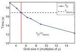
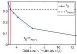
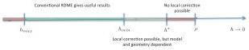
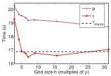
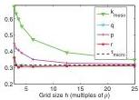

# Reaction-diffusion master equation in the microscopic limit

Stefan Hellander

Department of Information Technology, Uppsala University, Box 337, SE-75105 Uppsala, Sweden

Andreas Hellander and Linda Petzold

Department of Computer Science, University of California, Santa Barbara, Santa Barbara, California 93106-5070, USA

(Received 7 December 2011; published 3 April 2012)

Stochastic modeling of reaction-diffusion kinetics has emerged as a powerful theoretical tool in the study of biochemical reaction networks. Two frequently employed models are the particle-tracking Smoluchowski framework and the on-lattice reaction-diffusion master equation (RDME) framework. As the mesh size goes from coarse to fine, the RDME initially becomes more accurate. However, recent developments have shown that it will become increasingly inaccurate compared to the Smoluchowski model as the lattice spacing becomes very fine. Here we give a general and simple argument for why the RDME breaks down. Our analysis reveals a hard limit on the voxel size for which no local RDME can agree with the Smoluchowski model and lets us quantify this limit in two and three dimensions. In this light we review and discuss recent work in which the RDME has been modified in different ways in order to better agree with the microscale model for very small voxel sizes.

DOI: 10.1103/PhysRevE.85.042901

PACS number(s): 87.10.Mn, 82.37.-j, 82.39.-k, 87.10.Hk

A prevalent view in molecular systems biology is that the noise in cellular reaction networks, arising intrinsically from low copy numbers of macromolecules, can have a substantial impact on function [1,2]. Two frequently used models for simulating stochastic reaction-diffusion systems are the reaction-diffusion master equation (RDME) [3,4] and the Smoluchowski model [5], which we will refer to as the mesoscopic and microscopic models, respectively. In the RDME the computational domain is divided into voxels. The RDME is attractive from a computational perspective; it is the logical extension of spatially homogenous simulations based on the Gillespie algorithm [6], and keeps track of the location of molecules only up to the resolution of the mesh, hence allowing for coarse graining.

On a finer modeling level, the Smoluchowski model treats diffusion and reactions in continuous space, with molecules explicitly represented as spheres with a certain interaction radius. As such, it is an example of a model commonly referred to as particle tracking. Software for simulations using the different modeling frameworks is publicly available [7–14].

A well-known property of the mesoscopic model is that it converges to the classical reaction-diffusion partial differential equation in the macroscopic limit. For a system approaching the microscopic regime, it is tempting to think of the RDME as a better and better approximation to the Smoluchowski model for finer and finer mesh resolutions. This picture is misleading, as it has been shown that, as the size of the voxels in an infinite three-dimensional (3D) domain decreases, all bimolecular reactions are eventually lost in the mesoscopic model [15]. Recent work has demonstrated that fast, microscopic rebinding events can substantially affect the macroscopic properties of a biochemical signal cascade when reactions are highly diffusion limited [16]. To accurately simulate such systems requires a fine spatial resolution. On these scales, the conventional RDME may be too inaccurate to capture even the qualitative behavior predicted by the microscopic model [17].

The fact that the conventional mesoscopic model becomes inaccurate as we approach the microscopic level is not surprising, as we are moving out of the domain of validity for

which it was derived. However, it can pose a real practical problem, as it is hard to know a priori if a simulation with the RDME will yield useful or misleading results. This is especially true for biochemical models with multiscale properties, which are frequently encountered in molecular biology. Simply resorting to simulations on the microscopic scale whenever in doubt is currently not feasible in general due to the high computational cost for systems with many particles. A natural approach to remedy this problem is to try to extend the domain of validity of the RDME as the mesh size tends to zero. Isaacson [15] suggests that one way of doing this would be to let the association rate constants depend explicitly on the mesh size. Recently, approaches to make such corrections to the RDME have been proposed [17,18] based on different optimization criteria. The corrected mesoscopic association rate in 3D in [18] is derived based on an ansatz about the steady-state distribution for a model problem in the mesoscopic model and only works above a certain critical size of the mesh. The association rate in [17] is derived by matching the mesoscopic equilibration time for a reversible reaction to the microscopic one and has no such property. Instead it is observed that for small voxel sizes the RDME needs to be extended to a nonlocal setting to give accurate results.

In this paper we add to the analysis of Isaacson [15] and show, by a simple and intuitive argument, how and when the RDME breaks down. Our results extends those of Isaacson in that they are valid for finite domains in 2D and 3D and independent of the choice of the mesoscopic association rates. In addition, we prove that below a certain critical size of the mesh it will be impossible to make the local RDME consistent with the Smoluchowski model for any choice of the mesoscopic association rate. For a simple model problem we derive optimal mesoscopic association rates in both 2D and 3D, compute the critical size of the mesh, and show that it can be considerably larger than the interaction radii of the molecules.

The reaction-diffusion master equation. In the mesoscopic model, the computational domain is divided into nonoverlapping voxels. Inside voxels, the molecules react according

1539-3755/2012/85(4)/042901(5)

042901-1

©2012 American Physical Society

BRIEF REPORTS

to a prespecified set of rules. In a small time interval $dt$, a bimolecular reaction $A + B \rightarrow C$, for example, occurs with probability $k_a abdt/V$, where $k_a$ is the mesoscopic rate constant for the reaction, $a$ and $b$ are the discrete copy numbers of $A$ and $B$ in that voxel, and $V$ is the volume of the voxel. Diffusion is modeled as jumps between adjacent voxels. For a Cartesian mesh with mesh spacing $h$, the rate for a diffusive jump is given by $D/h^2$, where $D$ is the diffusion constant. The time evolution of the system is described as a Markov process, and the probability density function (PDF) of the system evolves according to the RDME [3,4]. Realizations of the process can be generated efficiently using kinetic Monte Carlo methodology [19].

The Smoluchowski model. In the Smoluchowski model two molecules $A$ and $B$ are assumed to move by Brownian motion with diffusion constants $D_A$ and $D_B$, and react with a certain probability at a distance determined by the sum of their reaction radii $\rho$. For two molecules $A$ and $B$, the probability of a bimolecular reaction is governed by the Smoluchowski equation. Given an initial relative position $\mathbf{r}_0$ at time $t_0$, the equation for the PDF $p$ of the new relative position [in a spherical coordinate system $\mathbf{r} = (r, \theta, \phi)$ is given by $\partial_r p = D \Delta p$ with initial condition $p(\mathbf{r}, t_0) = \delta(\mathbf{r} - \mathbf{r}_0)$ and boundary conditions

$$\lim_{|\mathbf{r}| \to \infty} p(\mathbf{r}, t) = 0, \quad 4\pi\rho^2 D \left. \frac{\partial p}{\partial r} \right|_{r=\rho} = k_r p(\mathbf{r}, t)|_{r=\rho},$$

where $D = D_A + D_B$ and $k_r$ is the microscopic association rate. It can be shown that a weighted mean $\mathbf{R}$ of the positions will be normally distributed [13], and by sampling a new $\mathbf{r}$ and $\mathbf{R}$ we obtain the new positions of the molecules at some time $t$.

An efficient method for simulating systems of molecules is the Green's function reaction dynamics (GFRD) [13,14] method.

Breakdown of the mesoscopic model. Recent work has demonstrated that the RDME breaks down in the limit of infinitesimal voxels. Isaacson [15] shows that the probability for the occurrence of bimolecular reactions vanishes with decreasing voxel size for molecules on a lattice in an infinite 3D domain. The study is restricted to the case where the mesoscopic reaction rates are not dependent on the size of the voxels. Here we present an intuitive way to understand the degeneration of the mesoscopic model in finite domains in 2D and 3D, and with mesoscopic reaction rates that depend explicitly on the mesh. Our analysis will also provide additional insight into why and when this breakdown occurs.

To see why the RDME model cannot work for very small voxels, it is illustrative to consider the simple process of bimolecular association $A + B \stackrel{k_a}{\rightharpoonup} C$. In 3D, the conventional mesoscopic reaction rate $k_a$ is defined by $k_a = (4\pi\rho D k_r)/(4\pi\rho D + k_r) =: k_{\text{meso}}$ [20,21]. It is valid for large enough voxels, and in 2D no analogous expression is well defined. We will refer to the conventional mesoscopic rate constant as $k_{\text{meso}}$ and to any mesoscopic rate constant as $k_a$.

In a Cartesian coordinate system, consider one $A$ molecule and one $B$ molecule. Without loss of generality we may assume that the $A$ molecule is stationary in some voxel $V_A$ and that the $B$ molecule diffuses with diffusion constant $D_B$. Let the

domain be a square or a cube with side length $L$. We will restrict ourselves to periodic boundary conditions. The correct choice of other boundary conditions on the meso- and microscale is studied in [22].

Assume that the $B$ molecule has a uniformly distributed initial position. Now let $\tau_{\text{meso}}$ be the average time until the two molecules react, let $k_j = 2dD/h^2$ (where $d$ is the dimension) be the rate for a diffusive jump, and let $k_a$ be the mesoscopic reaction rate.

First assume that the molecules do not start in the same voxel. Before the molecules can react they have to diffuse to the same voxel. The average time for the $B$ molecule to diffuse to $V_A$ is denoted by $\tau_D$. Now, given that the two molecules are in the same voxel, the average time until an event occurs is $\tau_e = (k_a + k_j)^{-1}$. With probability $P_r = k_a/(k_a + k_j)$ the next event will be a reaction event, and if the molecules do not react they will diffuse apart one voxel. The average number of times the molecules have to be in the same voxel before they react is thus $P_r^{-1}$, and if we then define $\tau_D^1$ to be the average time for the $B$ molecule to diffuse to $V_A$ given that it starts one voxel away, we obtain

$$\begin{aligned} \tau_{\text{meso}} &= \tau_D + (P_r^{-1} - 1)(\tau_e + \tau_D^1) + \tau_e \\ &= \tau_D + k_a^{-1}(1 + N_{\text{steps}}^1), \end{aligned} \tag{1}$$

where $N_{\text{steps}}^1 = k_j \tau_D^1$. The following theorem was proven in [23,24].

Theorem 1. Assume that the molecule $B$ has a uniformly distributed random starting position $x_B$ on the lattice, $x_B$ not equal to $x_A$, and that the molecules can move to nearest neighbors only (as in the RDME). Then the following holds:

$$N_{\text{steps}} = \pi^{-1} N \ln(N) + 0.1951N + O(1)(2D),$$

$$N_{\text{steps}} = 1.5164N + O(N^{1/2})(3D),$$

where $N_{\text{steps}}$ is the average number of steps until $x_B = x_A$ for the first time and $N$ is the number of voxels in the domain. Furthermore, $N_{\text{steps}}^1 = N - 1$ in 2D and 3D, where $N_{\text{steps}}^1 = k_j \tau_D^1$ is the average number of steps until $x_B = x_A$ given that $A$ and $B$ start one voxel apart.

Corollary 1. Let $\tau_D$ be the time until $A$ and $B$ are in the same voxel for the first time. Then

$$\tau_D \sim \frac{L^2}{2\pi D} \ln\left(\frac{L}{h}\right) + 0.1951\frac{L^2}{4D} \quad \text{as} \quad h \to 0(2D),$$

$$\tau_D \sim 1.5164\frac{L^3}{6Dh} \quad \text{as} \quad h \to 0(3D),$$

where $h$ is the voxel size.

This follows immediately from Theorem 1 and the fact that $\tau_D = \frac{N-1}{N} N_{\text{steps}} k_j^{-1}$, where the factor $(N-1)/N$ is because the molecules start in the same voxel with probability $1/N$.

From Corollary 1 and Eq. (1) we conclude that for a sufficiently small voxel size in the discrete space model, we will have $\tau_{\text{meso}} > \tau_D > \tau_{\text{micro}}$ (where $\tau_{\text{micro}}$ is the average time until two uniformly distributed molecules react in the microscopic model), for any choice of the mesoscopic rate constant, since $k_a^{-1}(1 + N_{\text{steps}}^1) > 0$ for all $k_a > 0$. Eventually, as $h \to 0$, no bimolecular reactions will occur since molecules can react only when they are in the same voxel and $\tau_D \to \infty$, hence $\tau_{\text{meso}} \to \infty$. Note that the reason for this effect is not that

042901-2

BRIEF REPORTS

FIG. 1. (Color online) The expected time until the molecules are in the same voxel for the first time, $\tau_{D}$, is computed with the RDME on a Cartesian grid on a square (a) and a cube (b) with reflective boundary conditions. To the right of the vertical line we have $\tau_{D} < \tau_{\mathrm{micro}}$. In that region the mesoscopic reaction rate can be corrected so that the expected time until the molecules react matches the expected time in the microscale model. To the left of the vertical line we have $\tau_{D} > \tau_{\mathrm{micro}}$, and no such correction is possible. We have used the parameters $\rho = 2 \times 10^{-9} \mathrm{~m}$, $D = 10^{-12} \mathrm{~m}^{2} \mathrm{~s}^{-1}$ (3D), and $D = 10^{-14} \mathrm{~m}^{2} \mathrm{~s}^{-1}$ (2D).

the diffusion process is inaccurately described at these length scales but rather that molecules react only after having diffused to the same voxel.

No local correction to the association rates can make the RDME consistent with the microscopic model. Due to the computational advantage of using the conventional RDME over the microscopic model, it is natural to try to modify the RDME to agree better with the Smoluchowski model for fine lattice spacings. A natural approach is to correct the mesoscopic association rate constants in the RDME by letting them depend on the discretization. This would preserve the local nature of the reactions and the low computational cost. However, one immediate consequence of the analysis in the previous section is that below a certain mesh size $h^{*}$ no such local correction can make the mean association rate between two molecules agree with that in the microscopic model. In fact, for a given domain and model, this happens precisely when $\tau_{D} > \tau_{\mathrm{micro}}$. This is illustrated in Fig. 1 for the case of a square with side length $L = 250\rho$ and a cubic domain with side length $L = 100\rho$, with $k_{r} \to \infty$.

As long as $\tau_{D} < \tau_{\mathrm{micro}}$, that is $h > h^{*}$, it is possible to modify the association rate, i.e., derive a discretization-dependent rate constant that will give the same mean association time as the microscopic model. To give the correct binding times for as large a regime as possible, a modified reaction propensity $q(h)$ needs to have the property $q \to \infty$ for $\tau_{D} \to \tau_{\mathrm{micro}}$ (and hence $h \to h^{*}$).

While our analysis does not preclude the possibility of better matching the mean association time by increasing $D$ and thus decreasing $\tau_{D}$, this would make the effective diffusion too fast and thus introduce another source of error.

Discussion. Figure 2 shows a schematic representation of the RDME's behavior as a function of the mesh size. For $h < \rho$, the RDME makes little sense and we cannot expect the model to work in this regime. In the other extreme, above $h_{\mathrm{max}}$, discretization errors due to large voxels will be unacceptably high. For $h_{\mathrm{min}} < h < h_{\mathrm{max}}$ the conventional mesoscopic rate constants will work well, but for $h < h_{\mathrm{min}}$ the RDME will become increasingly inaccurate. For $h^{*} < h < h_{\mathrm{min}}$ it is possible to derive mesh- and problem-dependent

FIG. 2. (Color online) Schematic representation of the RDME's behavior as a function of $h$. For $h < h^{*}$, no local correction to the conventional mesoscopic reaction rates exists for the simple problem of diffusion to a target.

reaction rates that make the RDME agree better with the microscopic model. The precise locations of the critical values $h_{\mathrm{min}}$, $h_{\mathrm{max}}$, and $h^{*}$ are model and geometry dependent.

In [15,25] the analytical solutions of the RDME and the Smoluchowski equation for a single bimolecular association reaction are expanded in a series and the three leading terms in $h$ are computed. It is shown that the two first terms will converge to the same value as $h$ tends to zero, but that the difference between the third terms will diverge. There is an $h$ that minimizes the difference between the first terms of the expansion. This illustrates that for some $h < h_{\mathrm{min}}$ the reaction rates will need to be modified to make the mesoscopic model accurate. However, as we have shown here, one will eventually reach $h^{*}$ and the difference between the models will inevitably increase, independent on the choice of $k_{a}$.

Recently, two different corrections to the mesoscopic rate constant have been proposed [17,18]. In the 3D case with a cubic domain and a uniform, Cartesian discretization, Erban and Chapman [18] consider the model problem $A + B \xrightarrow{k_{a}} B$, $\emptyset \xrightarrow{k_{b}} A$. They derive a mesh-dependent rate expression by matching the true steady-state distribution (which can be obtained analytically for this simple problem) to the distribution obtained using a mesh size $h$. They arrive at

$$q(h) = D k_{a} / (D h^{3} - \beta k_{a} h^{2}). \tag{2}$$

They also find a critical mesh size $h_{\mathrm{crit}} = \beta_{\infty} / (k_{a} D)$ under which no further correction can be made, where $\beta_{\infty} \approx 0.252\,72$ is a unitless constant valid for $L \gg h$. $q$ satisfies the basic requirements of our analysis: the existence of a critical mesh size and the correct limiting behavior as the mesh size tends to that critical value. Substituting $k_{a}$ for the conventional expression $k_{\mathrm{meso}}$ and taking $k_{r} \to \infty$, we obtain $h_{\mathrm{crit}} \approx \pi \rho$.

Fange et al. pursue a similar idea in [17]. They study a reversible reaction and derive mesoscopic reaction rates such that the equilibration time of the system matches the equilibration time in the Smoluchowski model. They carry out this analysis in 2D and 3D and obtain

$$p(h) = k_{r} / \{1 + \alpha \ln[1 + 0.544(1 - \gamma)/\gamma]\}(2D),$$

$$p(h) = k_{r} / [1 + \alpha(1 - \gamma)(1 - 0.58\gamma)](3D),$$

where $\gamma = \rho / (\rho + \ell)$, $\rho + \ell$ is the radius of a disk with area $h^{2}$ in 2D and a sphere with volume $h^{3}$ in 3D, $\alpha = k_{r} / (4\pi\rho D)$ in 3D, and $\alpha = k_{r} / (2\pi D)$ in 2D. These expressions do not predict a critical mesh size, but have the property $p(h) \to k_{r}$ as $h \to 0$ in both 2D and 3D.

Based on our analysis we obtain another correction in both 2D and 3D. From Eq. (1) it follows that $k_{a} = N / (\tau_{\mathrm{micro}} - \tau_{D})$ in order to have $\tau_{\mathrm{meso}} = \tau_{\mathrm{micro}}$ (where we have used that

042901-3

BRIEF REPORTS

FIG. 3. (Color online) The average mesoscopic association time using different reaction rates, compared to the average microscopic association time. The expressions for the discretization-dependent mesoscopic reaction rates from [17,18] and those obtained here all depend on the ansatz used to derive them. All expressions produce more accurate results than the conventional expression for our model problem for $h > h^*$.

$N_{\text{steps}}^1 = N - 1$). For $h$ sufficiently small we can approximate $\tau_D$ in terms of $L$, $h$, and $D$ using Corollary 1, and a reasonable choice of $k_a$ would therefore be

$$r(L, h) = \begin{cases} \frac{(L/h)^2}{\tau_{\text{micro}} - \left[ \frac{L^2}{24D} \ln(\frac{L}{6}) + \frac{0.1951L^2}{4D} \right]} (2D), \\ \frac{(L/h)^3}{\tau_{\text{micro}} - 1.5164L^3/(6Db)} (3D). \end{cases} \tag{3}$$

From these expressions we obtain $h^* \approx \sqrt{\pi} \exp(0.1951\pi/2 + 3/4)\rho \approx 5.1\rho$ (2D) and $h^* \approx \pi\rho$ (3D). These values make the denominator zero if $\tau_{\text{micro}}$ is approximated by the analytical expressions for a disk derived in [17] (2D) or by $(k_{\text{meso}}/L^3)^{-1}$ (3D), in good agreement with the simulations in Fig. 1.

The corrections obtained by Erban and Chapman do not coincide with the corrections obtained by Fange et al., illustrating how the corrections are dependent on the ansatz used to derive them. On the other hand, for $h$ small and the special case $k_a = k_{\text{meso}}$ and $\tau_{\text{micro}}$ approximated by the value obtained from the conventional mesoscopic expression $(k_{\text{meso}}/L^3)^{-1}$, our corrections given by (3) agree with Erban

and Chapman's in 3D, and predict the same $h^*$. We emphasize that our formula (3) makes the relationship of the critical mesh size and the microscopic binding time explicit, in contrast to (2), and can in principle be used to obtain corrected rates and critical voxel sizes for matching any microscopic model, as long as an analytical or numerical method to approximate $\tau_{\text{micro}}$ is available. As can be seen in Fig. 3, our corrections match the mean association time well in 2D [Fig. 3(a)] and all corrections give better results than the conventional expression $k_{\text{meso}}$ in 3D [Fig. 3(b)]. Interestingly, Fange et al. find experimentally for their example that they cannot match the Smoluchowski model in [[17], Fig. 3] perfectly using the conventional RDME with the local corrections $\rho(h)$ even for $h \approx 5\rho$. Instead they modify the lattice model to allow for reactions between molecules in immediately neighboring voxels. In doing so they match the models all the way down to $h = 2\rho$. Our analysis explains why the local corrections alone were not sufficient, and their results demonstrate the possibility of better agreement with the microscopic model by a generalization of the conventional RDME to allow for neighbor interactions. Another approach that has potential to circumvent the problem are hybrid methods [26,27] where the microscopic model is applied locally in space or for certain chemical species.

In conclusion, the conventional RDME cannot be made consistent with the Smoluchowski model since there will always be a mesh size for which no local correction to the reaction rate can give the correct mean association time. Above $h^*$ local corrections can extend the domain where the RDME works well. However, the corrections will inevitably be model and geometry dependent.
